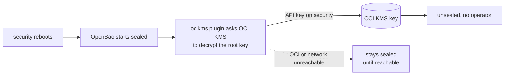

# 0018. Auto-unseal through a cloud KMS key

## Context

[Revision 0](revision-000.md) chose manual Shamir shares because every
reboot of `security` was operator-driven, so a human was at the keyboard
whenever an unseal prompt appeared. It named the condition that would end
that: unattended reboots becoming normal.

That condition now holds. The CD agent runs `maintenance.yaml` on the 1st
and 15th at 03:00 ([ADR 0044 (CD agent trigger)](../0044-prod-automation-trigger-and-execution/revision-000-c.md)),
and the `apt` role reboots a host whenever a package upgrade leaves
`/var/run/reboot-required`, a kernel update being the usual cause. A
reboot of `security` leaves OpenBao sealed until someone supplies the
shares, and the `deploy`, `rotation` and `redeploy-storage` jobs fail
until then. Until this revision is built, `maintenance.yaml` upgrades
`security` without rebooting it, which keeps revision 0's premise true by
leaving kernel updates on that host waiting for the operator.

**Seal facts.** OpenBao 2.7 removed the `awskms`, `gcpckms`, `ocikms`,
`azurekeyvault`, `alicloudkms` and `pkcs11` seals from its binary; they
are external plugins ([2.7.0 release notes](https://openbao.org/community/release-notes/2-7-0/)).
The pinned image is 2.7.1. The Transit seal is built in, and the static
key seal is not among the removed ones. With auto-unseal the init output
holds recovery keys, not unseal keys. Recovery keys authorize quorum
operations and cannot decrypt the root key, so they do not unseal a node
whose seal is unavailable. Moving from Shamir to an auto seal is a
one-time `bao operator unseal -migrate` that turns the Shamir shares into
the recovery keys, and needs both seals available
([Seal concepts](https://openbao.org/docs/concepts/seal/)).

**Candidate keys.** OCI KMS software-protected keys in the default vault
cost nothing, and the tenancy already holds this repo's OCI credentials
([ADR 0016 (OCI credential creation)](../0016-oci-credential-creation-and-expiry/revision-000.md)).
The `ocikms` seal authenticates as the compute instance or with an API
key from the OCI SDK config; a Proxmox VM has no instance identity, so
the API key is the only form available. GCP Cloud KMS costs about $0.06
per key version per month and 3 cents per 10,000 operations, needs a
billing account and a project this repo does not have yet
([GCP e2-micro provisioning](../../projects/gcp-e2-micro-provisioning.md)),
and authenticates with a service account key file.

**Threat model.** The asset is the root key that protects everything in
OpenBao. The adversary has the `security` VM's disk or a copy of it (a
Proxmox backup, a stolen drive), or has taken the OpenBao snapshot that
[ADR 0019 (OpenBao offsite snapshot)](../0019-openbao-offsite-snapshot-path/revision-000.md)
sends off-site. With Shamir, a disk copy is useless without a threshold
of shares kept off the host. With auto-unseal, a disk copy that includes
the KMS credential unseals until that credential is revoked, and a
snapshot alone stays useless. The credential is therefore the new thing
to protect: it sits on the host that reboots, which is what lets the
host unseal itself.

## Decision

Seal OpenBao with an OCI KMS key through the `ocikms` plugin.

- **Key.** One software-protected AES key in the tenancy's default vault,
  used for nothing else.
- **Credential.** A dedicated IAM user whose only policy lets it use that
  one key, with its API key in the SDK config file on `security`, mode
  `0600`, outside the raft data and every snapshot. It is not the identity
  that mints the leaf and rotation credentials, and cannot manage or
  delete keys.
- **Recovery-critical secrets.** The credential becomes a third class of
  secret that [ADR 0017 (Secrets store recovery)](../0017-recovering-the-secrets-store-from-total-loss/revision-000.md)
  keeps outside OpenBao: kept offline as the Shamir shares and the GPG
  key are. The old Shamir shares are kept as the recovery keys, with the
  same handling.
- **Migration.** Once, with an operator at the keyboard, by the
  Shamir-to-auto procedure above, on a snapshot taken just before.
- **After migration.** `security` sets `patch_reboot_allowed` back to
  true, `maintenance.yaml` checks that OpenBao is unsealed once a
  rebooted host is back, and `unseal.py` is kept only for a node whose
  seal is being changed.

## Alternatives considered

- **Keep manual Shamir (revision 0).** Costs nothing and gives the
  strongest at-rest protection. It leaves a reboot of `security` waiting
  on an operator, which in practice means kernel updates on the host
  that holds every secret are delayed. Lost on that.
- **GCP Cloud KMS.** The same design with a service account key. Lost on
  needing a billing account and project that do not exist yet, and a
  per-key charge, for no property OCI lacks.
- **Transit seal against a second OpenBao.** Built in, no cloud. It moves
  the manual unseal to the second instance, which then needs a host that
  can be rebuilt without `security` and its own unseal handling. Lost on
  adding a second secrets store to run.
- **Static key seal.** Unseals unattended with no cloud dependency. The
  key sits on the same disk as the data, and nothing can revoke it after
  a copy, where an API key can be revoked in the tenancy. Lost on that.

## Assumptions

- **Claim:** An `ocikms` seal plugin for OpenBao 2.7.x is published as an
  artifact whose checksum or digest can be pinned, and can be placed in
  the container without building an image of our own.
  **Breaks if wrong:** The plugin has to be built and distributed by this
  repo, which adds a supply-chain decision of the kind
  [ADR 0077 (Pinned checksum verification)](../0077-knowing-a-pinned-release-checksum-is-the-publishers/revision-000.md)
  makes.
  **Checked by:** reading the plugin's release assets and the 2.7 plugin
  documentation, then a spike.
- **Claim:** The `ocikms` plugin works with a key policy limited to using
  one key, with no permission to manage or list keys.
  **Breaks if wrong:** The credential can do more than unseal, and the
  threat model's revocation argument weakens.
  **Checked by:** a spike with the narrowest policy that lets init,
  migration and restart succeed.
- **Claim:** `security` reaches OCI's KMS crypto and management endpoints
  at boot, without the `services` host's DNS or any app on `security`
  needing to be up first.
  **Breaks if wrong:** A reboot with `services` down leaves OpenBao sealed
  until the operator intervenes, no better than revision 0.
  **Checked by:** restarting the spike node with the DNS host stopped.
- **Claim:** Shamir-to-`ocikms` migration completes on a single-node raft
  node and the node unseals after a restart.
  **Breaks if wrong:** The move needs a different procedure, such as a
  fresh node restored from a snapshot.
  **Checked by:** a spike on a throwaway OpenBao 2.7.1.
- **Claim:** The tenancy's account type does not reclaim an idle
  default-vault key.
  **Breaks if wrong:** The root key becomes undecryptable, and the
  snapshots with it.
  **Checked by:** reading Oracle's terms for the tenancy's account type.

## Consequences

- A reboot of `security` no longer needs an operator, provided OCI and the
  network are reachable. If they are not, OpenBao stays sealed, as it does
  today, until they are.
- The KMS key becomes a single point of recovery. Its key material cannot
  be exported, so losing the key or the tenancy makes the barrier, and
  every snapshot, undecryptable: the recovery keys cannot stand in for it.
  Revision 0's offline shares had no such dependency, and
  [ADR 0017](../0017-recovering-the-secrets-store-from-total-loss/revision-000.md)
  split its snapshot credentials across two providers to avoid exactly
  this. Accepted here against the cost of manual reboots, and tracked as
  a reconsideration trigger.
- A copy of the `security` disk unseals until the API key is revoked. A
  VM backup taken by Proxmox is covered by this, so the backup's
  protection is now part of OpenBao's.
- The seal plugin is a new binary in the path of every boot, pinned and
  updated like the image.
- The CI and Molecule OpenBao targets stay on a one-share Shamir seal, so
  the seal itself is exercised only by the spike and the production
  migration.
- The topic docs [`openbao.md`](../../topics/secrets/openbao.md) and
  [`openbao-backup-restore.md`](../../topics/secrets/openbao-backup-restore.md)
  change when this is built, to describe the seal, the third
  recovery-critical secret and the restore order with it.

## Invariants

- The KMS credential never enters the repository, OpenBao's raft data or
  an OpenBao snapshot.
- The credential's policy reaches one key and cannot manage or delete it.
- Recovery keys stay offline with the same handling the Shamir shares had.

## Non-goals

- A multi-node cluster, or an HSM.
- Moving other secrets out of OpenBao.

## Validation

- A restore drill that starts from the offline credential and a snapshot,
  with no previous node, and ends with an unsealed node.
- After a maintenance reboot of `security`, the job checks that OpenBao is
  unsealed and fails visibly if it is not.

## Reconsideration triggers

- The tenancy is closed, restricted or moved, or the key cannot be
  recovered by a drill.
- The seal plugin stops being published for the OpenBao version in use.
- `security` stops being rebooted unattended.

## Revision notes

Revision 0's premise, that every reboot of `security` is operator-driven,
no longer holds, because the maintenance job reboots hosts on a schedule.
This revision replaces manual Shamir unseal with a cloud KMS seal, and
records what that costs in recovery and at-rest protection.
