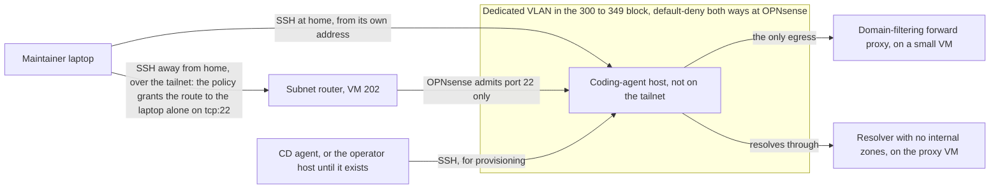

# 0053. Network reach of the coding-agent host

## Problem

A compromised agent session on the coding-agent host has no network path to the secrets store, the CD agent, the operator host, the managed hosts, the Proxmox node, or the maintainer's workstation. The boundary is enforced outside the host, so it holds whatever runs on it.

## Context

[`vm-provisioning.md`](../../topics/infra/vm-provisioning.md) maps each block of 50 VMIDs to a VLAN by `vlan_id = (vmid // 50) * 5`, with `.1` reserved for OPNsense's sub-interface. The 6XX–8XX ranges are unassigned. Every VM attaches to one VLAN-aware bridge on the node.

[ADR 0020 (Automation identity scope)](../0020-automation-identity-and-access-scope/revision-001.md) binds AppRoles by source CIDR, so subnet boundaries are also an authentication factor. OPNsense rules are hand-maintained today; the project that will carry them in code ([`opnsense-config.md`](../../projects/opnsense-config.md), by the method of [ADR 0089 (OPNsense configuration)](../0089-how-the-opnsense-gateway-is-configured/revision-000.md)) builds on Tofu's root module ([`vm-provisioning.md`](../../topics/infra/vm-provisioning.md#tofu-project)) and does not wait for the migration.

The maintainer also needs the host away from home. Tailscale subnet routers source-NAT forwarded traffic by default, so over the tailnet the client reaches the VLAN with the subnet router's address, not the laptop's, and the tailnet policy is what limits that route to the laptop.

Claude Code needs `api.anthropic.com`, `claude.ai` and `platform.claude.com` for sign-in and token refresh, and `downloads.claude.ai` for its native installer and updater. The repo's own tooling fetches from PyPI, Ansible Galaxy, GitHub, `ghcr.io`, Docker Hub, and Ubuntu mirrors.

**Checked on a scratch bridge.** A guest on a VLAN-aware bridge configured as the lab's is on its own VLAN and no other: the bridge admits only that VLAN on the guest's port. Frames tagged for another VLAN, double-tagged frames and frames tagged for the bridge's untagged VLAN reached neither another zone's gateway interface nor the Proxmox node's address, while the same targets answered when asked from their own side. The lab's own bridge was not probed; [Validation](#validation)'s canary probes run there.

A domain-filtering proxy is a small program. Squid on a 2 GB VM held about 45 MB resident and spent about a quarter of a second of CPU on 200 tunnelled requests from a client in the zone. It let the allowlisted host name through and refused every other with a `403` on the tunnel request. The node's headroom is many times that footprint, and the gateway had over a gigabyte of memory free. Whether the proxy's package installs on OPNsense was not tested.

**Resolver.** The gateway's Unbound is the one resolver for every VLAN and forwards the internal zones to the two DNS servers ([ADR 0040 (Tofu VM DNS)](../0040-dns-for-tofu-provisioned-vms/revision-000.md)), so a host of the zone that used it would see those zones. Unbound can refuse them for one subnet with a per-subnet view, and a view survived a play run and a GUI apply on a scratch gateway. It lives in a file the gateway's API cannot write, and the pinned collection has no module for it ([ADR 0089 (OPNsense configuration)](../0089-how-the-opnsense-gateway-is-configured/revision-000.md)). `--check` reads only what the API holds, so it reported no change with the view in place and would report none without it.

**Threat model.** The adversary is a compromised agent session. The assets are the secrets store, the CD agent, and hosts reachable from it. An allowlist limits lateral reach and drive-by fetches. It cannot stop the agent leaking what it can read (the workspace, its Claude token) through an allowed destination such as GitHub.

## Decision

This diagram shows what can reach the coding-agent host and what it can reach as this revision decided it, not what runs now.

- **Zone.** A dedicated VLAN in the 300 to 349 block (VMID 302 gives VLAN 30, `192.168.30.0/24`), default-deny in both directions at OPNsense.
- **Inbound.** SSH only, from two sources: the maintainer client ([ADR 0055 (Coding-agent client access)](../0055-maintainer-client-access-to-the-coding-agent-host/revision-000.md)) and, for provisioning, the CD agent or, until it exists, the operator host ([ADR 0054 (Untrusted host management)](../0054-managing-an-untrusted-host-from-the-cd-agent/revision-000.md), [ADR 0058 (Operator work host)](../0058-where-operator-work-runs/revision-000.md)). Each is source-restricted, with sshd enforcing the pairing per account. The maintainer client arrives from the laptop's own address at home and from the subnet router's address over the tailnet, so sshd's pairing cannot tell the laptop from another tailnet node; the tailnet policy carries that restriction.
- **Outbound.** Only through a domain-filtering forward proxy whose allowlist is derived from what Claude Code and the repo's tooling actually fetch. Direct egress is denied. The proxy runs on a small dedicated VM; an OPNsense package is a later option, once it is shown to install and fit. The same proxy serves VLAN 25 under its own allowlist ([ADR 0058 (Operator work host)](../0058-where-operator-work-runs/revision-000.md)).
- **DNS.** The zone's hosts resolve through a small resolver on the proxy VM that has no internal zone and no forward to one, and are given its address, not the gateway's. The gateway's Unbound keeps serving every other VLAN. The maintainer and the CD agent reach the host by address.
- **Tailnet.** The host does not join Tailscale. The subnet router (VM 202) advertises the VLAN's route so the maintainer can reach the host away from home, the tailnet policy grants that route to the laptop alone on `tcp:22`, and `tests` assert that no other node has it. OPNsense admits the subnet router to the VLAN on port 22 only.
- **Rules.** Hand-built and documented in a topic doc first; written again in the gateway's Ansible configuration by the network project's last stage, not imported.

## Alternatives considered

- **Per-host firewall only.** Root on the host can rewrite it. Rejected as the authoritative layer.
- **Domain-named firewall aliases instead of a proxy.** Registries and GitHub sit behind shared CDN addresses, so IP-resolved aliases are broad and drift. Kept as a fallback if a proxy is not viable.
- **A shared services VLAN.** Puts the untrusted host on a subnet that AppRole CIDRs and other hosts already trust.
- **Home access only, with no route on the tailnet.** Keeps the VLAN off the tailnet entirely, but leaves the host unreachable when the maintainer is away. Rejected.
- **A per-subnet view in the gateway's Unbound.** Refuses the internal zones for the zone and adds no daemon, but the file is outside the API, so `--check` cannot show it missing and a gateway rebuilt from the play would run without it unnoticed.
- **The play writing that file over SSH.** Would make drift visible, but the seed leaves the SSH service off and the play would need a key for it.
- **No DNS for the zone, with the proxy resolving every name.** Breaks anything that does not use the proxy: `git` over SSH, `apt`, and tools that ignore `HTTPS_PROXY`.
- **Letting the zone resolve the internal zones.** The names and addresses of internal hosts would be readable from the host, though the firewall still blocks reaching them.

## Consequences

- Allowed destinations remain an exfiltration channel for anything the agent can read. This is accepted.
- The allowlist needs upkeep as the repo's tooling changes.
- The first rules are hand-maintained, which is drift-prone until they are carried in code.
- The proxy is a host to patch and rebuild like any other.
- The zone's resolver and the flow to it are one more thing to patch and one more allowed flow; the egress project builds both.
- [ADR 0040 (Tofu VM DNS)](../0040-dns-for-tofu-provisioned-vms/revision-000.md)'s one resolver holds for every VLAN but this zone.
- The subnet router can reach the host's SSH port, so a compromised router gains a path to an untrusted host, not out of it.

## Invariants

- No flow from the VLAN to any other internal VLAN, OpenBao, the CD agent, the operator host, the workstation, or the Proxmox management address.
- Inbound sessions are stateful and source-restricted; nothing is initiated from the VLAN into another zone.
- The VLAN's subnet is inside no AppRole CIDR binding, and its tailnet route is granted to the laptop alone.
- The zone's resolver holds no internal zone and no forward to one.

## Non-goals

- Preventing exfiltration through allowed destinations.
- TLS inspection: the lab's TLS stays uninspected. The proxy filters on the requested host name only.

## Validation

Probes run from a canary VM in the same VLAN under the same rules, outside the coding-agent host, since a compromised host cannot be trusted to report on itself. The exported rule set is compared against the topic doc, and a probe from a tailnet node other than the laptop confirms it cannot reach the VLAN's SSH port. A canary asks the zone's resolver for an internal name and expects it not to resolve, with a public name resolving as its control.
