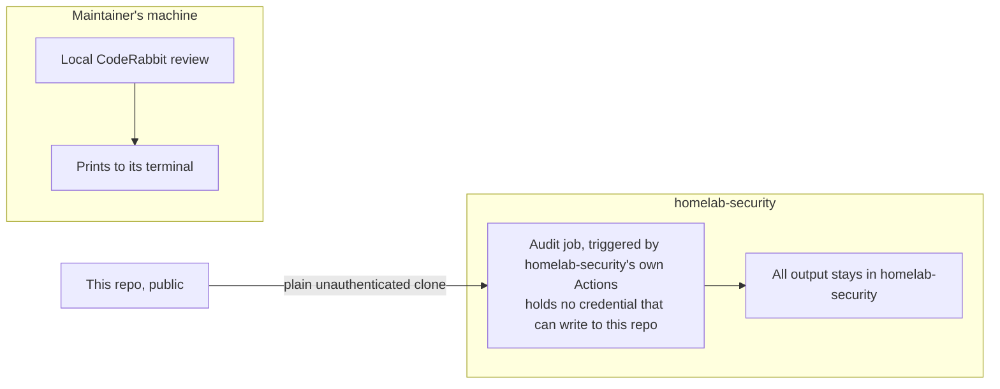

# 0061. Where automated code review runs, and what it may write

## Problem

Automated review of this repo's code must never make its findings
visible on any surface this repo itself controls — a PR comment, an
Actions run log — before a human has seen them, and whatever produces
those findings must not be able to alter this repo on its own.

## Decision

This diagram shows where the audit job and the local review run and where their output goes as this revision decided it, not what runs now.

- The audit job is defined and triggered from `homelab-security`'s own
  Actions, never from this repo's.
- `homelab-security` reads this repo by a plain, unauthenticated clone.
  Reading a public repo needs no credential, and none is granted.
- The audit job holds no credential that can write to this repo's GitHub
  remote. All output goes only into `homelab-security`
  ([ADR 0060 (Review findings tracker)](../0060-tracking-and-managing-code-review-findings-for-a-public-repository/revision-000.md)) —
  never a commit, comment, or check here.
- A local CodeRabbit review runs on the maintainer's machine and prints
  to its terminal. Nothing from it is committed here or posted to a pull
  request.
- This is a distinct identity from
  [ADR 0051 (Coding-agent isolation)](../0051-coding-agent-execution-isolation/revision-000.md)'s
  coding-agent host. That host is interactive-only and deliberately
  holds no standing credential (`ANTHROPIC_API_KEY` and
  `CLAUDE_CODE_OAUTH_TOKEN` unset; sign-in by login only). The review
  agent here is unattended and does hold a standing, narrowly-scoped
  credential ([ADR 0062 (Reviewer identity)](../0062-automation-identity-for-the-agent-based-reviewer/revision-000.md)) —
  a different job with a different trust profile, not a variation on the
  coding-agent host's.

## Invariants

No credential held by the audit process can write to this repo's
GitHub remote. Nothing about a finding's content is ever written to a
surface this repo's own git history, PR comments, or Actions logs
expose.

## Non-goals

Which credential authenticates the audit agent
([ADR 0062 (Reviewer identity)](../0062-automation-identity-for-the-agent-based-reviewer/revision-000.md)).
`homelab-security`'s internal structure ([ADR 0060 (Review findings tracker)](../0060-tracking-and-managing-code-review-findings-for-a-public-repository/revision-000.md)).

## Reconsideration triggers

This project starts accepting external pull requests — changes the
fork/dispatch trust calculus behind the "no dispatch from this repo"
default. Headless CodeRabbit access becomes available at no cost, which
would let a per-PR review run from `homelab-security`'s CI again.
