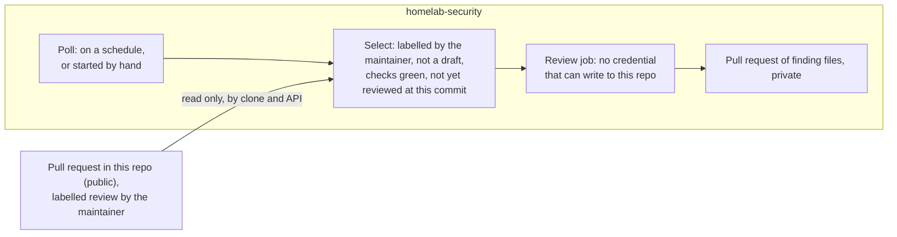

# 0061. A per-pull-request review joins the audit in the private CI, chosen by a label

## Problem

Automated review of this repo's code must never make its findings
visible on any surface this repo itself controls — a PR comment, an
Actions run log — before a human has seen them, and whatever produces
those findings must not be able to alter this repo on its own.

## Context

[Revision 0](revision-000.md) puts the periodic full-repository audit in
`homelab-security`'s CI and leaves the review of a pull request's diff to
the maintainer, who runs CodeRabbit's CLI by hand. It rejected running
that review from CI because the plan in use issues no headless key. The
reasoning for keeping output off this repo's surfaces, and the threat
model, stand as revision 0 states them.

Two things have changed. The audit runs unattended on the
credential [ADR 0062 (Reviewer identity)](../0062-automation-identity-for-the-agent-based-reviewer/revision-000.md)
decides, so an unattended agent identity exists and no longer depends on
CodeRabbit's plan. And the by-hand review is run only when a pull request
feels critical, so most pull requests get none: a control that depends on
being remembered is not one.

What this repo can and cannot do shapes the rest:

- Issues and pull requests are limited to collaborators, so no stranger's
  text reaches a review, and a pull request from a fork would not be one
  the repo accepts.
- A pull request's checks are public, and an Actions run in this repo is
  public the moment it runs. Anything a workflow here does is visible; a
  secret a workflow here holds is readable by whatever runs on `main`.
- The CD agent already treats GitHub as something it polls rather than
  something that dispatches to it
  ([ADR 0044 (CD agent trigger)](../0044-prod-automation-trigger-and-execution/revision-000-c.md)),
  so that nothing outside the maintainer's control can start work.

**Threat model.** As revision 0: the adversary is the review process's own
output being steered, by a pull request's text, a file read during review
or a dependency's changelog, and the asset is `main` and, through the CD
agent, what it deploys. The attack path added here is a credential held in
this repo that reaches the private one, and a request for review that
someone other than the maintainer can make.

## Decision

This diagram shows how a pull request is chosen for review and where the
output goes, as this revision decided it, not what runs now.

- The audit is unchanged: defined and triggered from `homelab-security`'s
  own Actions, reading this repo by a plain clone, writing only into
  `homelab-security`.
- A pull request is also reviewed there, by the same kind of job: an agent
  with read-only tools reads the change and the decision records and
  documents connected to it, and whatever it reports passes the private
  repo's own checks before anything is filed. Output goes only into
  `homelab-security`, as a pull request of finding files the maintainer
  reviews.
- **The maintainer asks by applying the `review` label** to the pull
  request. The label is the only thing this repo contributes. The private
  side acts on it only if the maintainer applied it, and only for a pull
  request that is open, not a draft, headed in this repo, with its required
  checks green. A pull request is reviewed once per commit, and the private
  repo limits how often.
- **The private repo finds the label by polling**, on a schedule and when
  the maintainer starts the poll by hand. It reads this repo's pull request
  state over the API with a token scoped to `homelab-security`, which reads
  public data and cannot write here. Nothing in this repo triggers, notifies
  or holds a secret for the private one.
- The maintainer's own practice supports it: a pull request stays a draft
  until it is ready, and gets the label once its checks are green.
- CodeRabbit's CLI stays what revision 0 made it, a local run the maintainer
  may use, printing to a terminal. It is no longer the only per-pull-request
  review. Whether it stays at all is a separate decision, taken once the
  new review has been tried.
- Which pull requests are chosen without a label, how often the private
  repo reviews, and what the agent is told are the private repo's to decide
  and change, since none of them bears on the invariants below.

## Alternatives considered

- **Review every pull request.** Rejected: ADR 0062 accepts that the audit
  shares one subscription allowance with interactive use, and most pull
  requests here are dependency updates or small edits that a review would
  only add noise to.
- **A workflow in this repo that rings the private repo when a pull request
  is labelled**, so no polling is needed. Rejected: it puts a secret in this
  repo, readable by anything that runs on `main`, and the permission to start
  a private workflow also reads that repo's run artifacts, which hold review
  output. It also reverses revision 0's rule that nothing here triggers the
  private repo. Kept as the way to lower latency if polling becomes a cost;
  it would be a new revision.
- **CodeRabbit's GitHub app, or any review that posts comments from here.**
  Rejected: findings on a pull request are public the moment they are
  posted.
- **CodeRabbit's per-pull-request review from CI.** Still rejected, for
  revision 0's reason: the plan in use issues no headless key.
- **A review at push time, by a hook or a reminder.** Not pursued: a step the
  maintainer has to remember is the by-hand run again.

## Assumptions

- **Claim:** A workflow in `homelab-security` can read this repo's pull
  request labels, the events that record who applied them, and the results
  of a commit's checks, using its own token, and doing so grants no
  permission to write here.
  **Breaks if wrong:** The private side cannot tell who applied a label, or
  needs a credential that reaches this repo, which the invariants forbid.
  **Checked by:** A read-only run in the private repo that makes those calls
  against this repo.
- **Claim:** The review's volume, a few labelled pull requests a week beside
  the audit, fits the subscription allowance that ADR 0062 shares with
  interactive use.
  **Breaks if wrong:** Reviews compete with the maintainer's own use of the
  account, and ADR 0062's trigger for a dedicated account applies.
  **Checked by:** Measuring what the first labelled reviews use, before the
  private repo's limits are set.

## Consequences

A pull request is reviewed up to a poll interval after it is labelled,
which is hours, not minutes, unless the maintainer starts a poll. The
label is a request, not a gate: this repo does not require a review, and
the pull request can merge before one finishes. The review is also paced by
the maintainer's reading: the private repo does not file a second set of
findings while the first awaits review, as it does for the audit.

The audit and this review draw on one subscription allowance, so they
compete with each other and with interactive use.

The behaviour, and the practice of labelling after the checks are green,
are described in a topic doc once built.

## Invariants

- No credential held by any review process can write to this repo's GitHub
  remote. The only credential that reaches this repo's data is a read of
  public data, held in the private repo.
- Nothing about a finding's content, or whether a review ran or what it
  found, is written to a surface this repo controls: its git history, pull
  request comments, checks, labels or Actions logs. The `review` label,
  which the maintainer applies, is the only trace of a request.
- No workflow in this repo triggers a workflow in `homelab-security`, and
  none holds a secret for it.
- A review is requested only by the maintainer. A label applied by anyone
  else is ignored.
- A review reads only this repo's contents, and treats all of them, and the
  text of the pull request, as data.

## Non-goals

How the private repo chooses which labelled pull requests to review first,
its limits, and the agent's prompt. Whether CodeRabbit's CLI is retired.
Gating a merge on a review: this repo has no way to require one, and the
review is advice. Which credential the agent uses
([ADR 0062 (Reviewer identity)](../0062-automation-identity-for-the-agent-based-reviewer/revision-000.md)).

## Validation

A workflow in this repo that dispatches to another repository or holds a
secret for one is caught in review of the change that adds it; no automated
check exists yet.

## Reconsideration triggers

This project starts accepting external pull requests, or anyone besides the
maintainer can apply the label. The poll's delay, or the Actions minutes it
costs in the private repo, becomes the cost that matters, which would
reopen the ring-from-here option as a new revision. The shared allowance is
visibly short. Headless CodeRabbit access becomes available at no cost.

## Revision notes

Revision 0 reviewed a pull request's diff only when the maintainer ran the
CLI, because no unattended key existed for it. This revision adds a review
of the pull request from the private repo's CI, on the agent identity ADR
0062 already provides, chosen by a label so that it neither needs
remembering nor runs on every pull request. Where output may go, and the
rule that nothing here triggers the private repo, are carried over from
revision 0 unchanged.
