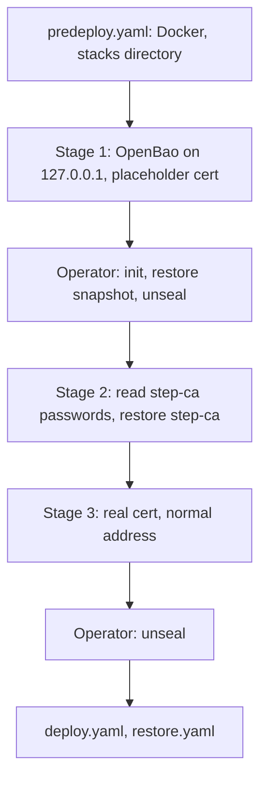

# 0099. Rebuilding the security host when OpenBao and step-ca are lost with it

## Problem

`security` runs OpenBao and step-ca. A new VM has neither, and the repository's
own playbooks cannot create them, because each depends on the other and on a
secrets store that is not there yet. The host has to come back with the same
secrets and the same certificate authority, since every other host trusts the
authority's root and reads its secrets from the store.

## Context

- **The playbooks need both services first.** `deploy.yaml` and `restore.yaml`
  begin with Play 0, which logs into OpenBao as the `controller` AppRole and
  reads step-ca's root certificate by running `docker exec` on `security`. On
  a new VM there is no Docker and no container.
- **The three dependencies form a loop.** OpenBao's listener needs a
  certificate in its `certs` volume, issued by step-ca. step-ca needs its
  password, which is a Vault-backed secret stored in OpenBao. `restore.yaml`
  needs OpenBao for the S3 keys it reads the archives with.
- **What survives.** OpenBao's raft snapshot is in R2 and B2, encrypted with a
  key held offline, and the unseal shares are held separately. step-ca's `data`
  volume, which holds the authority's keys, is in the nightly backups. OpenBao's
  `certs` volume is not backed up and does not need to be, since step-ca issues
  its certificate again.
- **The `controller` AppRole is part of the snapshot**, so the `role_id` and
  `secret_id` already in the controller's file cache work against restored data
  when the `secret_id` was issued before the snapshot.
- **OpenBao's data volume has to be owned by its own user before it starts**, and
  `roles/openbao` does that. `bao operator init`, the snapshot restore and the
  unseal handle key shares and the root token, which no playbook should hold.
- **Caddy's compose file creates the `caddy-proxy` network** that OpenBao's and
  step-ca's stacks join as external, and Caddy deploys after Play 0.
- **A node that is uninitialised can be initialised by whoever reaches it
  first.** Published on every address, a new OpenBao is open to the LAN until
  its operator runs `init`.

**Threat model.** The asset is the secrets store and the authority's keys during
the window in which the store is empty and uninitialised. An adversary on the
LAN who reaches the listener first could initialise it and hold its root token.

## Decision

`bootstrap-security.yaml` brings the host to the point where Play 0 passes, in
stages named by tag. A run that names no stage changes nothing. The operator's
steps stay manual.

1. **Stage 1.** The play creates the `caddy-proxy` network with the labels
   Compose gives its networks, so Caddy's stack adopts it later, and deploys
   OpenBao with the repository's own config and image. The listener is published
   on `127.0.0.1` only. A self-signed certificate valid for 24 hours is placed in
   the `certs` volume, only when the volume holds none, and handed to OpenBao's
   user.
2. **Operator steps.** The operator initialises the node with throwaway keys,
   restores the decrypted snapshot with `-force`, and unseals it with the original
   shares, as the [restore drill](../../topics/secrets/openbao-backup-restore.md#restore-drill)
   describes.
3. **Stage 2.** The play logs in as `controller` inside the container, with the
   `secret_id` on stdin, reads `step-ca-password` and
   `step-ca-provisioner-password`, revokes the token, renders step-ca's files
   without starting it, and restores its `data` volume from the decrypted
   archive. step-ca first runs on the restored volume. An archive without
   `config/ca.json` is refused before anything is stopped, since step-ca's
   entrypoint would create a new authority.
4. **Stage 3.** OpenBao is deployed again on its normal address, a self-signed
   certificate is removed, and the certificate is issued by the restored step-ca
   with the same task `deploy.yaml` runs. That restart seals OpenBao, and the
   operator unseals it with the original shares.

The pre-deploy play (`predeploy.yaml`, Play 1 of `deploy.yaml`) runs first, since
it reads no secret.

## Alternatives considered

- **A second OpenBao config with no TLS for the restore.** It needs no placeholder
  certificate, and it leaves a configuration that production never runs and that
  can drift from `openbao.hcl`. The placeholder keeps one config.
- **Restore step-ca first, with its password typed by the operator.** The password
  exists only inside OpenBao, so the operator would need a second copy of it
  outside the store.
- **A new authority.** Every host's trust of the old root, the certificates
  issued from it and the renewal timers would have to be replaced at once.
- **Making Play 0 skip OpenBao on a flag.** Every secret the later plays render
  comes from the store, so the plays would fail further in, and the flag would
  be a standing way to deploy without it.

## Assumptions

- **Claim:** The real images behave as the images used in the rehearsal: the
  Alpine image extracts a gzip archive with `tar -z` and has `find`, `cp -a`
  and `head`, and OpenBao's image owns `/openbao/data` as its own user.
  **Breaks if wrong:** stage 1 or the restore role fails partway, with the
  stack stopped.
  **Checked by:** the first rebuild of `security`.
- **Claim:** The `security-step-ca-*` archive holds the volume under a directory
  named `step-ca_data`, as the restore role looks for, and its database was
  copied in a state step-ca opens, since step-ca is not stopped during the backup.
  **Breaks if wrong:** stage 2 refuses the archive, or step-ca fails its health
  check on the restored volume.
  **Checked by:** stage 2 of the first rebuild, which compares the root
  certificate's fingerprint with a host that already trusts the authority.
- **Claim:** The `secret_id` in the controller's file cache was issued before the
  snapshot, and has not expired.
  **Breaks if wrong:** stage 2's login is refused.
  **Checked by:** stage 2 of the first rebuild.
- **Claim:** After a forced restore the node can be unsealed with the original
  shares whether or not it reports itself sealed.
  **Breaks if wrong:** stage 2 stops at its check that OpenBao is unsealed.
  **Checked by:** the first rebuild.

## Consequences

- The rebuild has two manual unseals and a manual restore, as every OpenBao
  restore does.
- OpenBao answers on a certificate nothing trusts for up to a day if stage 3 is
  not run. It listens on `127.0.0.1` only until stage 3, which publishes it on the
  LAN, sealed, while the placeholder is still in place.
- Another host's rebuild needs none of this, since Play 0 passes once `security`
  is healthy.
- The procedure is in
  [`openbao-backup-restore.md`](../../topics/secrets/openbao-backup-restore.md#rebuilding-security).

## Invariants

- OpenBao is published on `127.0.0.1` alone until it holds restored data.
- A certificate that already exists in OpenBao's volume is never replaced, except
  a self-signed one in stage 3.
- step-ca never starts on an empty volume.
- No token, password or `secret_id` appears in an argument list or a log.

## Non-goals

- Initialising OpenBao, restoring its snapshot and unsealing it. Those handle key
  shares and the root token.
- Rebuilding any host but `security`.
- Recovering from the loss of the snapshot, the unseal shares or the offline
  backup key.

## Validation

`ansible/tests/test_bootstrap_security.py` fails when a stage can run without
being named, when only stage 1 stops being the one that publishes on loopback,
when stage 3 issues the certificate with other variables than `deploy.yaml`, or
when the pre-deploy play starts reading a secret.
