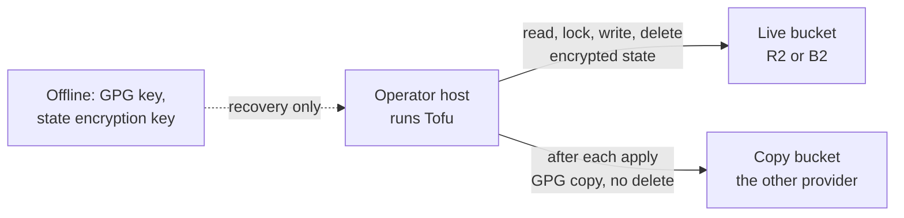

# 0103. Where Tofu's state is held

## Problem

Tofu's record of what it built is a local file on one VM. Losing that VM loses the record,
and every rebuild changes it. What has to be true: the state survives the loss of the
host that runs Tofu and of any host Tofu builds, only the operator can read it, and
recovering it needs nothing that Tofu itself has to rebuild first.

## Context

- **What exists.** State is `tofu/terraform.tfstate` on the host that runs Tofu. A copy
  is taken after each apply with `tofu state pull`, and the copies sit on the same VM
  ([`tofu/state-and-credentials.md`](../../topics/infra/tofu/state-and-credentials.md)).
  Retiring VM 401 waits on the state leaving it
  ([`workstation-management.md`](../../projects/workstation-management.md)).
- **The backend cannot be a host Tofu builds.** Tofu has to be able to rebuild any VM it
  manages, so a state bucket on one of them is unreachable at the moment it is needed.
  That rules out `storage`. It also rules out the operator host (VMID 302,
  [ADR 0058](../0058-where-operator-work-runs/revision-000.md)) while it can be built
  from the Ubuntu module, and even built by hand it is the one machine the state is meant
  to stop depending on.
- **A state credential is already expected.** ADR 0048 puts an S3 credential for the
  backend in the credentials file on the host that runs Tofu, beside the Proxmox token
  ([ADR 0048 (Tofu credentials)](../0048-where-tofu-credentials-live/revision-000.md)).
- **The pattern exists.** The secrets store's snapshots go to a bucket on both R2 and B2,
  so that recovery does not depend on one vendor
  ([ADR 0017](../0017-recovering-the-secrets-store-from-total-loss/revision-000.md),
  [ADR 0019](../0019-openbao-offsite-snapshot-path/revision-000.md)). Those buckets are
  made by hand, and the operator host's Internet allowlist already names both providers.
- **That bucket cannot be shared.** Its write credential is deliberately unable to delete,
  and its bucket takes retention rules. Tofu's backend overwrites the state and creates
  and deletes a lock object. Neither provider renames a bucket, and the existing name is
  fixed in the snapshot scripts.
- **State is sensitive.** It holds values a plan reads from providers, and some
  resources store secret-adjacent material. A provider that holds it must not be able to
  read it.
- **Size.** The state is small and a run touches it a few times: read, lock, write,
  unlock. Operations are far below either provider's free allowance. Storage is the
  shared limit, since each free allowance is per account and the backup archives are in
  the same accounts.

## Decision

State lives in a bucket named for it, `opentofu-state`, on R2 and on B2 (a different name
on B2 if that one is taken, since B2 names are global). Made by hand, like the snapshot
buckets.

- **Live backend.** One provider, chosen by the lock check under Assumptions. OpenTofu's
  `s3` backend points at it with a credential that reads, writes and deletes in that
  bucket and nothing else. It lives in the credentials file ADR 0048 describes, and a
  script beside the snapshot ones in `tools/cloud_credentials/` mints it and does not
  cache it. It is rotated on the cadence of the snapshot write leaf.
- **Copy.** After each apply the guarded wrapper
  ([ADR 0102](../0102-knowing-what-a-tofu-change-will-do/revision-000.md)) pushes
  `tofu state pull` output to the other provider, encrypted to the backup GPG public key
  as `snapshot-push.sh` does, with a write leaf that cannot delete. The copy is the
  history on the provider that has none, and the recovery path if the live account is
  lost.
- **Encryption.** OpenTofu state encryption, so the provider holds only ciphertext and a
  plan file is covered too. The key is in the credentials file and has an offline copy
  held like the backup GPG key, since the file is what a total loss removes.
- **Locking.** The backend's native lock file, if the live provider honours conditional
  writes. If it does not, the wrapper takes a lock on the operator host, since applies
  already go through it.
- **Migration.** `tofu init -migrate-state` from the operator host. The local file and
  its copies are deleted once a plan against the bucket shows no change.

## Alternatives considered

- **A separate SeaweedFS on the Proxmox node.** No vendor, but it shares the node, its
  disks and its power with everything the state describes, and it is one more service to
  patch and back up. The state would still have a single copy.
- **SeaweedFS on the operator host.** Tofu may build that host, and it is the machine the
  state must survive.
- **The `openbao-snapshots` bucket.** Its credential cannot delete and its bucket takes
  retention rules, and a rename means new buckets and new credentials on both providers.
- **`storage`.** Tofu builds it, and every restore reads from it.
- **The local file with better copies.** Leaves the file on the host that loses it.
- **A hosted state service.** A new vendor, account and credential for one file.

## Assumptions

- **Claim:** At least one of R2 and B2 honours `If-None-Match` on a write through the S3
  API, so the backend's lock file is a real lock, and OpenTofu's `s3` backend reads,
  writes and deletes state there with the non-AWS options set.
  **Breaks if wrong:** The wrapper's own lock covers one operator host and no more. If
  the backend itself cannot run, the decision needs another revision.
  **Checked by:** A throwaway bucket on each provider, a state written, a second
  conditional write refused, and a lock deleted, with a credential scoped as in the
  Decision.
- **Claim:** R2 keeps no history of an overwritten state, and B2 does keep it, so B2
  needs a lifecycle rule to prune old versions.
  **Breaks if wrong:** The copy bucket is not the only history, or B2's state grows with
  every apply.
  **Checked by:** The same bucket check, overwriting a key twice and listing it, and
  reading each provider's current documentation for versioning and lifecycle rules.

## Consequences

- The state leaves the LAN, encrypted. Reading it needs the credential and the key, and
  recovering from the copy needs the offline GPG key and a read credential minted for the
  occasion, as ADR 0017 does for snapshots.
- Two credentials and one key are added to the operator's custody, and the key's offline
  copy joins the yearly custody check
  ([`exercises.md`](../../topics/disaster-recovery/exercises.md)).
- State shares each account's free storage with the backup archives. The state is a few
  megabytes, so what it adds is small, but the allowance is not its own.
- Tofu's apply depends on the live provider being reachable. The copy cannot run Tofu on
  its own, only recover the state.
- [`tofu/state-and-credentials.md`](../../topics/infra/tofu/state-and-credentials.md)
  describes the backend once it is built.

## Invariants

- No host that Tofu builds holds or is needed to reach the state.
- A provider never holds readable state.
- The live credential reaches the state bucket only, and the copy credential cannot
  delete.
- After migration the operator host's file is not the only copy.

## Non-goals

- Access to the state from the CD agent, or applying from it
  ([ADR 0102](../0102-knowing-what-a-tofu-change-will-do/revision-000.md)).
- More than one workspace, or a second maintainer's access.
- Rotating the state encryption key on a schedule.

## Reconsideration triggers

A provider drops conditional writes or ends its free allowance; a second maintainer or
the CD agent needs to read the state; the operator host becomes something Tofu cannot
rebuild by design; spare hardware outside the node makes a local backend worth running.
