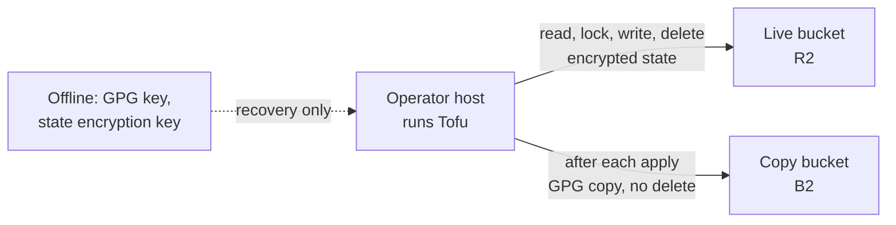

# 0103. Where Tofu's state is held

## Problem

Tofu's record of what it built is a local file on one VM. Losing that VM loses the record,
and every rebuild changes it. What has to be true: the state survives the loss of the
host that runs Tofu and of any host Tofu builds, only the operator can read it, and
recovering it needs nothing that Tofu itself has to rebuild first.

## Decision

State lives in a bucket named `opentofu-state` on R2, made by hand like the snapshot
buckets. A second bucket on B2 (a different name if that one is taken, since B2 names
are global) holds copies.

- **Live backend.** R2. OpenTofu's `s3` backend points at the bucket with a credential
  that reads, writes and deletes in that bucket and nothing else. It lives in the credentials file ADR 0048 describes, and a
  script beside the snapshot ones in `tools/cloud_credentials/` mints it and does not
  cache it. It is rotated on the cadence of the snapshot write leaf.
- **Copy.** After each apply the guarded wrapper
  ([ADR 0102](../0102-knowing-what-a-tofu-change-will-do/revision-000.md)) pushes
  `tofu state pull` output to B2 under a new key each time, encrypted to the backup GPG
  public key as `snapshot-push.sh` does, with a write leaf that cannot delete. The copies
  are the history R2 does not keep, the way back from a bad state write, and the recovery
  path if the R2 account is lost. They accumulate at a few megabytes each; pruning is a
  lifecycle rule set on the bucket by hand.
- **Encryption.** OpenTofu state encryption, so the provider holds only ciphertext and a
  plan file is covered too. The key is in the credentials file and has an offline copy
  held like the backup GPG key, since the file is what a total loss removes.
- **Locking.** The backend's native lock file (`use_lockfile`), which R2 enforces.
- **Migration.** `tofu init -migrate-state` from the operator host. The local file and
  its copies are deleted once a plan against the bucket shows no change.

## Invariants

- No host that Tofu builds holds or is needed to reach the state.
- A provider never holds readable state.
- The R2 credential reaches the state bucket only, and the B2 copy credential cannot
  delete.
- After migration the operator host's file is not the only copy.

## Non-goals

- Access to the state from the CD agent, or applying from it
  ([ADR 0102](../0102-knowing-what-a-tofu-change-will-do/revision-000.md)).
- More than one workspace, or a second maintainer's access.
- Rotating the state encryption key on a schedule.

## Reconsideration triggers

R2 drops conditional writes or ends its free allowance; B2 gains conditional writes and
a single provider with history becomes simpler; a second maintainer or
the CD agent needs to read the state; the operator host becomes something Tofu cannot
rebuild by design; spare hardware outside the node makes a local backend worth running.
