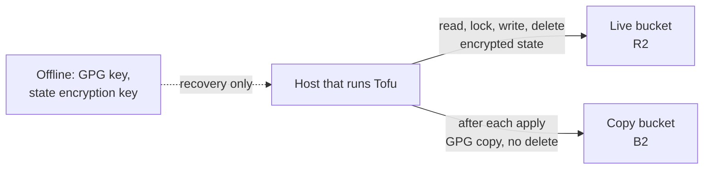

# 0103. Tofu's state in an encrypted R2 bucket, with a GPG copy on B2

## Problem

Tofu's record of what it built is a local file on one VM. Losing that VM loses the record,
and every rebuild changes it. What has to be true: the state survives the loss of the
host that runs Tofu and of any host Tofu builds, only the operator can read it, and
recovering it needs nothing that Tofu itself has to rebuild first.

## Context

- **What existed.** State was `tofu/terraform.tfstate` on the host that runs Tofu, with
  its copies on the same VM.
- **The backend cannot be a host Tofu builds.** Tofu has to be able to rebuild any VM it
  manages, so a bucket on one of them is unreachable when it is needed. That rules out
  `storage`, and the host that runs Tofu while it can be built from the Ubuntu module: the
  controller today, and the operator host that
  [ADR 0058 (Operator work host)](../0058-where-operator-work-runs/revision-000.md) plans to
  take its place. Even built by hand it is the machine the state must stop depending on.
- **The pattern exists.** ADR 0048 puts an S3 credential for the backend in the
  credentials file beside the Proxmox token
  ([ADR 0048 (Tofu credentials)](../0048-where-tofu-credentials-live/revision-000.md)). The
  secrets store's snapshots go to a bucket on both R2 and B2, made by hand, so that
  recovery does not depend on one vendor
  ([ADR 0111](../0111-recovering-the-secrets-store-from-total-loss/revision-000.md)), and
  the host that runs Tofu needs both providers on its Internet allowlist, which the
  operator host's planned flows already name.
- **That bucket cannot be shared.** Its write credential cannot delete and its bucket
  takes retention rules, while Tofu's backend overwrites the state and creates and deletes
  a lock object. The name is fixed in the snapshot scripts and neither provider renames a
  bucket.
- **State is sensitive.** It holds values a plan reads from providers, and some resources
  store secret-adjacent material, so a provider that holds it must not be able to read it.
- **Size.** The state is small and a run touches it a few times. Operations are far below
  either provider's free allowance; storage is the shared limit, since the backup archives
  are in the same accounts.
- **What the two providers do.** Checked with scoped credentials on scratch buckets and
  OpenTofu 1.13's `s3` backend. R2 refuses a second `If-None-Match: *` write, so the
  backend's lock file is a real lock, but it lists no object versions and keeps only the
  latest state. B2 answers a conditional write with `501 NotImplemented`, so OpenTofu
  cannot take its lock there, but it keeps old versions of an overwritten key.

## Decision

State lives in a bucket named `opentofu-state` on R2, made by hand like the snapshot
buckets. A second bucket on B2 (a different name if that one is taken, since B2 names
are global) holds copies.

- **Live backend.** R2. OpenTofu's `s3` backend points at the bucket with a credential
  that reads, writes and deletes in that bucket and nothing else. It lives in the credentials file ADR 0048 describes, and a
  script beside the snapshot ones in `tools/cloud_credentials/` mints it and does not
  cache it. It is rotated on the cadence of the snapshot write leaf.
- **Copy.** After each apply the guarded wrapper
  ([ADR 0102](../0102-knowing-what-a-tofu-change-will-do/revision-000.md)) pushes
  `tofu state pull` output to B2 under a new key each time, encrypted to the backup GPG
  public key as `snapshot-push.sh` does, with a write leaf that cannot delete. The copies
  are the history R2 does not keep, the way back from a bad state write, and the recovery
  path if the R2 account is lost. They accumulate at a few megabytes each; pruning is a
  lifecycle rule set on the bucket by hand.
- **Encryption.** OpenTofu state encryption, so the provider holds only ciphertext and a
  plan file is covered too. The key is in the credentials file and has an offline copy
  held like the backup GPG key, since the file is what a total loss removes.
- **Locking.** The backend's native lock file (`use_lockfile`), which R2 enforces.
- **Migration.** `tofu init -migrate-state` from the host that runs Tofu. The local file and
  its copies are deleted once a plan against the bucket shows no change.

## Alternatives considered

- **A separate SeaweedFS on the Proxmox node.** No vendor, but it shares the node, its
  disks and its power with everything the state describes, and it is one more service to
  patch and back up. The state would still have a single copy.
- **SeaweedFS on the host that runs Tofu.** Tofu may build that host, and it is the machine the
  state must survive.
- **The `openbao-snapshots` bucket.** Its credential cannot delete and its bucket takes
  retention rules, and a rename means new buckets and new credentials on both providers.
- **`storage`.** Tofu builds it, and every restore reads from it.
- **The local file with better copies.** Leaves the file on the host that loses it.
- **A hosted state service.** A new vendor, account and credential for one file.

## Consequences

- The state leaves the LAN, encrypted. Reading it needs the credential and the key, and
  recovering from the copy needs the offline GPG key and a read credential minted for the
  occasion, as ADR 0111 does for snapshots.
- Two credentials and one key are added to the operator's custody, and the key's offline
  copy joins the yearly custody check
  ([`exercises.md`](../../topics/disaster-recovery/exercises.md)).
- State shares each account's free storage with the backup archives. The state is a few
  megabytes, so what it adds is small, but the allowance is not its own.
- Tofu's apply depends on R2 being reachable. The B2 copy cannot run Tofu on its own,
  only recover the state.
- [`tofu/state-and-credentials.md`](../../topics/infra/tofu/state-and-credentials.md)
  describes the backend.

## Invariants

- No host that Tofu builds holds or is needed to reach the state.
- A provider never holds readable state.
- The R2 credential reaches the state bucket only, and the B2 copy credential cannot
  delete.
- After migration the file on the host that runs Tofu is not the only copy.

## Non-goals

- Access to the state from the CD agent, or applying from it
  ([ADR 0102](../0102-knowing-what-a-tofu-change-will-do/revision-000.md)).
- More than one workspace, or a second maintainer's access.
- Rotating the state encryption key on a schedule.

## Reconsideration triggers

R2 drops conditional writes or ends its free allowance; B2 gains conditional writes and
a single provider with history becomes simpler; a second maintainer or
the CD agent needs to read the state; the host that runs Tofu becomes something Tofu cannot
rebuild by design; spare hardware outside the node makes a local backend worth running.

## Revision notes

Revision 0 named the operator host of ADR 0058 as the host that runs Tofu, so its exclusion of that host and its migration step rested on a decision that is not settled yet. This revision states the same exclusion for whichever host runs Tofu, and names the operator host only as the planned successor of the controller. The bucket, the credentials, the copy, the encryption and the invariants are unchanged.
