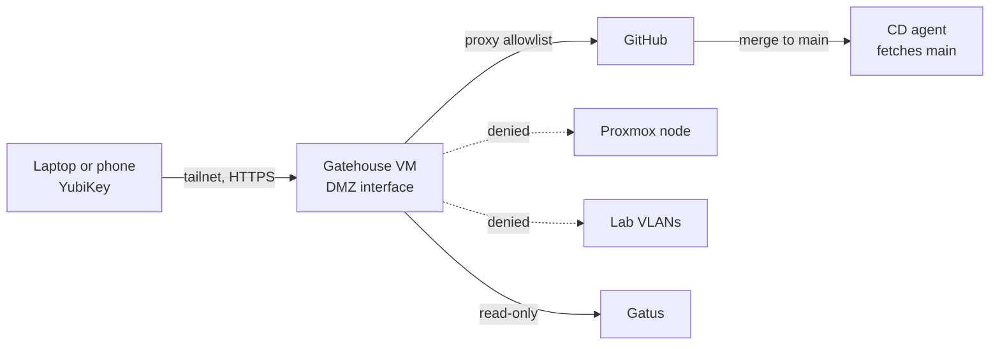

# 0114. Landing a series from a device other than the laptop

## Problem

A series lands only from a terminal on the maintainer's laptop under the maintainer's own `gh` login. Landing has to be possible from the laptop and the phone away from home, with the review of the series and the merge of each layer as careful as they are at the terminal. A merge to `main` is a deploy, so whatever lands a series must not hold a standing power over `main`, and must not sit where its compromise reaches the infrastructure credentials or the production hosts.

## Context

- [ADR 0112 revision 1 (Landing a patch series)](../0112-landing-a-series-of-dependent-changes-on-main/revision-001.md) replays a series on a scratch worktree, keeps each pull request as a branch, pushes, waits on the required checks and merges each layer with `gh pr merge --admin --merge`. Its credential is the maintainer's `gh` login, a run-wide `--yes` confirms every merge, and a layer that changes hooks, CI, `tools/` or the Python dependencies always asks. The tool's own changes are applied with `git am`, not landed by it.
- The CD agent fetches `main` anonymously and deploys what it finds. [ADR 0044 revision 0-c (CD agent trigger)](../0044-prod-automation-trigger-and-execution/revision-000-c.md) holds that it has no credential that can write to the GitHub remote, no listener that triggers or serves a job, and runs no unmerged code. [ADR 0056 (Workstation credentials)](../0056-credentials-held-by-the-maintainer-workstation/revision-000.md) puts the push credential on the laptop, and [ADR 0058 (Operator work host)](../0058-where-operator-work-runs/revision-000.md) keeps the operator host free of untrusted content.
- A console parses uploaded patches, shows text written by others and runs the repository's checks on unmerged patches. That is untrusted content with a power over production, so it belongs on none of the three hosts above.
- The Proxmox node is not on a VLAN. Its management address is on the WAN side, which the gateway's outbound NAT reaches ([`opnsense-config.md`](../../projects/opnsense-config.md)). A guest on the WAN bridge would be adjacent to it, which the VLAN rules otherwise prevent. The node is also a tailnet device, and the policy holds explicit grants only ([`tailnet-policy.md`](../../topics/infra/tailnet-policy.md)).
- A GitHub App's user-to-server token acts as the user. Pocket ID is a passkey-only OIDC provider that signs in with the maintainer's YubiKeys, on the phone over NFC. A passkey is bound to the hostname it was registered on.

**Threat model.** The asset is `main`, which the CD agent deploys. The adversaries are a web attacker reaching the console's origin (cross-site requests, script injected through diff or review text), a patch whose checks run code, and a compromised console host. The attack paths are a merge made without the maintainer's intent, a token or credential read from the host, and a path from the host to the Proxmox node, the operator host or production. The first two are limited by short-lived, series-bound authority and by running patch code where no credential is present. The third is limited by where the host sits and by what the tailnet grants it. A compromised host holding a live token can still merge until the token is revoked or expires.

## Decision

A web console, called Gatehouse, uploads a `.series` file, shows it for review, replays it, pushes the layers and merges them, from the laptop or the phone over the tailnet. The `land_series` command stays as the break-glass path and shares the library underneath.

**Host and network.**

- The console runs on its own VM, built by Tofu and configured by a role the operator host applies. The VM is in no group `deploy.yaml` targets, and its code reaches it only by that role: copied from the controller's checkout while it lives in this repository, and as a release pinned by version and sha256 once it is its own repository. `main` cannot replace it.
- The VM sits on a new OPNsense interface in a range the VMID scheme leaves unassigned. The interface allows the Internet through the proxy allowlist and denies every private range, which includes the Proxmox node's WAN-side address. Nothing inside the lab initiates to it.
- It joins the tailnet under its own tag. The policy grants the maintainer's devices its HTTPS port, grants the tag at most one read-only path to Gatus for the status panel, and tests that it reaches no other node.
- It holds no infrastructure credential: no OpenBao identity, no SSH key to a managed host, no Tofu or Proxmox credential.

**Sign-in.** Pocket ID runs on the VM with sign-up closed and only the maintainer's YubiKeys registered. Landing a series needs a login made for that series.

**Merge credential.** A GitHub App installed on this repository alone, with the permissions merging needs, gives one user token per series through device flow.

- The token is held in memory and no refresh token is kept. It is revoked when the series completes, is aborted or goes idle, and otherwise expires.
- Starting a series needs the fresh Pocket ID login and the GitHub approval. The approval binds to the hash of the series file and each layer's tree, since a layer's commit changes when it is moved onto a new base and its tree does not.
- Each merge pins the head commit. A failed check, a tree that differs from the approved one, a layer on the stop list, or a timed-out wait pauses the series until the maintainer acts. A mode that confirms each layer with a tap, without a new login, is available.
- No standing token and no App with a standing bypass exists.

**Replay.** The replay runs in a transient systemd sandbox with no network and no credentials, on dependencies fetched beforehand. A layer that changes the dependencies runs with an allowlisted network after the maintainer confirms. The component that holds the token verifies the replay's output against the series hash and runs `git push` with hooks off. It never runs patch code.

**Status.** For each series the console shows the merge commits, the required checks and the deploy job's heartbeat, read from Gatus through one read-only grant. It shows no deployed commit.

**Implementation.** Python 3.14 with dependencies from `uv.lock` only, server-rendered pages with a strict content-security policy and no inline script, and no JavaScript build chain.

This diagram shows the design as this revision decided it, not what runs now.

## Alternatives considered

- **A local web UI on the laptop.** It changes nothing in ADR 0112 and does not reach the phone.
- **The upstream-side bridge instead of a DMZ interface.** Isolation is structural and survives an OPNsense rebuild, but the VM is adjacent to the hypervisor's management plane, depends on the Proxmox firewall holding, and loses the proxy allowlist and OPNsense's view of its traffic.
- **The CD agent host.** It breaks all three properties of ADR 0044 revision 0-c on the host that holds the production credentials.
- **The operator host.** It would handle untrusted content next to the infrastructure credentials.
- **The console does everything but the bypass merge, which the maintainer clicks in GitHub's web UI.** It keeps ADR 0056 intact, but the UI merge cannot pin the head the maintainer reviewed. It is the fallback if an App token cannot use the bypass.
- **A standing token, or an App with a standing bypass.** A permanent path to production from an exposed host.
- **Pocket ID on an internal VLAN.** It needs a path from the DMZ into that VLAN and stops landing when it is down, and gains little, since a compromised console host with a live token can merge whoever hosts the sign-in.
- **WebAuthn in the console itself.** It can refuse synced credentials and bind an assertion to a transaction, at the cost of more security code to own.
- **Tailnet identity alone.** A compromised device would be enough to merge.
- **Replay in the land process.** Simpler, and it gives patch code the token.
- **The source in this repository for good.** The tool would then land changes to the repository it is part of. The seam the console needs is built here first and the tool moved to its own repository once the seam is stable.
- **Each host exposing its deployed commit, or a statement signed by the CD agent.** The first needs a read path the console's zone lacks. The second proves nothing about the hosts, and the agent has no listener or credential to deliver it.

## Assumptions

- **Claim:** a ruleset's Admin bypass applies to a GitHub App's user token, and the merge call's `sha` parameter pins the head.
  **Breaks if wrong:** the console cannot merge, or cannot guarantee it merges the head that was reviewed. The merge falls back to the maintainer's own click in GitHub's web UI.
  **Checked by:** a spike on a scratch repository with the same ruleset shape as `main`.

- **Claim:** device flow works for the App with no callback, a token can be revoked, and a refresh token can be left unrequested.
  **Breaks if wrong:** a standing secret (the App's client secret) must sit on the host to revoke, or a token outlives its series until it expires.
  **Checked by:** the same spike, reading the App's settings and the revocation call.

- **Claim:** Pocket ID honours a request for a fresh login, keeps sign-up closed, and signs in with an NFC key from the phone's browser.
  **Breaks if wrong:** the login cannot be tied to a series, and the console implements WebAuthn itself.
  **Checked by:** a throwaway Pocket ID instance and the maintainer's tokens.

- **Claim:** DMZ rules that deny every private range stop the VM reaching the Proxmox node's management address, the node's own firewall can limit 8006 and 22 to the gateway's WAN address and the maintainer's tailnet devices, and the tailnet tests assert that the VM's tag reaches nothing.
  **Breaks if wrong:** a compromised console host has a path to the hypervisor.
  **Checked by:** a probe from the VM to the node's management ports, and the policy's `tests`.

- **Claim:** the checks a replay runs from a patch run in a transient sandbox with no network and no credentials once their dependencies are fetched.
  **Breaks if wrong:** a check that needs the network or a credential runs outside the sandbox, or is skipped.
  **Checked by:** running the replay in such a unit on a real series.

- **Claim:** Gatus can be read through one read-only grant, and the deploy job can push a heartbeat.
  **Breaks if wrong:** the status panel shows the merge and the checks only.
  **Checked by:** reading [`gatus.md`](../../topics/monitoring/gatus.md) and the heartbeat configuration of the deploy job.

## Consequences

A new VM, interface and tailnet tag, and a second holder of merge power that exists for the length of a series. Once the assumptions are resolved, ADR 0112's credential invariant, ADR 0056's table of what each host holds and ADR 0053's description of network reach each need a new revision. The console asks for a login and an approval for every series, and a series that outlasts its token needs a new approval. The tailnet's coordination service is on the path to the console, and the CLI is the way around it. The behaviour the console implements is the same as [`landing-a-series.md`](../../topics/engineering/landing-a-series.md), which is updated as it is built.

## Invariants

- No credential that can merge to `main` is stored on the console host. A merge token exists from a series' approval until its completion, abort, idle timeout or expiry.
- A series is approved against the hash of its file and each layer's tree, and a layer merges only with that tree and a pinned head.
- A layer on the stop list always asks the maintainer.
- Patch code never runs where a credential is present.
- The console host holds no infrastructure credential, and its tailnet tag has no grant beyond the read-only path to Gatus.
- The console's code is not replaced by anything `main` contains.
- The `land_series` command keeps working without the console.

## Non-goals

- Opening layers in parallel.
- Running Tofu or Ansible from the console.
- Changing the rulesets or who may bypass them.
- Using the sign-in service for any other app.
- Reporting the deployed commit of each host.

## Validation

The tailnet policy's `tests` assert that the console's tag reaches no other node. The role's Molecule verify checks the sandbox unit's directives and that no credential file exists on the host. Unit tests of the console cover the approval binding, the pause conditions and the token's revocation. A probe from the VM to the Proxmox node's management ports must fail.

## Reconsideration triggers

- GitHub changes how a user token is issued, scoped or revoked.
- Pocket ID changes its sign-in model or is no longer maintained.
- Series become rare enough that the CLI is enough.
- A second person lands changes.
