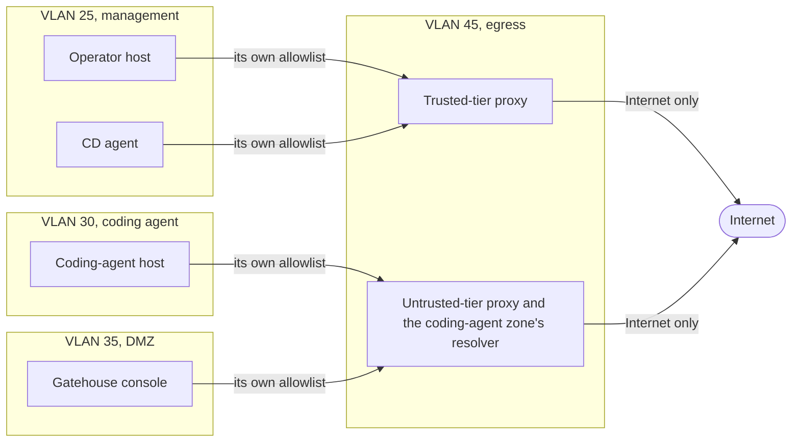

# 0116. Internet egress for hosts in default-deny zones

## Problem

A host in a zone that denies direct Internet access still needs a few named destinations: a registry, a release host, a state bucket, an API. What it may reach has to be reviewed code, not a firewall rule that drifts. A compromised consumer must not be able to change what it may reach, and the thing that enforces it must neither share a network with a consumer nor take down a zone that has to rebuild the lab.

## Context

- **Who needs it.** Three zones deny direct Internet access, each on a decision of its own. The coding-agent zone (VLAN 30) reaches the Internet only through a proxy ([ADR 0053 (Coding-agent network reach)](../0053-network-reach-of-the-coding-agent-host/revision-000.md), `approved`). The management zone (VLAN 25) holds the operator host and, in the VMID scheme, the CD agent, and [ADR 0058 (Operator work host)](../0058-where-operator-work-runs/revision-000.md) sends its Internet traffic through the same proxy under an allowlist of its own (`working`). The DMZ (VLAN 35) holds the Gatehouse console, whose interface allows the Internet "through the proxy allowlist" ([ADR 0114 (Remote series landing)](../0114-landing-a-series-from-a-device-other-than-the-laptop/revision-000.md), `working`). The zones with Internet today reach it directly ([`network-boundary-checks.md`](../../topics/infra/network-boundary-checks.md#the-flows-in-the-list)); this record does not change them.
- **The proxy is already assumed three times.** The coding-agent zone's record had assumed a proxy of its own that served two VLANs. The third consumer, and the decision about where the proxy runs, are in no record: the egress project lists "which zone the proxy VM sits in" as an open item, and [ADR 0089 (OPNsense configuration)](../0089-how-the-opnsense-gateway-is-configured/revision-000.md) leaves where it runs outside its scope.
- **The management zone's rebuild depends on it.** Tofu's state is in an encrypted R2 bucket with a copy on B2 ([ADR 0103 (Tofu state backend)](../0103-where-tofus-state-is-held/revision-001.md), [`state-and-credentials.md`](../../topics/infra/tofu/state-and-credentials.md)). With direct egress denied, a `tofu apply` from the operator host reaches the bucket only through the proxy, so a proxy that is down blocks the run that would rebuild it.
- **A package on the gateway couples it to a pin.** The Ansible collection `oxlorg.opnsense` works only with the OPNsense release of its own version, and the two are pinned and rehearsed together ([ADR 0089](../0089-how-the-opnsense-gateway-is-configured/revision-000.md)). A proxy there would change only when that pin does, and its configuration would be a second kind of object in the play. A VM goes through the pipeline the repository already runs: Tofu builds it and Ansible configures it.
- **A proxy is small.** Squid on a 2 GB VM held about 45 MB resident and spent about a quarter of a second of CPU on 200 tunnelled requests, allowed the listed host name and refused every other with a `403` on the tunnel request (measured for the coding-agent zone).
- **Source addresses name hosts.** A VM's address is derived from its VMID and static, so the source address of a connection identifies the host in every zone without DHCP ([`vm-provisioning.md`](../../topics/infra/vm-provisioning.md#vmid--vlan--ip-scheme)). Within one VLAN nothing at the gateway separates two hosts, and a host could send with a neighbour's address unless the node refuses it.
- **The management zone's destinations are all named hosts.** The tooling that zone runs reaches the Ubuntu mirrors (plain HTTP, the one unencrypted destination), GitHub and its release-asset host, the Python package index and its file host, the Ansible Galaxy hosts, the OpenTofu registry, the download hosts that hook environments install from, and the state bucket's and its copy's storage endpoints. None is an address literal, so filtering on the requested host name serves every one, about a dozen names in all. The set follows the workflows the zone runs, and a workflow that is new may add names. A workflow that runs containers would also need a container registry, which none of these does.
- **The Gatehouse console's destinations are named hosts too.** GitHub's API and device-flow endpoints, the OS mirrors, and Tailscale's control-plane, log and package hosts work through an HTTP `CONNECT` proxy when `tailscaled` is given the proxy address in its defaults file. With no UDP egress, the node's traffic with its peers is carried by Tailscale's relays over HTTPS. A relay's name is one of a set (`derpNN.tailscale.com`) that Tailscale changes, so the allowlist names the Tailscale domain and not each relay.
- **The node's per-VM firewall holds the source address.** With the firewall on a VM's network device and an IP filter holding only that VM's address, the node drops IPv4 packets the VM sends with another address in the same VLAN and passes those with its own. The datacenter firewall has to be on for the filter to apply. A key by source address holds inside a shared VLAN only for a VM that carries the filter.
- **A rule left in place shows as a changed task.** The OPNsense module's check mode reports a rule that exists while the play declares it absent as a changed task, and `--diff` prints no contents of the rule. The task's name is therefore what tells the operator what was left behind.
- **A new zone needs the seed.** On the pinned 26.1 series the gateway's API cannot assign a VLAN device to an interface or give it an address; the seed does, at first boot only, and 26.7 adds an assignment API (ADR 0089). Every new zone costs an edit to the seed.
- **A same-VLAN proxy is reachable without the gateway.** Traffic between two hosts of one VLAN is switched on the bridge and never reaches the gateway ([`flows.yaml`](../../../tools/network_checks/flows.yaml)). That is why the proxy cannot sit in a consumer's VLAN.
- **Spare address space.** The 450 to 499 VMID block, VLAN 45 and `192.168.45.0/24`, is unassigned in the scheme.
- **The block of the services hosts is not a place for it.** The four application hosts and the Tailscale router share VLAN 20 with the secrets store and the backup storage. The DMZ's own rule is that nothing inside the lab initiates to it and every private range is denied outbound (ADR 0114), which a proxy that serves other zones cannot meet.

**Threat model.** The adversaries are a compromised consumer and a compromised proxy. The assets are what a consumer holds and what the allowlist protects. A compromised consumer is limited to its own allowlist, which a consumer cannot edit. A compromised proxy bypasses the allowlist of the tier it serves and nothing more: it holds no secret, the lab's TLS is not inspected, so a tunnel's content is not readable by it, and a TLS connection redirected to another address fails certificate verification. An allowlisted destination such as GitHub remains a path for whatever a consumer can read, which is accepted.

## Decision

This diagram shows the consumers, the two proxies and the zone as this revision decided them, not what runs now.

- **Two instances of one role.** The trusted-tier proxy serves the management zone: the operator host and the CD agent. The untrusted-tier proxy serves the coding-agent zone and the DMZ. Each is a small VM built by Tofu and configured by Ansible like any other host, and it patches and rebuilds like one. A consumer is served by its own tier's proxy and by no other.
- **Why two.** The management zone holds the credentials that rebuild the lab and must not wait on an allowlist that changes with the coding agent's tooling, or share an outage or a compromise with a zone that parses untrusted content. One instance per consumer would add a VM and its patching for little more, since keying the allowlist by host already separates what each may reach.
- **Zone.** Both sit in a new VLAN, 45, in the 450 to 499 block, which this revision names the egress zone. The interface admits only the proxy port, and on the untrusted tier the resolver port, each from its consumers' addresses, plus SSH from the host that provisions it. Outbound it allows the Internet and denies every private range except the gateway's own address in the zone, for DNS and time as every zone has. No other zone's host is admitted, and neither proxy is admitted to any internal address.
- **Keying.** An allowlist belongs to one consumer host and is keyed by its source address. The operator host and the CD agent, which share VLAN 25, have two allowlists. A host with no allowlist reaches nothing. The allowlists have one source in the repository and are rendered into each instance's configuration; a proxy filters on the requested host name only. Each consumer VM carries the node's per-VM IP filter with its own address, so the node refuses its packets that carry another address and the key holds inside a shared VLAN. The proxies listen on IPv4 only, the family the filter covers.
- **Placement.** Neither proxy runs on a consumer's VLAN, on the `services` host or in the DMZ.
- **The coding-agent zone's resolver.** It stays as ADR 0053 sets it and runs on the untrusted-tier VM. The other zones keep resolving through the gateway.
- **Failure policy.** There is no standby. The VM holds no state, so rebuilding it is a `tofu apply` and a deploy. For the case where the trusted-tier proxy is what is down, the gateway's play has a temporary rule, switched by a variable, that admits the operator host directly to the state backend's and the providers' endpoints. The operator host applies it through the gateway's own address, which it reaches without the proxy, The play owns the rule: present when the variable is set and declared absent otherwise, so a rule left in place is reported by the next `--check` as a changed task, named for the rule, with no need for the gateway project's later stage that removes rules the play does not write. The rehearsal of this path belongs to the exercise cadence of [ADR 0101 (DR exercise cadence)](../0101-exercising-disaster-recovery/revision-000.md), and its results are kept as that record says.
- **Probe.** The boundary checks gain a probe that opens an HTTP `CONNECT` tunnel through a proxy ([ADR 0094 (Network boundary checks)](../0094-showing-the-network-boundary-behaves-as-declared/revision-000.md)). A canary is a consumer with the allowlist of the host it stands for; a listed name must open a tunnel and any other must be refused with a `403`.
- **The record of the system.** Each proxy has a service record under [ADR 0100 (Recording a system's integration)](../0100-recording-how-a-system-is-integrated/revision-001.md). The coding-agent project builds the proxies, and the project of each other consumer adds its allowlist.

## Alternatives considered

- **One proxy for every consumer.** One VM to patch, but a bad allowlist render, an outage or a compromise reaches the zone that rebuilds the lab and the zone that holds the adversary together. Lost on isolation.
- **One proxy per consumer.** Separates failure fully, at a VM and its patching for each consumer, on a node the records call limited in headroom. Per-host keying already separates what each may reach. Lost on cost.
- **A proxy package on the gateway.** Needs no VM and no zone, but ties the proxy to the gateway's release pin, adds a configuration object to the play, and was never shown to install. Lost on coupling.
- **A standby for the trusted tier.** The repository declares one node, so a standby shares its fate, a bad render reaches both, and a client's `HTTPS_PROXY` holds one address, so failover needs a floating address or a DNS change. Lost on cost for the failures it covers.
- **Keying the allowlist by VLAN.** The operator host and the CD agent would share the union of what either needs. Lost on least privilege.
- **A proxy in a consumer's VLAN, or on the `services` host.** A compromised consumer reaches it without crossing the gateway, or a security control shares a host and a zone with production and the backup storage. Lost on isolation.
- **A proxy in the DMZ.** It would need inbound from internal zones, which the DMZ's rule forbids, and it would share a VLAN with a consumer.
- **Direct Internet for the management zone, with proxies for the other two.** Leaves the zone that holds the infrastructure credentials with the widest egress. Lost on least privilege.
- **Domain-named firewall aliases instead of a proxy.** Registries and GitHub sit behind shared CDN addresses, so address-resolved aliases are broad and drift. Kept as a fallback if a proxy proves unworkable.

## Consequences

- The zone's interface joins the seed with the coding-agent and DMZ interfaces, so the rebuilt gateway has all three, and the zone's rules reach it through the play, not by hand ([ADR 0089](../0089-how-the-opnsense-gateway-is-configured/revision-000.md)).
- Two more VMs to patch, size and rebuild, on a node whose headroom is recorded only as the early accounting in [ADR 0035 (Container orchestration)](../0035-container-orchestration-platform/revision-000.md) and as repeated mentions that it is limited.
- A trusted-tier outage blocks Tofu until it is rebuilt or the temporary rule is applied, and an operator who needs the rule is working from the node's console or the gateway play.
- Two proxies of different trust share VLAN 45. Neither initiates to the other and each admits only its own consumers, so adjacency gives a compromised untrusted tier a path to the trusted tier's listening port, which its own address filter refuses. This is accepted.
- ADR 0053 stops describing the proxy and cites this record for it; ADR 0058 and ADR 0114 cite this record for the proxy they rely on.
- The Gatehouse console's tailnet traffic is carried by relays only, since its zone sends no UDP, and its allowlist names the whole Tailscale domain.
- The node's datacenter firewall has to be on, and each consumer VM is built with its network device's firewall on and an IP filter holding its own address.
- Allowlists need upkeep as the consumers' tooling changes, and a change to a trusted tier's allowlist is a security-relevant change to review.
- Allowed destinations remain an exfiltration channel for whatever a consumer can read.

## Invariants

- A consumer in a default-deny zone reaches the Internet only through the proxy of its tier, apart from the temporary rule of the failure policy.
- A proxy reaches no internal address except the gateway's own in its zone, holds no secret, and is admitted only from its own consumers.
- A tier serves no consumer of the other tier.
- An allowlist belongs to one host; a host with none reaches nothing.
- The allowlists have one source in the repository.

## Non-goals

- Preventing exfiltration through allowed destinations.
- TLS inspection: the lab's TLS stays uninspected.
- High availability, and a proxy for zones that reach the Internet directly.
- Splitting or moving the `services` host.

## Validation

A canary in each consumer zone runs the tunnel probe against a listed name and a refused one, with the listed name as the deny's control, and the flow list gains the egress zone and the flows to it. A test that renders every allowlist from its source fails on a consumer without one and on a name listed for the wrong tier. The exported gateway rules are compared with the topic doc, and a test that a temporary rule left in place with its variable unset is reported by `--check` as a changed task.

## Reconsideration triggers

- A second Proxmox node, which makes a standby worth its cost.
- The temporary rule is applied a second time.
- A consumer outside the three zones needs a proxy, or the trusted tier gains a consumer whose allowlist differs enough to want its own instance.
- The gateway's assignment API arrives, which changes what a new zone costs.
