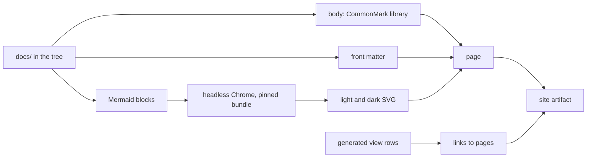

# 0119. Reading the documentation tree away from GitHub's page

## Problem

A reader who follows a row of a generated view, or reads on a phone, has to leave the doc site for the markdown file on GitHub, where the page knows nothing of the document's front matter (a decision's state, what supersedes it, which project implements it) and has none of the site's navigation or phone layout. The documents have to be readable where the views are, without a second system to keep and without anything that changes what a document says.

## Context

- [ADR 0117 (Generated doc views)](../0117-delivering-the-generated-doc-views-to-readers/revision-000.md) publishes the three generated views and lists topic docs, decisions and projects as non-goals. Every project and decision a row names is a link to GitHub, and the views are the pages readers arrive on.
- **What there is to render.** About 300 markdown files under `docs/`: topic docs, projects, decision revisions, the architecture diagrams, the READMEs and the explorations. They hold paragraphs, lists with task-list items, tables, fenced blocks, one blockquote and one HTML comment, and nothing uses a GitHub alert, a footnote or raw HTML.
- **The renderer reads them.** markdown-it-py, already in the lock file through another package, parses every one of those files under its CommonMark rules with tables enabled. The doc site's own renderer, which handles a link, a code span and bold text, refuses anything else, and that refusal is what keeps a view from showing markup wrongly.
- **The diagrams render at build time.** Every Mermaid block renders to SVG in one headless Chrome page in about ten seconds, from the single bundle `mermaid.min.js` of Mermaid 11 (about 3.5 MB). The runner has Chrome and `playwright` is a dev dependency. A diagram's colours are fixed in its SVG, so a dark page needs a second rendering.
- **Anchors.** Docs and the drift check use the anchor GitHub gives a heading ([`doc-site.md`](../../topics/documentation/doc-site.md#anchors-and-links)); the site already computes it.
- **Limits.** A Pages site is limited to 1 GB and a deployment times out after 10 minutes. About 300 pages and the diagrams are small against both. The layout check opens every page at several sizes, so its time grows with the page count.
- **Explorations.** Nothing durable may point at an exploration, because it is deleted when it ends.

## Decision

The doc site publishes the documentation tree as pages, built by the renderer it already has, extended.

- **Which documents.** Every markdown file under `docs/` except `explorations/` and the `TEMPLATE` files: the topic docs and their index, the project docs, each decision revision, the READMEs and the architecture docs. A page's address follows its path, so a link can be derived from the path it already uses.
- **How a body is read.** A CommonMark library reads the body, with tables, strikethrough and task-list boxes, and the existing templates and styles lay it out. A block the renderer has no rule for fails the build, as markup outside its subset fails a view today, so a page is never wrong without saying so. Headings take GitHub's anchors.
- **What a page adds.** A header drawn from the front matter: a decision's state and what it supersedes, replaces or relies on, the projects that implement it; a project's status, blocker and decision. Every page links to its source on GitHub.
- **Links.** A relative link to a document the site renders becomes a link to its page with its anchor kept; a link to any other file in the repository goes to it on GitHub, as it does today; a link to a view goes to its page.
- **Diagrams.** A Mermaid block is drawn to SVG during the build in headless Chrome, from a bundle committed and pinned as the stylesheet is, in a light and a dark rendering that the page chooses between by `prefers-color-scheme`. No script reaches the reader. A diagram that fails to render fails the build.
- **Navigation.** The site gains Topics, Projects, Decisions and Architecture alongside the three views, which keep the build that makes them and their card layout on a phone. A generated view's rows link to the pages. The home page carries `docs/README.md`, and each section opens on its list, with its README one link away from every page of the section.
- **Reading aids.** A decision page links every revision of its lineage and the neighbouring ADRs by number, and a page's prose has one reading measure. The decision index may lay its rows out for finding a decision, with its numbers ten to a row and its topic groups as tabs, in the markdown view and on the site, provided every row's content stays in the view, a group stays reachable by its anchor and by the filter, and every group shows when the stylesheet is not applied. A document page with several headings lists them on the page, beside the prose on a wide screen and above it on a phone, and the index of topics shows its groups as tabs on the site with a filter over its links, on the same terms. These aids are made from a page's own headings and links, so no source document carries markup for them, and they hide nothing from a reader without the stylesheet.

The diagram shows the design as this revision decided it, not what runs now.

## Alternatives considered

- **Stay as the views are.** No new code, and a row still leaves the site for GitHub. It loses on the problem.
- **Pages from front matter only**, with the body left on GitHub. It needs no markdown support, but the markdown check showed the renderer can read every document, so the page would be a stub that sends the reader away, and a project's or decision's body is the part they came for.
- **A documentation generator** for the prose docs, with the views kept as they are. It adds search and navigation, and costs a second build, a second theme to bring in line, and a dependency whose direction is unsettled: Material for MkDocs is in maintenance mode and its stated window for fixes has ended, and its successor has not been checked against what this repository needs. It cannot make the views, so both builds stay. It was not tried against the documents, so the choice here is on the cost of two systems, not on a failure.
- **Mermaid drawn in the page** by a script. It ships about 3.5 MB of script to every reader, needs the script to see a diagram at all, and puts code in the page that the build does not control.
- **Mermaid from an npm package at build time.** It brings a Node toolchain and a tree of packages into the build for one bundle, where the bundle committed and hashed has nothing to fetch.

## Consequences

- A document that uses markup the renderer lacks fails the doc-site build, which runs on any pull request that changes a document. An author meets that before merge, and it is read as a request to teach the renderer or to change the document.
- The doc-site pull request job now runs for documentation changes, and the layout check has to cover a sample of document pages for each kind, not every page at every size.
- A pinned 3.5 MB bundle is committed, and an update adds that much again to history; `markdown-it-py` becomes a direct dependency, and both changes sit on the stop list.
- A page can differ from GitHub's in small ways, such as spacing, so each page links to its source.
- A contents list takes width from a table beside it, and the layout check, which stops at phone and tablet widths, gains a wide size for the pages that have one.
- The decision index's markdown view changes with its page, so a reader of either finds a decision the same way, and the grid has to stay readable on GitHub.
- The deployed site grows by the HTML of every document and the SVG of every diagram in two renderings, a few megabytes in all.
- [`doc-site.md`](../../topics/documentation/doc-site.md) describes the behaviour.

## Invariants

- A page is a function of the tree and the commit it is built from: it reads no history and no clock, and two builds of one commit are the same bytes.
- The site shows only what the repository holds, and the public-repository rule in [`docs/README.md`](../../README.md#public-repo) applies to every page.
- Markup the renderer does not handle fails the build and is never shown wrongly.
- Every heading has the anchor GitHub gives it, so a link that worked on the file works on the page.
- The reader's browser runs no script that a page needs to be read, and makes no request to a third party.
- Every page links to its source file.
- The deploy job holds no `contents` write permission and deploys only from `main`.
- An exploration is never a page.

## Non-goals

- Searching across the documents. [ADR 0117](../0117-delivering-the-generated-doc-views-to-readers/revision-000.md) names it as a non-goal and this revision keeps it so.
- Editing or commenting on a page, or any behaviour that needs a server.
- A view of an older commit or of a pull request.
- Documents outside `docs/`, such as the READMEs at the repository root.

## Validation

A test builds every page twice from a fixture tree and fails when the bytes differ. A test parses every document in the tree and fails when a block has no rule, so a document that gains one fails in the pull request that adds it. The workflow tests keep the deploy job's permissions as they are. The layout check runs at phone and landscape sizes on the views and a sample of document pages for each kind.

## Reconsideration triggers

- The renderer refuses documents often enough that authors write around it.
- A pinned bundle's update or the Mermaid version GitHub draws with differ enough that a diagram reads differently.
- The site approaches its size limit, or the build approaches the deployment timeout.
- A documentation generator that checks links and anchors strictly, builds the same bytes twice and takes the generated views in, so that a second build costs less than keeping this renderer.
- A reader asks for search that the site cannot give.
