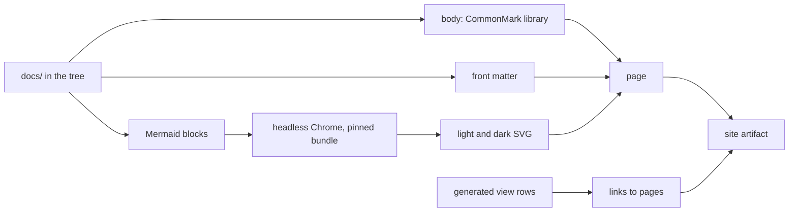

# Render the tree as pages under a home page from the root README

## Problem

A reader who follows a row of a generated view, or reads on a phone, has to leave the doc site for the markdown file on GitHub, where the page knows nothing of the document's front matter (a decision's state, what supersedes it, which project implements it) and has none of the site's navigation or phone layout. The documents have to be readable where the views are, without a second system to keep and without anything that changes what a document says.

## Context

- [ADR 0117 (Generated doc views)](../0117-delivering-the-generated-doc-views-to-readers/revision-000.md) publishes the three generated views. A row of one links to a document, which has to be readable on the site, on a phone as much as on a desktop.
- **Who arrives.** The home page is where a visitor to the repository lands. `docs/README.md` tells a contributor where a doc goes and says nothing of what the repository is; the root `README.md` does.
- **One home for a fact.** A second copy of the README's text would drift from it without a check noticing ([`docs/README.md`](../../README.md)).
- **What there is to render.** The markdown under `docs/` and the root `README.md`: paragraphs, lists with task-list items, tables, fenced blocks and Mermaid diagrams. The root README also has badges, which are images.
- **The renderer reads them.** markdown-it-py parses CommonMark with tables. The doc site's own renderer for the views handles a link, a code span and bold text and refuses anything else, which is what keeps a view from showing markup wrongly.
- **The diagrams render at build time** in headless Chrome from one pinned Mermaid bundle. A diagram's colours are fixed in its SVG, so a dark page needs a second rendering.
- **Anchors.** Docs and the drift check use the anchor GitHub gives a heading ([`doc-site.md`](../../topics/documentation/doc-site.md#anchors-and-links)).
- **Limits.** A Pages site is limited to 1 GB and a deployment times out after 10 minutes. The layout check opens every page at several sizes, so its time grows with the page count.
- **Explorations.** Nothing durable may point at an exploration, because it is deleted when it ends.

## Decision

The doc site publishes the documentation tree as pages, built by the renderer it already has, extended.

- **Which documents.** Every markdown file under `docs/` except `explorations/` and the `TEMPLATE` files: the topic docs and their index, the project docs, each decision revision, the READMEs and the architecture docs. A page's address follows its path, so a link can be derived from the path it already uses.
- **How a body is read.** A CommonMark library reads the body, with tables, strikethrough and task-list boxes, and the existing templates and styles lay it out. A block the renderer has no rule for fails the build, as markup outside its subset fails a view today, so a page is never wrong without saying so. Headings take GitHub's anchors.
- **What a page adds.** A header drawn from the front matter: a decision's state and what it supersedes, replaces or relies on, the projects that implement it; a project's status, blocker and decision. Every page links to its source on GitHub.
- **Links.** A relative link to a document the site renders becomes a link to its page with its anchor kept; a link to any other file in the repository goes to it on GitHub, as it does today; a link to a view goes to its page.
- **Diagrams.** A Mermaid block is drawn to SVG during the build in headless Chrome, from a bundle committed and pinned as the stylesheet is, in a light and a dark rendering that the page chooses between by `prefers-color-scheme`. No script reaches the reader. A diagram that fails to render fails the build.
- **Navigation.** The site gains Topics, Projects, Decisions and Architecture alongside the three views, which keep the build that makes them and their card layout on a phone. A generated view's rows link to the pages. Each section opens on its list, with its README one link away from every page of the section, and `docs/README.md` is a page of its own, the guide to where docs go.
- **Home page.** It introduces the repository to a visitor, then offers each entry of the navigation. Its markdown is a template beside the views' introductions, holding a title, links only the site needs, and slots that name parts of the root `README.md`: its opening without the title and badges, and `##` sections by their anchors. The build fills the slots, so no sentence is written twice, and a slot that names nothing fails the build. The template has no generated markdown file, so it adds nothing to `docs/` or its indexes.
- **Reading aids.** A decision page links every revision of its lineage and the neighbouring ADRs by number, and a page's prose has one reading measure. The decision index may lay its rows out for finding a decision, with its numbers ten to a row and its topic groups as tabs, in the markdown view and on the site, provided every row's content stays in the view, a group stays reachable by its anchor and by the filter, and every group shows when the stylesheet is not applied. A document page with several headings lists them on the page, beside the prose on a wide screen and above it on a phone, and the index of topics shows its groups as tabs on the site with a filter over its links, on the same terms. A diagram that a screen shrinks can be drawn at its own width on request, and on a phone the project list folds its projects not yet started. These aids are made from a page's own headings, links and diagrams, so no source document carries markup for them, and they hide nothing from a reader without the stylesheet or without a script: a fold is open in the markup.

The diagram shows the design as this revision decided it, not what runs now.

## Alternatives considered

- **Keep `docs/README.md` as the home page.** Nothing to build, and a visitor lands on contributor rules.
- **Render the whole root `README.md` as the home page.** One source with no template, but its badges are images, and its setup commands, tree layout and link table repeat what the site's navigation does.
- **A home page with its own text in `docs/`.** The simplest page to write, and a second copy of the README's facts, or a README emptied of them for GitHub's readers. It would also be one more document to index.
- **A documentation generator** for the prose docs. It adds search and navigation, and costs a second build, a second theme and a dependency; it cannot make the views, so both builds would stay.
- **Pages from front matter only**, with the body left on GitHub. A page would be a stub that sends the reader away, and the body is the part they came for.
- **Mermaid drawn in the page** by a script. It ships a large bundle to every reader and puts code in the page that the build does not control.
- **Mermaid from an npm package at build time.** It brings a Node toolchain into the build for one bundle, where the committed and hashed bundle has nothing to fetch.

## Consequences

- Renaming a README section the template names stops the build until the template follows.
- A change to the root `README.md` runs the doc-site build on its pull request.
- A document that uses markup the renderer lacks fails the build, which an author meets before merge.
- A pinned Mermaid bundle is committed, and an update adds that much again to history.
- A page can differ from GitHub's in small ways, so each page links to its source.
- [`doc-site.md`](../../topics/documentation/doc-site.md) describes the behaviour.

## Invariants

- A page is a function of the tree and the commit it is built from: it reads no history and no clock, and two builds of one commit are the same bytes.
- The site shows only what the repository holds, and the public-repository rule in [`docs/README.md`](../../README.md#public-repo) applies to every page.
- Markup the renderer does not handle fails the build and is never shown wrongly.
- Every heading has the anchor GitHub gives it, so a link that worked on the file works on the page.
- The reader's browser runs no script that a page needs to be read, and makes no request to a third party.
- Every page links to its source file.
- The deploy job holds no `contents` write permission and deploys only from `main`.
- An exploration is never a page.

## Non-goals

- Searching across the documents. [ADR 0117](../0117-delivering-the-generated-doc-views-to-readers/revision-000.md) names it as a non-goal and this revision keeps it so.
- Editing or commenting on a page, or any behaviour that needs a server.
- A view of an older commit or of a pull request.
- Documents outside `docs/` as pages of their own. The home page shows parts of the root `README.md`; the rest of it, and every other file outside `docs/`, stays on GitHub.

## Validation

A test builds every page twice from a fixture tree and fails when the bytes differ. Tests fill the home page from a fixture README and fail a slot that names no section. A test parses every document in the tree and fails when a block has no rule. The layout check runs at phone and wide sizes on the views and a sample of document pages for each kind, and the workflow tests keep the deploy job's permissions.

## Reconsideration triggers

- The renderer refuses documents often enough that authors write around it.
- A pinned bundle's update or the Mermaid version GitHub draws with differ enough that a diagram reads differently.
- The site approaches its size limit, or the build approaches the deployment timeout.
- A documentation generator that checks links and anchors strictly, builds the same bytes twice and takes the generated views in, so that a second build costs less than keeping this renderer.
- A reader asks for search that the site cannot give.

## Revision notes

The home page was `docs/README.md`, and the root READMEs were a non-goal. It now introduces the repository from parts of the root README, and `docs/README.md` is the guide page. The reading aids gain a full-size diagram and a folded list.
