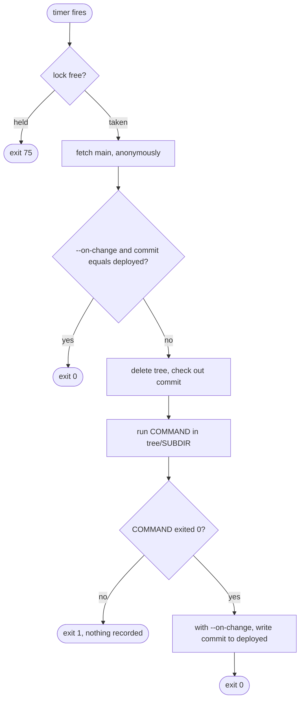

# CD Agent: Job Runner

[`tools/cd_agent/run_job.py`](../../../tools/cd_agent/run_job.py) is the poll, decide and run step of [ADR 0044 revision 0-c (CD agent trigger)](../../decisions/0044-prod-automation-trigger-and-execution/revision-000-c.md): one invocation is one run of one job. The `cd_agent` role installs it on the agent host and runs it from each job's timer ([`cd-agent-host.md`](cd-agent-host.md)). It imports only the standard library, so the host runs it with its own `python3` and no virtualenv.

```text
cd tools && python3 -m cd_agent.run_job --repo-url URL --state-dir DIR [--cwd SUBDIR] [--on-change] -- COMMAND...
```

## What a run does



The parts the diagram does not show:

| Step | Detail |
| :--- | :--- |
| Lock | Exclusive, on `DIR/lock` |
| Fetch | `main` only, anonymously, into the bare `DIR/repo.git`; the URL is `https` with no credentials. `GIT_*` variables and every git config file are ignored, and only `https` is allowed |
| Before each fetch | The repository's `config`, `hooks/`, `info/`, `worktrees/` and `objects/info/` are deleted and `config` rewritten, since the job user owns the directory. Python starts with `-s -P`, so no user site or working directory is searched |
| `--on-change` | Compares with `DIR/deployed`; any difference runs, a force-push backwards included. A missing or malformed record counts as never deployed |
| Checkout | `DIR/tree` is deleted and the commit checked out as a new detached worktree |
| Command | Runs in `DIR/tree/SUBDIR` (default the root) with the environment plus `CD_AGENT_STATE_DIR`. A `--cwd` that leaves the tree or is not a directory fails first |
| Record | Only on exit `0`, so a failed commit runs again and the last good one stays recorded |

Without `--on-change` the run always uses the latest `main` and records nothing: the shape for maintenance, rotation and credential expiry, which run on their own schedule.

## Exit status

| Status | Meaning |
| :-: | :--- |
| `0` | `COMMAND` succeeded, or `--on-change` found nothing new. |
| `1` | `COMMAND` exited non-zero, or the run could not be carried out (fetch failed, bad URL, bad `--cwd`, `COMMAND` could not start). |
| `2` | Usage error. |
| `75` | Another run holds the lock. |

## State directory

| Path | Holds |
| :--- | :--- |
| `repo.git/` | The fetched bare repository; only `refs/remotes/origin/main` exists in it. |
| `tree/` | The checkout `COMMAND` ran in, replaced at the start of every run. |
| `deployed` | The last commit `COMMAND` succeeded on; written only with `--on-change`. |
| `lock` | The file the run holds its exclusive lock on. |
| `toolchain/` | What [`toolchain.py`](#toolchain) builds for a command that asks for it: its own virtualenv, `uv` cache and Ansible collections. |

To see what a job last did, on the agent host:

```bash
job=deploy
sudo cat "/var/lib/cd-agent/$job/deployed"
sudo journalctl -u "cd-agent-$job.service" -n 100 --no-pager
```

The tests in [`tools/tests/cd_agent/`](../../../tools/tests/cd_agent/test_run_job.py) run real `git fetch` against a local repository and assert each rule above.

## Toolchain

A job that needs Python packages or Ansible collections runs [`tools/cd_agent/toolchain.py`](../../../tools/cd_agent/toolchain.py) as its command, with its real command after a `--`:

```text
python3 -m cd_agent.toolchain [--collections FILE] [--python PATH] -- COMMAND...
```

It runs from the checkout's working directory, which `run_job.py` has chosen, and does the following:

1. Finds the checkout's root: the nearest directory at or above the working directory that holds `uv.lock`.
2. Runs `uv sync --locked --no-dev` against that root into `$CD_AGENT_STATE_DIR/toolchain/venv`, with the `uv` cache beside it and no Python downloads. `--locked` stops the run if `uv.lock` no longer matches `pyproject.toml`, and `uv` installs exactly what the lock names, with its hashes, removing anything else. The interpreter is the one running `toolchain.py`, unless `--python` names another.
3. With `--collections`, runs `ansible-galaxy collection install` for that requirements file (relative to the working directory, and refused if it leaves the checkout) into `$CD_AGENT_STATE_DIR/toolchain/collections`.
4. Replaces itself with `COMMAND`, which finds the virtualenv's `bin/` first on `PATH` and has `VIRTUAL_ENV` set, plus `ANSIBLE_COLLECTIONS_PATH` when collections were installed. `COMMAND`'s exit status is the job's.

Any failure in steps 1 to 3 exits `1` without running `COMMAND`, so under `--on-change` the commit is not recorded and the next poll retries it. The environment is built from the commit being run, so the tools always match it, and no job shares an environment with another. A new commit that changes the lock reinstalls only the difference. Galaxy pins collections by version, not hash, so unlike the lock it is an input the commit does not fully determine.

`uv` must be on `PATH`, and the interpreter must satisfy the project's `requires-python`. `toolchain.py` imports only the standard library.
