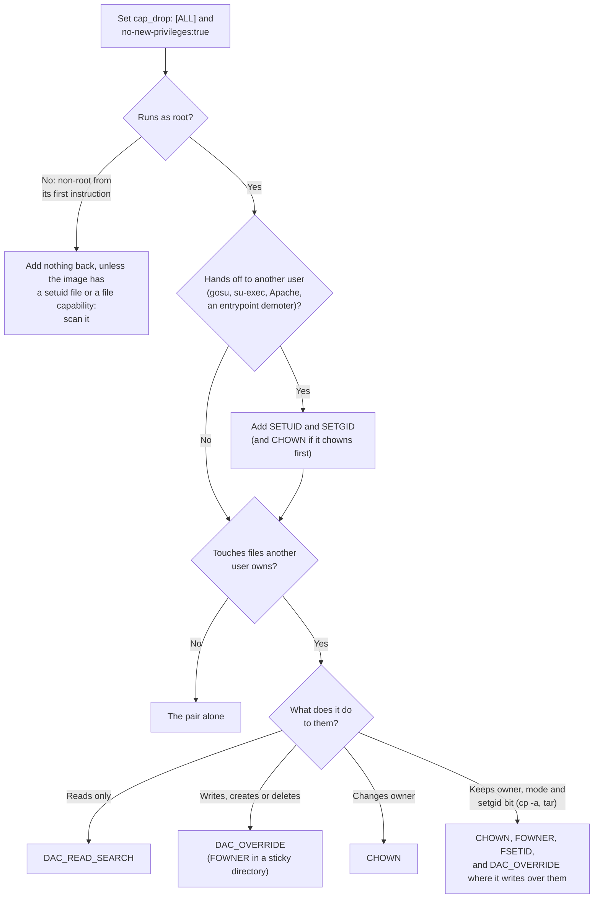

# Container Hardening

Every service and every helper container Ansible starts sets
`cap_drop: [ALL]` and `security_opt: [no-new-privileges:true]`, then adds back
only what its process does. This page covers how to choose what to add back,
what each capability is for, and how to check the result.

| Setting | What it does |
| :--- | :--- |
| `cap_drop: [ALL]` | Removes every capability from the container's bounding set. A process that runs as a non-root user from its first instruction held none to begin with, so for it this changes nothing unless the image relies on `exec` granting one. |
| `no-new-privileges:true` | Stops `exec` granting a privilege through a setuid binary or a file capability. The daemon already sets it for every container ([`docker-daemon.md`](docker-daemon.md)); the line in each compose file keeps it on where the service is defined, whatever the daemon is set to. |

`cap_drop` has no daemon-wide default, so it is set per service.

## Choosing what to add back

A root process needs none of these for files it created itself or that root
already owns. Reading a `0600` file root owns takes no capability.

## What each capability is for

| Capability | Root needs it to | Without it |
| :--- | :--- | :--- |
| `CHOWN` | Change the owner or group of a file it does not own, even to the owner the file already has. | `chown` fails with `Operation not permitted`. `cp -a` and `tar` cannot restore ownership; BusyBox `cp -a` prints `can't preserve ownership` and still exits 0, leaving root-owned files. |
| `FOWNER` | Change the mode or timestamps of a file it does not own, and remove other users' files from a sticky directory (`1777`). | `cp -a` and `tar` print `can't preserve permissions` or `times` and can exit 0 with the wrong modes. `rm` in a sticky directory fails with `Operation not permitted`. |
| `FSETID` | Keep a setuid or setgid bit when it changes a file's owner or mode, and set setgid on a file whose group it is not in. | The kernel drops the bit and the command exits 0: a `2775` directory comes back `775`. |
| `DAC_OVERRIDE` | Open, write, create or delete files and directories whatever their mode and owner. | `Permission denied`. A job fails at once; a service can run until it first writes, such as SQLite's `attempt to write a readonly database` at login. |
| `DAC_READ_SEARCH` | Read files and search directories whatever their mode, with no write access. | `Permission denied` on reads. A healthcheck that reads nothing stays green while the container cannot open what it archives. It is not in Docker's default set, and it allows `open_by_handle_at`, which the default seccomp profile blocks without it. Where the process may write anyway, `DAC_OVERRIDE` (in the default set) covers the same reads. |
| `SETUID`, `SETGID` | Switch to another user (`gosu`, `su-exec`, Apache's worker drop, an entrypoint demoter). `cp`, `find`, `rm` and `tar` do not use them. | The entrypoint cannot make the switch. |
| `NET_BIND_SERVICE` | Bind a port below 1024. A binary that carries it as a file capability with the effective bit set is refused at `exec` without it (`capabilities(7)`, "Safety checking for capability-dumb binaries"). | The listener or the whole process fails to start. |
| `IPC_LOCK` | `mlock` memory so secrets stay out of swap (OpenBao). | The lock fails and the process refuses to start or runs unprotected, depending on its configuration. |
| `NET_RAW` | Send ICMP, for `ping`. | Ping checks stop working. `dashy` gives `ping` this as a file capability and do not keep it here, because only a ping check or monitor uses it. |

Three of these fail without an error that stops the job: `CHOWN` and `FOWNER`
under BusyBox `cp -a`, and `FSETID`. Check the owner and mode of what the job
leaves, not only its exit code.

## Verifying a set

1. Read the image's Dockerfile and entrypoint for `setcap`, `chmod u+s`,
   `sudo`, `su-exec`, `gosu` and `setpriv`, and scan it:
   `python -m container_hardening.scan_image IMAGE`, run from `tools/`
   ([`scan_image.py`](../../../tools/container_hardening/scan_image.py)). The
   scan reads the image without running it, so a compiled entrypoint that
   drops privileges still needs the next steps.
2. Boot the service with the set on a fresh volume and on a populated one. A
   fresh volume shows what a first run creates; a populated one shows the
   owners it inherits.
3. Exercise the real operation, not only the healthcheck: log in, write a
   record, read a backup. A start-up probe passes with a missing capability
   until the process first needs it.
4. Restart the container once and check it comes back healthy:
   `docker restart NAME; docker inspect --format '{{.State.Health.Status}} {{.RestartCount}}' NAME`.
   An entrypoint that cleans up or chowns what its previous start left behind
   passes its first start and fails the second.
5. For a one-shot job, compare the hardened run with an unhardened one: exit
   code, new error lines, and the owner, group and mode of every file it
   leaves. Add capabilities back one at a time, and read the tool's own error
   line to see which one it is missing.

## Docker behaviour that changes the result

| Behaviour | Consequence |
| :--- | :--- |
| Mounting an empty named volume on a path the image has resets the volume's top directory to the image's owner and mode. A volume holding anything, even one dotfile, keeps its owner. | A test that sets an owner on an empty volume loses it when the container starts. Put a file in the volume first. |
| A container's writable layer survives `docker restart`, a daemon restart and a host reboot. A recreate, such as a compose change, replaces it. | A start that succeeds on a new container proves nothing about the next one. |
| A foreground `community.docker.docker_container` task fails when the container exits non-zero. | A missing capability that makes the tool exit non-zero fails the task. Only an exit 0 with wrong metadata needs an assertion. |
| Whether `no-new-privileges` drops a file capability can depend on the kernel. | Confirm on the kernel that runs the service, not on a different one. |
