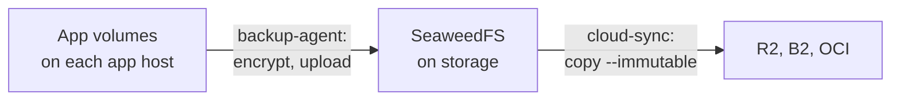

# Backup — Off-host and Cloud Copies

A separate VM (`storage`) runs
[SeaweedFS](https://github.com/seaweedfs/seaweedfs) as a self-hosted
S3-compatible target. One [`offen/docker-volume-backup`](https://github.com/offen/docker-volume-backup)
agent per host (`backup_agent` role) pushes GPG-encrypted archives of
selected named volumes to SeaweedFS — nothing else. Cloud coverage
(Cloudflare R2 / Backblaze B2 / OCI Object Storage) is a separate
`cloud_sync` role running only on `storage`, reading those same
already-encrypted objects out of SeaweedFS and copying them onward — see
[`backup-threat-model.md`](backup-threat-model.md) for why it's designed this way, "What's backed up"
for SeaweedFS coverage, and [`cloud-sync.md`](cloud-sync.md) for how the
cloud leaf works.

S3 credential generation/rotation is covered in [`secrets.md`](../security/secrets.md),
not here.

OpenBao's own backup/restore uses a different mechanism entirely (a
raft snapshot, not this volume-backup pipeline) — see
[`backup-restore.md`](../security/openbao/backup-restore.md).

Getting data back is [`restore.md`](restore.md); proving that path works end
to end is [`fire-drill.md`](fire-drill.md).

## Architecture



- Each app declares its volumes under the `backup:` key of its `app_catalog`
  entry. The agent has no per-app logic.
- One `docker-volume-backup` container per host runs one schedule per app, always
  to SeaweedFS. Each run tars and uploads the whole of that app's volumes (no
  delta sync), so a schedule's cost grows with its own app only. Schedules are
  independent, so there are no retention or cron conflicts to validate.
- `backup_agent`'s `compose.yaml` is the only templated compose file in this
  repo, since the mounted volumes differ per host.

### Stopping an app for a snapshot

An app that must be stopped for a consistent snapshot sets two things, and the
role renders the third:

| Where | Setting |
| :--- | :--- |
| The app's compose service | Label `docker-volume-backup.stop-during-backup=<app-name>`: its own name, not a shared `true` |
| The app's `app_catalog.yaml` entry | `backup.stop_during_backup: true` |
| The app's schedule file (rendered) | `BACKUP_STOP_DURING_BACKUP_LABEL=<app-name>` |

The label match is scoped per schedule file, not per container: backing up app A
never stops app B, although all schedules share one container.

### Docker API access

The agent reaches the Docker API through a `docker-socket-proxy` sidecar, added
only when some app on the host needs stopping. The sidecar runs the stock image
with no capability flags; the role mounts `docker-api-rules.cfg` read-only over
the image's `haproxy.cfg.template`. Editing that file recreates the container,
through a label that carries its hash.

| Method | Paths passed, with or without an API version prefix |
| :--- | :--- |
| `GET` | `/_ping`, `/version`, `/info`, `/containers/json` |
| `POST` | `/containers/{id}/start` and `/stop`, for a full 64-character lower-case id |

Every other call gets a 403, so the agent cannot create, exec into, kill, update
or delete a container, or read a container's environment, files or logs. See
[ADR 0004 (Docker API access)](../../decisions/0004-container-access-to-the-docker-api/revision-001.md)
for why Docker API access goes through a scoped proxy instead of the socket.

**Known limitation (single operator, trusted LAN):** the grant has no
per-container ACL. The proxy can start or stop any container on the host by id,
and list every container with its labels. Only `docker-volume-backup`'s label
match scopes a schedule to its own app.

### Container privileges

The agent runs as root with every capability dropped except `DAC_READ_SEARCH`,
and `no-new-privileges`. Every volume is mounted read-only; the capability lets it
open the schedule files the deploy user owns and the files each app's user owns,
so `DAC_OVERRIDE` is not needed. The proxy sidecar drops every capability, adds
none back and sets `no-new-privileges`. See
[Container hardening](../deploy/adding-an-app.md#container-hardening).

## Storage host

SeaweedFS runs single-node (`weed server -filer -s3`) — sufficient for "a
copy exists off-host," not HA for the backup target itself.

- **Filer web UI** (`https://filer.store.{{ lan_domain }}`) — human-facing,
  Caddy + Tinyauth + TLS like every other app, and read-only: the route
  registers `read_only: true`, so Caddy answers anything but `GET` and
  `HEAD` with 405. Writes and deletes go through the S3 API's scoped
  identities only.
- **S3 API** (`https://s3.store.{{ lan_domain }}`) — machine-facing only.
  Registered `auth: false` (Tinyauth's forward-auth needs an interactive
  redirect a non-interactive S3 client can't complete). Auth is instead
  the per-identity S3 SigV4 keypairs in
  `docker/seaweedfs/configs/s3-identity.json.j2` — one
  bucket-admin identity (`Admin:<bucket>`, every action on the bucket, held only
  by `storage`), one narrow, path-scoped
  identity per `backup_agent` host, and one bucket-wide but read-only
  identity for `cloud_sync`'s own relay-outward reads. See
  [`backup-threat-model.md`](backup-threat-model.md) for why, and the [SeaweedFS S3 Configuration
  wiki](https://github.com/seaweedfs/seaweedfs/wiki/S3-Configuration) to
  adjust the scoping.

## Bucket creation

SeaweedFS does not auto-create a bucket on first `PUT`, even with
`Admin`-scoped credentials. `ansible/roles/seaweedfs_bucket` creates it
explicitly (Play 5 in `deploy.yaml`, `storage` only, after SeaweedFS
deploys and before `backup_agent` runs). Kept out of `backup_agent` itself
since bucket creation is a one-time storage-side concern.

The role leaves the bucket's versioning suspended. Each agent prunes by
retention (see "What's backed up") with a plain delete, which on a versioned
bucket only adds a delete marker and keeps the archive stored; suspended, the
delete frees the data. A pruned archive still leaves a zero-byte delete marker.

## Encryption

Archives are GPG-encrypted (`GPG_PUBLIC_KEY_RING_FILE`) with an asymmetric
keypair: hosts hold only the public key; the private key stays offline and
is never on any homelab host, so a compromised host can't decrypt existing
backups.

The output is binary OpenPGP, the agent's default. Setting `GPG_OUTPUT` to
`armored` makes it base64 text, about a third larger. `gpg -d` reads either
form, so restore does not depend on which one an archive has.

`ansible/files/backup-gpg-public-key.asc` is the public half of the live
backup key. Show its fingerprint with:

```sh
gpg --show-keys --with-fingerprint ansible/files/backup-gpg-public-key.asc
```

Replacing the file only affects archives written afterwards: every archive
already in SeaweedFS or a cloud target stays encrypted to the old key, so
the old private key has to be kept for as long as any of them is
retained.

### Generating a keypair

Only needed for a first deploy or to rotate the key.

Run on your own workstation, never on `storage` or an app host:

```sh
# paste alone; answer its questions: RSA and RSA, size 4096, expiration 0
gpg --full-generate-key
```

```sh
# note the hex string after "rsa4096/"
gpg --list-secret-keys --keyid-format=long
```

```sh
# paste alone; it waits for that hex string
read -r -p 'key id: ' key_id
```

```sh
# from the repo root; the private key goes to your home directory, not the checkout
gpg --armor --export "$key_id" > ansible/files/backup-gpg-public-key.asc
(umask 077; gpg --armor --export-secret-keys "$key_id" > ~/homelab-backup-private.asc)
```

Store `~/homelab-backup-private.asc` offline (password manager, offline USB)
with a redundant copy — losing it makes every backup unrecoverable.

## What's backed up

| Host | App → volumes | Stopped during backup | Retention | Cloud targets |
| :--- | :--- | :--- | :--- | :--- |
| `services` | `kms` → `data` | yes (`kms`) | 7 days | R2, B2 (default) |
| `services` | `wastebin` → `data` | no | 7 days | R2, B2 (default) |
| `security` | `beszel-hub` → `data` | yes (`beszel-hub`) | 7 days | R2, B2 (default) |
| `security` | `tinyauth` → `data` | yes (`tinyauth`) | 7 days | R2, B2 (default) |
| `security` | `lldap` → `data`, `certs` | no | 7 days | R2, B2 (default) |
| `security` | `step-ca` → `data` | no | 7 days | R2, B2 (default) |
| `play` | `minecraft` → `backups` only | no | 7 days | OCI (override) |

Apps without a `backup:` key in `app_catalog.yaml` are out of scope.
Every app above lands in SeaweedFS directly (`backup_agent`, per-host,
nightly); "Cloud targets" is what `cloud_sync` (storage-only, see
[`cloud-sync.md`](cloud-sync.md)) additionally relays it to, on its own
separate schedule. A failed run alerts to Telegram — see
[`telegram-notifications.md`](../monitoring/telegram-notifications.md).

Schedule, retention, compression and whether the app is stopped come from
`backup_defaults` (`group_vars/all/main.yaml`) unless the app's own
`backup:` block sets them; see
[`adding-an-app.md`](../deploy/adding-an-app.md#2-register-it-in-app_catalog).

Why some apps differ:

- **`lldap` is never stopped.** It is the auth backend, so stopping it takes login
  away from every app behind Caddy and Tinyauth, a bigger blast radius than the
  SQLite consistency risk it would guard against.
- **`minecraft` is not stopped and sets `backup.compression: none`.**
  `itzg/mc-backup` already quiesces the world over RCON and gzips the archive that
  the agent mounts (`docker/minecraft/compose.yaml.j2`). The other apps are raw
  volume data and use the `gz` default.

If a restore ever turns up a corrupt SQLite or LDAP file for `wastebin` or
`lldap`, add `stop_during_backup: true` and the matching label
([above](#stopping-an-app-for-a-snapshot)).

## Running a backup now

Only the nightly schedule starts a backup. To take one outside it, run
`backup` inside the agent container with one app's schedule file as the
environment, as the deploy user on that app's host, from the
`backup-agent` directory under `compose_deploy_dir`:

```sh
# paste alone; it waits for the app's name
read -r -p 'app: ' app && docker exec --env-file "conf.d/$app.env" backup-agent backup
```

One schedule file is one app and one archive. To back up every app on the
host, stopping at the first failure:

```sh
for f in conf.d/*.env; do docker exec --env-file "$f" backup-agent backup || break; done
```

The environment has to come from `--env-file`. The container's own
environment holds only the settings shared by every schedule (`.env`), so
a bare `docker exec backup-agent backup` has no bucket and no
`BACKUP_FILENAME`: it archives `/backup`, every app's volumes in one
archive, and uploads nothing. Sourcing the file in the container's shell,
as the upstream docs describe, fails on the `{{ .Extension }}` in
`BACKUP_FILENAME`; the variable stays unset and the archive is named
`backup-<timestamp>`, which restore discovery does not recognise (it
matches `<host>-<app>-<timestamp>`). `--env-file` passes every setting
through unchanged.

- **Exit status.** The command exits non-zero when the archive is not
  created or not uploaded, and a failure alerts to Telegram like a
  scheduled run does.
- **Stopped apps.** An app marked "Stopped during backup" above is stopped
  for the run, as it is overnight.
- **Overlap.** A run that meets a running one waits for the container's
  lock, up to the agent's lock timeout (60 minutes by default), instead
  of running alongside it.
- **Pruning.** Every run also prunes archives past the app's retention.

Exit status 0 means the upload finished. To see the object, list the
host's `<host>-<app>/` prefix in the bucket, for example in the filer web
UI; the newest object is the one just taken. The freshness check cannot
confirm it, since its threshold is the app's cron period plus a buffer,
which the previous night's archive already satisfies.

The cloud copies follow on `cloud_sync`'s own schedule. To relay now, on
`storage`:

```sh
sudo systemctl start cloud-sync.service
```

The unit is a oneshot, so the command returns when the run ends and fails
if any job failed; the jobs' output is in `journalctl -u cloud-sync.service`.

OpenBao is not in this pipeline. Its snapshot is taken as
[`backup-restore.md`](../security/openbao/backup-restore.md#running-a-backup)
describes.

## S3 endpoint format

`seaweedfs_s3_endpoint` (`group_vars/all/main.yaml`) must be a
**bare hostname** (e.g. `s3.store.{{ lan_domain }}`), not a URL —
`docker-volume-backup` passes it straight into minio-go's
`AWS_ENDPOINT`, which rejects a scheme prefix (`Endpoint url cannot
have fully qualified paths`). Scheme is the separate
`seaweedfs_s3_proto` var (default `https`). `cloud_sync`'s own
`rclone.conf` is unrelated and follows the opposite convention — see
[`cloud-sync.md`](cloud-sync.md).

## Out of scope

- Off-site/cloud replication of the `storage` host's own SeaweedFS data
  store — R2/B2/OCI hold independent app-level archives, not a mirror of
  SeaweedFS's bucket.
- HA for SeaweedFS (single-node by design).
