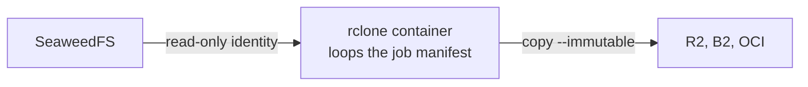

# Cloud Sync — Offsite Replication to R2/B2/OCI

`cloud_sync` (`storage`-only) reads already-encrypted archives straight
out of SeaweedFS and copies them onward to R2/B2/OCI via
[rclone](https://rclone.org) `copy --immutable` — never `sync`, and cloud-side
retention is a provider-native lifecycle rule configured out-of-band,
not managed by this repo. See
[ADR 0010 (Offsite copy deletion)](../../decisions/0010-preventing-homelab-side-deletion-of-offsite-copies/revision-000.md) for why: that
combination is what actually keeps a compromised on-prem host from
touching the offsite copy, not IAM scoping alone.

Current values, set directly in each console:

| Cloud | Lock (immutable window) | Delete-after | Config |
| :--- | :--- | :--- | :--- |
| R2 | 29 days (Bucket Lock) | 30 days | Object Lifecycle Rules + Bucket Lock Rules |
| B2 | 28 days (Default Bucket Retention) | 30 days | Custom lifecycle rule: 29d uploading→hiding, 1d hiding→deleting |
| OCI | 3 days (Retention Rule, Unlocked) | 5 days | Retention Rules + Lifecycle Policy Rules |

Why the locks sit where they do:

- Archive names embed the upload timestamp (`BACKUP_FILENAME` in
  `ansible/roles/backup_agent/templates/schedule.env.j2`) and are never reused.
- `--immutable` fails a job whose source object differs from the one in the cloud
  (rclone exits 6, reported like any failed job) without uploading it. The relay
  refuses an overwrite itself, so a provider's lock only ever guards a delete.
- Each lock is strictly shorter than its own delete-after, and that gap is not
  slack to tighten. R2 defers a lifecycle delete of a still-locked object until
  the lock clears; B2 fails it, which would produce failed lifecycle runs.

## Targets

An app's clouds are `backup.cloud_targets` in `app_catalog.yaml`:

- SeaweedFS is implicit for every backed-up app and never listed.
- An app's list replaces `backup_defaults.cloud_targets`
  (`group_vars/all/main.yaml`) rather than adding to it.
- Each name must be a key of `cloud_sync_targets` (`host_vars/storage.yaml`),
  which alone holds the credentials.

Minecraft overrides to `[oci]` alone. R2 and B2 apply one lock and one
delete-after to every object in their bucket, so about a month of its daily
archives would sit in each, far past either free allowance. OCI's rules are set
for a short window ([OCI window](#oci-window)). Whether a second cloud can hold
it too is open.

## OCI window

OCI's delete-after is sized so the bucket's average Standard-tier storage stays
within the free allowance of a paid account, [10 GB per
tier](https://docs.oracle.com/en-us/iaas/Content/FreeTier/freetier_topic-Always_Free_Resources.htm#objectstorage)
(a Free Tier-only account gets 20 GB combined instead). Storage above it is
billed. The bucket holds about as many archives as the delete-after has days,
so the longest window that stays free is the allowance divided by one
archive's size. Read the current size and object count with:

```sh
oci os bucket get -bn homelab-backups --fields approximateSize --fields approximateCount \
  --query 'data.{size:"approximate-size",count:"approximate-count"}'
```

Moving archives to Infrequent Access or Archive does not shorten the bill: their
minimum storage periods (31 and 90 days) are longer than the window, and an
object deleted earlier is charged for the whole minimum.

A second lifecycle rule aborts incomplete multipart uploads after a day. The
write credential has no `OBJECT_DELETE`, and OCI requires it for
[`AbortMultipartUpload`](https://docs.oracle.com/iaas/Content/Identity/policyreference/objectstoragepolicyreference.htm),
so rclone cannot abort a failed large upload itself; without the rule its parts
stay stored and billed.

## Age ceiling

SeaweedFS keeps an archive for `retention_days`, longer than OCI's
delete-after. `rclone copy` offers every object the destination lacks, so an
archive the lifecycle rule has deleted from OCI would be uploaded again while
SeaweedFS still holds it, and its age there would start over. The OCI job
therefore carries an age ceiling: `cloud_sync_targets.oci.max_age`
(`host_vars/storage.yaml`), passed as `--max-age`, which makes
rclone skip a source object older than that. The age is the object's
last-modified time in SeaweedFS, which is when it landed there.

The ceiling has two limits:

- Below the cloud's delete-after. An archive's age in SeaweedFS is never less
  than its age on the cloud, so an archive past the delete-after is already past
  the ceiling.
- Above the longest outage the relay should recover from. An archive older than
  the ceiling is never uploaded, so a cloud that was unreachable for longer than
  `max_age` does not receive what it missed.

R2 and B2 delete after 30 days, longer than SeaweedFS keeps an archive, so
they need no ceiling. A target without `max_age` has none, and its column in the
job manifest holds `-`.

## Transfer cap

Each of R2, B2 and OCI has a 10 GB free allowance, and the host a prefix belongs
to writes it. A host that suddenly writes far more would have the relay copy it
all, and the provider locks would hold it for weeks. So each target caps what one
run copies for one app: `cloud_sync_targets.<target>.max_transfer`
(`host_vars/storage.yaml`), passed as `--max-transfer` with
`--cutoff-mode=cautious`, so rclone starts no transfer that would pass it. The job
fails, the Telegram alert fires and the other jobs carry on.

| Target | Cap per app per run | Reasoning |
| :--- | :--- | :--- |
| R2, B2 | `32M` | The largest archive among their apps is under 1 MiB, and a run after missed days carries at most a week of them. Six apps at the cap for the 30-day lock stay under the allowance. |
| OCI | `4G` | Minecraft's archives are about 1.7 GiB, and `max_age` lets a run carry two or three after an outage. |

A bucket holds at most the cap times the days its objects are kept, per app:

- **R2, B2** (30 days): six apps at 32M hold at most about 6 GB; ten would reach
  the allowance.
- **OCI** (5 days): 4G allows 20 GB, above the allowance. Holding it to 10 GB
  needs a 2 GB cap, about one archive with no room to grow or to carry a missed
  day, so an overshoot is billed storage rather than a failure.

A job that stops at its cap has not copied everything. When an archive has really
grown, raise the cap in `host_vars/storage.yaml` and deploy to `storage`, or run
the relay by hand after checking the prefix. A target without `max_transfer` has
no cap, and its column in the job manifest holds `-`.

## Mechanism

`cloud-sync.timer` fires daily, after `backup_defaults.cron` so that every host's
nightly run has landed in SeaweedFS. It starts `cloud-sync.service`, a oneshot
that runs one `rclone/rclone` container:



Ansible renders the manifest from every backup host's `app_catalog` data, through
`hostvars`, so those hosts' own plays need not run first. It holds one job per
(app, cloud target) pair, and one job failing does not stop the rest.

| Flag | On | Why |
| :--- | :--- | :--- |
| `--max-age` | A target with `max_age` | [Age ceiling](#age-ceiling) |
| `--max-transfer`, `--cutoff-mode=cautious` | A target with `max_transfer` | [Transfer cap](#transfer-cap) |
| `--contimeout 20s`, `--low-level-retries 4` | Every job | A provider that accepts connections and then stalls would hold a run for hours at rclone's defaults (60 seconds, 10 retries) |
| `--timeout 2m` | Every job | An idle limit (default 5 minutes), so a moving upload is not cut off. It also bounds the wait for each response, so it is no tighter |

The bounds shorten a bad night; rclone still makes three attempts at each job, so
a stalled one takes several minutes to fail.

The container has every capability dropped except `DAC_OVERRIDE`,
`no-new-privileges` and a read-only root filesystem. `rclone.conf` is `0600` and
owned by the deploy user, so root in the container needs that capability to open
it; without it every job fails with "Failed to load config file".

## A failed run

The Telegram alert names the host. `journalctl -u cloud-sync.service` shows each
job's errors and, after them, a `FAILED:` line naming the job; the other jobs in
the run still ran. Running the relay again is safe, because it offers only what
the cloud lacks and refuses to replace an object that is already there, and the
next timer run does the same:

```sh
sudo systemctl start cloud-sync.service
```

To compare what SeaweedFS and a cloud hold for one app, read the image from the
installed unit. `--s3-versions` also lists the older versions a lifecycle rule
has hidden:

```sh
# paste alone; it waits for the app's host and name, then the cloud remote and bucket
read -r -p 'host: ' host; read -r -p 'app: ' app; read -r -p 'remote: ' remote; read -r -p 'bucket: ' bucket
```

```sh
IMG=$(grep -oP 'rclone/rclone:\S+' /etc/systemd/system/cloud-sync.service)
R="docker run --rm -v /opt/stacks/cloud-sync/rclone.conf:/config/rclone/rclone.conf:ro $IMG"
$R lsl "seaweedfs:homelab-backups/$host-$app"
$R lsl --s3-versions "$remote:$bucket/$host-$app"
```

## Before first use

None of this is Ansible-managed.

1. **Create the buckets by hand.** B2 bucket names are unique across every B2
   account, so its name differs:

   | Provider | Bucket |
   | :--- | :--- |
   | R2, OCI | `homelab-backups` |
   | B2 | `homelab-backups-b2` (`cloud_sync_targets.b2.bucket` in `host_vars/storage.yaml`) |

2. **Create the credentials.** `secret_catalog.yaml`'s `cloudflare-r2-*`,
   `backblaze-b2-*` and `oci-*` entries are a write and a read credential per
   provider, plus the R2 account ID, the B2 region and the OCI namespace and
   region. The B2 region is assigned by B2, not chosen: read it under B2 Console >
   Buckets > Bucket Details. The scripts that create the rest are in
   [`cloud-credentials/creation.md`](../security/cloud-credentials/creation.md).
   R2 cannot mint a delegate rotation key, so create its Custom Token in the
   console and let `create_rotation_keys --provider r2` cache it. To paste in
   console-made values instead, `openbao_utils/bootstrap.py` writes the same
   cache.

   What each credential may do is in
   [`cloud-credentials/scoping.md`](../security/cloud-credentials/scoping.md).
   B2 and OCI exclude delete from the write credential. R2 cannot, a platform
   limit, so there `copy` rather than `sync` carries the defence.

3. **Check each remote** before trusting the nightly run, as below.

### Checking a remote

Every `rclone.conf` endpoint is written with its scheme (`https://`), the opposite
of `docker-volume-backup`'s minio-go client. List each remote on `storage` with
the image the installed unit runs, which needs no checkout of this repository:

```sh
# paste alone; it waits for the remote's name in rclone.conf
read -r -p 'remote: ' name
```

```sh
IMG=$(grep -oP 'rclone/rclone:\S+' /etc/systemd/system/cloud-sync.service)
docker run --rm \
  -v /opt/stacks/cloud-sync/rclone.conf:/config/rclone/rclone.conf:ro \
  "$IMG" lsd "$name:"
```

Each remote name should list, or report an empty result without an error.
