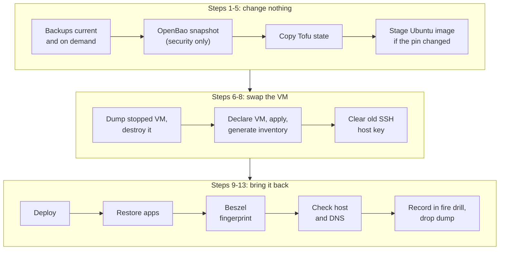

# Rebuilding a host

How a Tofu-built Ubuntu host is destroyed and rebuilt from the repository and
its backups, what each step is run with, and what is still done by hand. The
scripts the steps call are in [`rebuild-tools.md`](rebuild-tools.md); the one host
that cannot take the plain cycle is in [`rebuild-storage.md`](rebuild-storage.md).
Backup and restore mechanics are in [`backup.md`](backup.md) and
[`restore.md`](restore.md), and what a restore proved is in
[`fire-drill.md`](fire-drill.md#results).

## The cycle

Each rebuild is its own pull request. Steps 1 to 5 change nothing on the host
being rebuilt, so run them first and stop if one fails. The dump taken at step 6 is the
rollback until the new host is confirmed healthy: `retire_vm.sh restore` brings it back
as a stopped VM at a 9XX VMID.

| # | Step | Run with | Scripted |
| :-: | :--- | :--- | :-: |
| 1 | Every app of the host has a recent backup on some source | `python3 ansible/scripts/restore_all.py --check --host <host>` | yes |
| 2 | Take an on-demand backup of the host's apps and confirm each archive is in SeaweedFS | [`backup.md`](backup.md#running-a-backup-now) | partly |
| 3 | `security` only: take the OpenBao snapshot. It is not part of the app backup pipeline; the script exits 0 only once R2 and B2 both hold it | `tools/openbao_utils/scripts/snapshot-push.sh <role_id>` ([`openbao-backup-restore.md`](../secrets/openbao-backup-restore.md#running-a-backup)) | yes |
| 4 | Copy Tofu's state to B2 | `tools/tofu_state/state-copy-push.sh` ([State copy](../infra/tofu/state-and-credentials.md#state-copy)) | yes |
| 5 | Prepare and stage the Ubuntu image if the pin or `timezone` changed | [`prepare_image.sh`](../infra/tofu/ubuntu-vms.md#prepared-image), then `scp` to the node | partly |
| 6 | Dump the stopped VM and destroy it, then delete its Kea reservation and lease on the live gateway | [`retire_vm.sh`](rebuild-tools.md#retire_vmsh) `dump` and `destroy`; the reservation by hand | partly |
| 7 | Declare the VM, apply, run the inventory generator | [`vm-provisioning.md`](../infra/vm-provisioning.md#tofu--ansible-handoff) | yes |
| 8 | Remove the old SSH host key from `known_hosts` for the host's name and address | `cd tools && python3 -m rebuild_check.known_hosts <host>` | yes |
| 9 | Deploy | `deploy.yaml --limit <host>,localhost`; `security` first needs [the bootstrap](../secrets/openbao-backup-restore.md#rebuilding-security) | yes |
| 10 | Restore the host's apps | `python3 ansible/scripts/restore_all.py --host <host>` (`--skip step-ca` on `security`) | yes |
| 11 | Set the host's new Beszel agent fingerprint in the hub | [`beszel.md`](../monitoring/beszel.md#rebuilding-a-host) | no |
| 12 | Check the host, then that both DNS servers agree on it | `cd tools && python3 -m rebuild_check.host <host>`; `python3 -m rebuild_check.dns <host>` ([what they check](rebuild-tools.md#what-the-checks-look-at)) | yes |
| 13 | Record the restore in the fire drill, then delete the dump and `fstrim` the pool | [`fire-drill.md`](fire-drill.md#results); [`retire_vm.sh`](rebuild-tools.md#retire_vmsh) `drop-dump` | partly |

Why the order inside the cycle:

- **The Kea reservation goes at step 6.** The new VM holds its address from
  cloud-init. A reservation left in place would hide a failed static
  configuration behind a lease. (`storage` does this later, since its old VM
  outlives the new one.)
- **The image is staged first.** The first apply after a pin change replaces the
  Ubuntu template, which imports the prepared image. A VM cloned from the stock
  image keeps a DHCP address instead of its static one.
- **The host's hand-written DNS record goes in the rebuild's pull request.** The
  `bind9` role generates the `A` record from the inventory and refuses a host
  named both ways ([`bind9.md`](../services/bind9.md#the-host-zone)). The host's
  `ansible_host` and `ansible_user` leave `inventory.yaml` in the same pull
  request, keeping its group membership.
- **`restore_all.py --host` leaves the other hosts' apps alone**, so a rebuild
  never restores over a host that is running.

## Hosts

| Host | VMID | Differs from the cycle |
| :--- | :-: | :--- |
| `play` | 204 | Nothing. A leaf host, so the one to prove the cycle on |
| `storage` | 206 | Built beside the old VM and its buckets copied across: [`rebuild-storage.md`](rebuild-storage.md) |
| `security` | 205 | OpenBao is restored first, from the step 3 snapshot, because the playbooks read their secrets from it. `deploy.yaml` cannot run until OpenBao and step-ca exist on the new VM, so [its own procedure](../secrets/openbao-backup-restore.md#rebuilding-security) replaces step 9: `predeploy.yaml`, then `bootstrap-security.yaml` in three stages with the operator's steps between them, then `deploy.yaml`. `restore_all.py` skips `step-ca`, which the bootstrap restored |
| `services` | 203 | The DNS primary. See [below](#services) |
| `tailscale` | 202 | No Docker and no apps. See [below](#tailscale) |

When several hosts are rebuilt together, order them by what they depend on:
`storage` before `security` and `services`, since every restore reads from it;
`services` before `tailscale`, since its BIND9 serves the zones every other host
resolves through; `tailscale` last, since the router is the maintainer's route
into the lab and the other hosts are reached through it without joining the
tailnet.

A host keeps the vCPU and memory of its module call in
[`tofu/main.tf`](../../../tofu/main.tf). VM disks are on `local-lvm` (NVMe)
sized to what the host uses plus headroom, except `storage`'s, which stays on
`backup` (HDD) so the on-site copy of every backup does not share a disk with the
hosts it protects. The gateway (VM 201) is not part of this cycle; the hosts keep
using the live gateway at `.1` throughout.

### services

`services` is the DNS primary. While its VM is gone nothing renders a zone, and
`storage` answers from the copy it holds
([`bind9.md`](../services/bind9.md#losing-a-server)).

- Run `cd tools && python3 -m rebuild_check.dns` before step 6 and keep its
  output: a pass prints the SOA serial of the host zone and of the lan zone, and
  the two servers must agree before the primary is destroyed. Run it again after
  the deploy. The new primary renders its serials from the clock, so each must be
  higher than before and equal on both servers. A secondary ignores a transfer
  from a primary with a lower serial, and the check then fails and names both.
- The generated record for `services` has the same address as the hand-written
  one it replaces. The `ns1` record in that zone is written by hand, repeats the
  address and stays.
- `kms` and `wastebin` have a `backup` and are restored from `storage`, so their
  row in the fire drill's results also checks that an archive comes back from that
  host. Every other app is rebuilt by the deploy, including `dashy`, whose data
  volume [is not backed up](../../../ansible/inventory/group_vars/all/app_catalog.yaml).

### tailscale

`tailscale` is the subnet router and runs no Docker, so steps 1, 2, 10 and 11 do
not apply and step 9 is `network-infra.yaml`, with a single-use key made in the
console for the run ([`network-infra.md`](../infra/network-infra.md#tailscale-node-configuration)).

- **Run the cycle from the LAN.** While the VM is gone nothing advertises the
  lab's subnet. The Proxmox node joined the tailnet by hand and stays reachable
  over it ([Tailnet policy](../infra/tailnet-policy.md)).
- **The rebuilt node is a new device.** The policy already holds the tag and the
  route's approval. Check the device with `rebuild_check.host` before removing the
  old one in the console: until then the dump's rollback is the old VM with its
  node key.
- **The policy's `hosts` entry for the router** names its tailnet address, so it
  is replaced once the new device is in, or the policy's tests for the router
  test an address nothing holds.
- **It keeps `192.168.20.2`** as a static address from cloud-init under the MAC its
  module derives, and needs no reservation. The gateway's flows name that address.

## Still done by hand

| What | Where it is described |
| :--- | :--- |
| The gateway's Kea reservation and lease, and any alias, rule or forward that names the old address | Step 6 |
| The Beszel fingerprint | [`beszel.md`](../monitoring/beszel.md#rebuilding-a-host) |
| Creating the dump storage, once | [Dump storage](rebuild-tools.md#dump-storage) |
| OpenBao's unseal after any restart of it | [`openbao.md`](../secrets/openbao.md) |
| `rotation-read-watcher` on `security`: its AppRole's `role_id` and `secret_id` can be read and minted only by the `vault-bootstrap` identity, never by the `controller` identity Ansible runs as. `rebuild_check.host security` fails until it is installed | [`openbao-rotation-read-watcher.md`](../secrets/openbao-rotation-read-watcher.md#installing) |
| Fetching and decrypting the step-ca archive for the `security` bootstrap, needed before any secret is reachable | [`openbao-backup-restore.md`](../secrets/openbao-backup-restore.md#rebuilding-security) |
