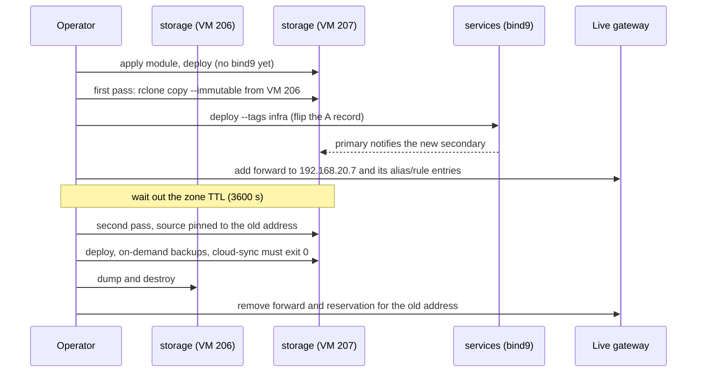

# Rebuilding `storage`

`storage` cannot take the plain [rebuild cycle](rebuild-runbook.md#the-cycle).
SeaweedFS keeps its data in a Docker volume on the VM's own root disk, so
destroying the VM destroys the on-site copy of every backup, and `storage` has to
stay up while every other host is rebuilt. It is built beside the old VM, its
bucket is copied across, DNS is flipped to the new address, and only then is the
old VM dumped and destroyed.

The VMIDs and addresses below are the pair used so far: the old VM at 206
(`192.168.20.6`) and the spare at 207 (`192.168.20.7`). A rebuild runs the
procedure once towards the spare. Moving back so that the VMIDs and addresses stay
contiguous runs it again with the numbers swapped ([Moving back](#moving-back)).

## How the flip works

Every client reaches SeaweedFS by name: `s3.store.<lan domain>` is a CNAME to
`storage.<host domain>`, and the `bind9` role builds that `A` record from
`storage`'s `ansible_host` ([`bind9.md`](../services/bind9.md#the-host-zone)). So
the flip is the `bind9` run on `services` after the generated inventory addresses
`storage` as the new VM. Until then everything that reaches SeaweedFS by name
talks to the old VM, whichever host runs it: the `seaweedfs_bucket` play checks
the old VM's bucket, and the `seaweedfs` remote of `cloud_sync` reads it.

The copy is S3 to S3, not a copy of the Docker volume. It only reads the old VM,
so `storage` stays up, and archive names are never reused, so
`rclone copy --immutable` can be repeated and a second pass adds only what arrived
since the first.



## Procedure

Each step names the pull request or the host it runs on.

| # | Step | Notes |
| :-: | :--- | :--- |
| 1 | Run the cycle's steps 1 and 4 for the apps on every host | Backups current and on demand; Tofu state copy |
| 2 | Add the module call (new VMID, `datastore_id = "backup"`, sizing as the old module) and the `storage` entry of `ansible_hosts`, apply, run the inventory generator | From here `storage` is the new VM to Ansible, and the old VM is reached by its address. Make the [edits below](#edits-in-the-same-pull-request) in the same pull request: the role refuses a host that a static record and the generated one both name |
| 3 | `deploy.yaml --limit storage,localhost`, without `services` | No `bind9` run flips the record yet. The new SeaweedFS starts empty. Its cloud-sync timer reads the old VM by name, so the two timers relay the same archives and `--immutable` makes the second a no-op |
| 4 | First pass, on the new VM | [Copying](#copying) |
| 5 | The flip: `deploy.yaml --limit services,localhost --tags infra` | The `storage` record reads the new address and the primary notifies the new secondary |
| 6 | On the live gateway, by hand: add the new address as a forward server for the host and `lan_domain` zones, and to any alias or rule that names the old address | The gateway forwards to the secondary, which the old VM stops being told about |
| 7 | Wait out the zone's TTL (3600 s), then repeat step 4's copy and check, with `--add-host <the name every client uses>:<old address>` on the `docker run` | After the flip that name resolves to the new VM; without the pin `old` would read the server `new` writes to and every check would pass. List the newest object under each `<host>-<app>/` prefix on both sides |
| 8 | `deploy.yaml --limit storage,localhost` again | The bucket play now checks the new VM. Take each app host's on-demand backup, confirm it landed there, and run `sudo systemctl start cloud-sync.service` there: it must exit 0 |
| 9 | Dump and destroy the old VM as the cycle's step 6 does; remove the forward to its address and its reservation from the live gateway | The old VM stays until every host's on-demand backup has reached the new one and a hand-started cloud sync has relayed it |

### Copying

[`bucket_copy.py`](rebuild-tools.md#bucket_copypy) does what this step describes.
By hand, run the image `cloud-sync.service` runs, with its hardening flags, on the
`caddy-proxy` network.

| Remote | Identity | Endpoint |
| :--- | :--- | :--- |
| `old` | `cloud-sync-reader` | The name every client uses (still resolves to the old VM until the flip) |
| `new` | The admin identity | `http://seaweedfs:8333`, the new VM's SeaweedFS reached past Caddy and DNS |

Both come from `RCLONE_CONFIG_OLD_*` and `RCLONE_CONFIG_NEW_*` variables in a
`0600` env file that is removed afterwards, with `type` `s3`, `provider` `Other`
and `force_path_style` `true` as the rendered `rclone.conf` sets:

```sh
docker run --rm --network caddy-proxy --env-file <env file> \
  --cap-drop ALL --security-opt no-new-privileges:true --read-only \
  <the cloud-sync image> copy --immutable old:homelab-backups new:homelab-backups
```

Then `rclone check --size-only old:homelab-backups new:homelab-backups` with the
same flags reports no difference. Size only, because an object written in parts
may not keep its ETag.

### Edits in the same pull request

| File | Change |
| :--- | :--- |
| `host_vars/services.yaml` | Delete the `storage` record; the role generates it |
| `inventory.yaml` | Keep `storage` in its groups and drop its `ansible_host` and `ansible_user` |
| `group_vars/all/main.yaml` | `dns_secondary_address` |
| `sos-inventory.yaml` | The `storage` address |
| `opnsense_gateway`'s defaults | `host_storage` and the second forward server |

`ansible/tests/test_opnsense_policy.py` fails when `sos-inventory.yaml`, `dns_secondary_address` and the gateway defaults disagree.

### Checks that need the lab

Before step 4:

- The new VM holds its address from its cloud-init configuration and not from a
  lease. A Kea reservation left for another host would hide a missing prepared
  image the same way.
- Which aliases, rules and reservations on the live gateway name the old address.

At step 8, since only then does `cloud_sync` read the copied archives: the relay
finds each one equal to the cloud's copy. It compares modification times, and
rclone keeps the original in object metadata when it copies. `--immutable` refuses
a difference without uploading, so a failure there changes nothing in the clouds.

### Rolling back

Until step 9 the flip is undone by removing the `ansible_hosts` entry,
regenerating, restoring the static record and `dns_secondary_address`, and
repeating step 5. An archive that reached the new VM meanwhile is copied back with
step 4's command reversed.

## Moving back

The same copy and flip run again with the numbers swapped: the spare is the old VM,
the new one is VMID 206 at `192.168.20.6`, and the edits above go back to
`192.168.20.6`. What differs:

- The spare's module is renamed `storage_old` with a `moved` block and applied on
  its own, since a `moved` block cannot name an address that is still declared. The
  next apply adds `module "storage"` at VMID 206 and publishes it as the `storage`
  entry of `ansible_hosts`; `storage_old` is not published.
- `old` is the name every client uses until the flip, and the spare behind it. The
  repeat copy after the flip pins that name to `192.168.20.7` with `--add-host`.
- The spare is stopped and dumped with `retire_vm.sh dump 207 storage`, then
  destroyed by removing `storage_old` from the root module and applying, so Tofu's
  state does not keep a VM that is gone. The gateway's forward to `192.168.20.7`
  goes with it.
