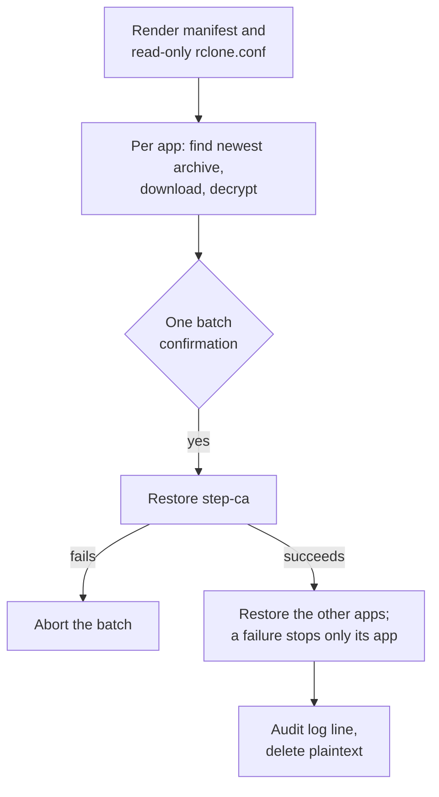

# Restore: Recovering from a Backup

For the backup design this restores from — encryption, what's covered —
see [`backup.md`](backup.md), and [`backup-threat-model.md`](backup-threat-model.md) for the threat model it's built against.

`playbooks/restore.yaml` wraps `ansible/roles/restore`: extracts a
decrypted archive into one or more named volumes, stopping and
redeploying the app's compose stack around it. It's a single play
(`hosts: managed_hosts`, validation `delegate_to: localhost` inline) —
splitting validation into a separate controller-only play silently skips
it under `--limit <group>`. For the same reason it can't
`import_playbook` the secrets bootstrap; pass it as a separate file on
the command line instead (see below).

## Safety gates

Two gates block the destructive steps, each covered by a
[Molecule scenario](../testing/molecule-testing.md) asserting the actual side effect
(container `StartedAt`, volume content), not just exit code:

- **Required vars** — `restore_app`, `restore_archive_local_path`,
  `restore_volumes`, and the archive existing on the controller.
- **Human confirmation** — a `pause` prompt. `restore_confirm` is a
  three-state signal (undefined → real prompt; `true`/`false` → `-e`-only,
  deterministic) so automated runs without a tty fail closed by default.

## Running a restore

```sh
# paste alone; it waits for the decrypted archive's path (from the manual steps below)
read -r -p 'archive: ' archive
```

```sh
# from ansible/; asks for yes before it touches anything
ansible-playbook playbooks/bootstrap-secrets.yaml playbooks/restore.yaml \
  -i inventory/inventory.yaml -i inventory/tofu-hosts.yaml --limit services,localhost \
  -e "{\"restore_app\": \"kms\", \"restore_archive_local_path\": \"$archive\", \"restore_volumes\": [\"kms_data\"]}"
```

Pass the three variables as **one JSON-object `-e` argument**. With separate
`key=value` pairs (`-e restore_volumes='["kms_data"]'`) the value stays a string:
Ansible parses `-e` as JSON only when the whole argument is a JSON object. The
confirmation prompt then spells the volume name out character by character, so read
it before typing `yes`. A run with `restore_confirm` set shows no prompt to read.

Each archive holds exactly one app (one schedule = one app — see
[Architecture in `backup.md`](backup.md#architecture)),
so `restore_volumes` only ever needs to list that one app's own volumes.

### Manual steps first

The private key never touches a homelab host:

1. Pull the object from the `homelab-backups` bucket, normally from SeaweedFS
   (filer UI, or an S3 client against `https://s3.store.{{ lan_domain }}`). If
   `storage` itself is lost, pull the same object from R2, B2 or OCI, whichever
   has it, through that provider's console or CLI: `cloud_sync` copies it
   verbatim. `cloud_sync_targets` in `host_vars/storage.yaml` names each bucket;
   keep a note of the buckets and regions somewhere that survives losing
   `storage`.
2. Decrypt it into a plain `.tar.gz` (`.tar` for an app with
   `compression: none`):

   ```sh
   # paste alone; it waits for the downloaded object's path
   read -r -p 'encrypted archive: ' enc
   ```

   ```sh
   # gpg may ask for the passphrase; the plaintext goes to your home directory, mode 0600
   archive="$HOME/$(basename "$enc" .gpg)"
   (umask 077; gpg --output "$archive" --decrypt "$enc")
   ```

3. Point `restore_archive_local_path` at that file, as above, and delete it once
   the restore is confirmed:

   ```sh
   shred -u "$archive"
   ```

### What the playbook does

In order:

1. Copies the archive to the target host.
2. Stops the app.
3. Extracts into a scratch volume.
4. Matches each name in `restore_volumes` against the archive's
   directory structure.
5. Copies it over the live volume.
6. Cleans up and redeploys.

A failure after step 1 still removes the copied archive and the scratch volume.

It pauses for `yes` before touching anything.

For `lldap` (multiple volumes in one archive), same rule — one
JSON-object `-e`:

```sh
-e '{"restore_volumes": ["lldap_data", "lldap_certs"]}'
```

## Batch restore (all apps, disaster-recovery scenario)

`ansible/scripts/restore_all.py` is a thin orchestrator over the per-app restore
above, for losing `services`, `security` or `play` outright. It finds each app's
latest backup, decrypts it and calls the same `restore.yaml` once per app, so the
per-app gates still apply. A single-app restore should still use the playbook.

In scope is every app with a `backup:` key in `app_catalog.yaml`, the same test
`backup_agent` uses. To keep a backed-up app out of batch runs, add it to
`restore_discovery_excluded_apps` in
`ansible/roles/restore_discovery/defaults/main.yaml`.

```sh
python3 ansible/scripts/restore_all.py            # interactive: one batch summary, one 'yes'
python3 ansible/scripts/restore_all.py --yes      # unattended (fire-drill automation, etc.)
python3 ansible/scripts/restore_all.py --host security --skip step-ca   # one rebuilt host
```

| Option | Effect |
| :--- | :--- |
| none | Every host's apps: the lost-everything case |
| `--host` | That host's apps only. Use it after a rebuild, since a restore stops and overwrites live apps. Repeatable |
| `--skip` | Leaves an app out, such as `step-ca` on a rebuilt `security`, restored by hand before `deploy.yaml` could run. Repeatable |
| `--yes` | Skips the batch confirmation |
| `--check` | Read-only: lists each app's newest backup on every source with its age, and exits non-zero when an app has no source within `--max-age-hours` (30). Also warns, without failing, when an archive's modification time is over an hour from the instant its name stamps |

A name the manifest does not hold stops the run before discovery, as does a
selection that leaves nothing. The summary names the hosts in scope before the
single `yes`. `step-ca` gates the batch only when the run covers it.

Run it on the controller only, the same trust requirement as everything in
[the backup threat model](backup-threat-model.md): the GPG private key has to be
there and decryption has to work without a prompt (gpg-agent already unlocked, or
a passphrase-less key).

What it does, in order:



1. Renders a controller-local manifest + a read-only `rclone.conf`
   (`ansible/roles/restore_discovery`, via
   `playbooks/restore-discovery-setup.yaml`) — app → host → volumes →
   cloud fallback target(s) → the host's `server_timezone`, in which its archive
   names are stamped, so an archive's age is read correctly — the same `app_catalog`/`host_vars`
   resolution `cloud_sync` already does for its own upload side, so the
   two can't drift apart. The rclone identities are the SeaweedFS
   `cloud-sync-reader` identity and the six cloud **read**-leaf
   credentials from `docs/topics/security/cloud-credentials/creation.md` — nothing here
   can write to SeaweedFS or any cloud target.
2. For each in-scope app: lists `seaweedfs:homelab-backups/<host>-<app>/`
   (the exact `AWS_S3_PATH` prefix `backup_agent`'s own
   `schedule.env.j2` uses). If that fails outright (SeaweedFS/`storage`
   unreachable) or lists no objects (a rebuilt `storage` with an empty
   bucket), falls back to that app's own cloud target(s) — the
   `cloud_targets` of its `backup_plan` entry, the same list
   `cloud_sync` fans out to, so a fallback only ever tries a bucket the
   app was actually relayed to. Whichever remote answers, it picks the
   newest object by `BACKUP_FILENAME`'s embedded timestamp (not
   directory-listing order or upload mtime), downloads it, and
   `gpg --decrypt`s it.
3. Prints one batch summary — app / host / source (`seaweedfs` or the
   cloud target name) / object key / timestamp — for every app it
   could discover, and lists anything it couldn't. Asks for a single
   `yes` (skipped with `--yes`). Nothing destructive has happened yet
   at this point.
4. Restores `step-ca` first via the real `restore.yaml`
   (`restore_confirm=true`, since the batch-level confirmation above
   already covers it) — `lldap`/`tinyauth` read its root cert on
   deploy (`deploy.yaml` Play 6), so a step-ca restore (or discovery)
   failure aborts the whole batch before touching anything else.
5. Restores the remaining apps, each via the same `restore.yaml` call.
   `minecraft` gets a second step afterward —
   `playbooks/restore-minecraft-world.yaml`, which runs
   `docker/minecraft/scripts/run_restore.sh -y` on `play` (see below). The
   playbook refuses to run without `-e restore_world_confirm=true`, which
   the batch passes after its own confirmation.
   A failure in any one of these is independent and doesn't block the
   rest; only step-ca's failure aborts everything.
6. Appends one line per app to
   `ansible/files/restore/audit-log.jsonl` (git-ignored, same as
   `ansible/files/secrets/`) — object key, timestamp, and outcome —
   and deletes the decrypted plaintext from its own scratch directory
   once that app's `restore.yaml` call has finished, success or not.
   Whatever is still decrypted when the run ends early (a missing
   step-ca, a declined prompt, a step-ca failure, an error or Ctrl-C) is
   deleted on the way out.

### Known limitations

**Compression:** the `restore` role reads the decrypted archive's own
leading bytes and extracts a gzip archive (`compression: gz`) or an
uncompressed tar (`compression: none`, as `minecraft` uses). An archive
that is neither, such as `compression: zst`, is refused before anything
is stopped.

**Empty listing:** `rclone lsjson` exits 0 with `[]` for a prefix with
no objects in an existing bucket, and non-zero only for a missing bucket
or an unreachable endpoint. `restore_all.py` therefore treats a failed
listing and an empty one the same way and moves on to the next remote.
An app is reported as "no objects found" only when SeaweedFS and every
cloud target of that app were unreachable or empty; the error names each
remote and which of the two it was.

Unverified: `rclone copyto`'s 20-second IO-idle timeout (not a
total-transfer cap — set in `_run_rclone`, `ansible/scripts/restore_all.py`)
could mistake a brief-but-legitimate stall on a slow or high-latency
link for a stuck download, on a large archive over a weak connection.
Worth watching for on the first real restore over anything other than
a fast LAN link.

For a fire drill proving the whole path end to end against real
infrastructure, see [`fire-drill.md`](fire-drill.md).

For `minecraft`, restoring `minecraft_backups` only gets you the on-host
`mc-backup` tar window — unpacking the newest tar into `minecraft_data`
needs `itzg/mc-backup`'s `restore-tar-backup` entrypoint as a second
step, deliberately kept out of Ansible:
`docker/minecraft/scripts/run_restore.sh` (deployed alongside the app,
see `app_catalog.yaml`), runs directly on the `play` host. For the
common case — undoing today's session from last night's on-host
snapshot — that script alone is the whole restore, no backup archive
or the `restore` role involved at all. It checks that the newest tar
reads cleanly, asks for a second confirmation (skipped by `-y`), stops
the stack, deletes everything in `minecraft_data` and unpacks the tar
into it. The delete is part of the restore: `restore-tar-backup` only
extracts into an empty directory. If the restore fails after the delete,
the stack stays stopped rather than starting an empty world; fix the cause
and run the script again. Run it after this playbook only
when `minecraft_backups` itself needed reconstituting first (host disk
loss). See the script's own header for both usages.
