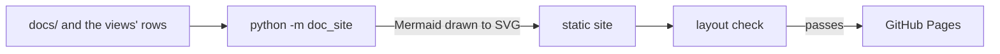

# The doc site renderer

`tools/doc_site` turns the repository's docs and the three generated views ([`project-planning`](https://wenenhoe.github.io/homelab/project-planning/), [`decision-index`](https://wenenhoe.github.io/homelab/decision-index/) and [`dr-coverage`](https://wenenhoe.github.io/homelab/dr-coverage/)) into a small static site, built from `main` and deployed on every push ([ADR 0117 (Generated doc views)](../../decisions/0117-delivering-the-generated-doc-views-to-readers/revision-000.md), [ADR 0119 (Docs as site pages)](../../decisions/0119-reading-the-documentation-tree-away-from-github/revision-000.md)). The views are not committed: a checkout writes them with the `generate-doc-indexes` hook ([`pre-commit.md`](../engineering/pre-commit.md)).



## Building the site

To read or check the site on this machine, from `tools/`:

```bash
uv run python -m doc_site --serve
```

It builds into a temporary directory outside the checkout, serves it at `http://127.0.0.1:8000/` and removes it on Ctrl-C, a closed terminal or `kill`. `--port` chooses another port. A change to a file shows after a restart.

To keep the built files, for the [layout check](#the-layout-check), build into a new directory:

```bash
cd tools
site=$(mktemp -d)
uv run python -m doc_site --commit "$(git rev-parse HEAD)" --out "$site"
```

- `--out` must be empty or absent. `--commit` takes a full commit id, whose date the command looks up; without it the footer says "Local build".
- A build with a diagram to draw needs Google Chrome and `playwright`.
- With no network, `uv run --offline` builds from what an earlier `uv sync` fetched. A link to a file that has no page goes to GitHub, so it does not open.
- Run it on the [workstation](../engineering/workstation.md): a build needs no credential.
- A build reads only the tree and the commit it is given (no clock, git state or network), so two builds of one tree and commit give the same bytes, which a test holds.

| Source | Page |
| :--- | :--- |
| `docs/README.md` | `/`, the home page |
| a generated view | `<view>/` |
| a project | `projects/<name>/` |
| a topic doc | `topics/<path>/` |
| a decision revision, and `removed.md` | `decisions/<lineage>/<revision>/`, `decisions/removed/` |
| an architecture doc | `architecture/<name>/` |
| a section's README | the section's address |

`TEMPLATE` files have no page.

## Previewing a series

After the [replay](../engineering/landing-a-series.md#replay), a layer's branch holds its changes and those of the layers before it. Building it runs that branch's `tools/`, so read a patch that changes them first. From `tools/`:

```bash
# paste alone; it waits for the layer's slug
read -r -p 'series slug: ' slug
```

```bash
git switch --detach "series/$slug"
```

```bash
uv run python -m doc_site --serve
```

```bash
# once the preview is stopped
git switch -
```

`--detach` leaves the branch itself free: a kept branch that is checked out stops the next replay.

## Design principles

Where a choice about a page is open, these decide it.

| Principle | What the site does |
| :--- | :--- |
| **Content first, no script needed** | A page is complete without JavaScript and, apart from its layout, without the stylesheet. The script only adds the row filter, the menu's open button and the copy buttons, and closes the contents list on a narrow screen |
| **One source, two outputs** | The site adds navigation (menus, breadcrumbs, contents lists, tabs), never content. A page says what its file says, and links to it |
| **Show where you are** | A breadcrumb, the page's own entry in the navigation, and a contents list of its headings |
| **Orient, don't hide** | Show a page's shape rather than folding its narrative away. Only a list of links is tabbed, by a rule that names the one page |
| **Every state has an address** | A heading, a tab and a view's section open from their anchor. A filter's text has no address |
| **Readable measure, one column** | See [the stylesheet](#the-stylesheet) |
| **Targets and contrast** | Menu, contents and tab links and copy buttons are at least 44 pixels tall; colours come from one set of tokens, light and dark. No check measures either, so read a page on a phone |

## Generated views

`doc_scripts/generate_doc_indexes.py` builds each generated section as rows (`doc_scripts/view_model.py`): a `Table`, a `Note` where a table would be empty, `Groups` (a heading over several tables) or a `Grid` (numbers ten to a row). The views' markdown and the site's HTML are both formatted from those rows. A cell holds a link, an inline code span or bold text, with `|` escaped; `doc_site/markup.py` refuses anything else, so a view that gains it fails the build instead of showing wrongly. From 992 pixels wide, code in the cell that titles a row wraps only between words, so a column never cuts a name.

Each view's `# Title` and introduction come from [`tools/doc_scripts/view_intros/`](../../../tools/doc_scripts/view_intros). On the page the introduction is split:

| Paragraph | Shows as |
| :--- | :--- |
| Opens with a section's name in bold (`**Roadmap** has ...`) | that section's caption |
| The first other one | the lede under the title |
| The rest, including one whose section was renamed | a "How to read this page" disclosure |

An introduction holds no `##` section, which the build refuses because the page would drop it. Its links are written for the view's place in `docs/`, where the drift checks read them.

| Part | Behaviour |
| :--- | :--- |
| Counts strip ([`summary.py`](../../../tools/doc_site/summary.py)) | On the planning page and decision index, each count links to its section and is counted from that section's rows. A missing section shows 0 and no link |
| Roadmap chips | Each project in the In progress, Startable and Waiting columns is a chip coloured by column, with an "unblocks N" badge. A cell that is not a list of project links shows as text |
| By number grid | One row per ten numbers (`011x`). A cell links a lineage's current revision, `0030 → 0104` for a merged number, the removal ledger for `demoted` or `dropped`; a dash is a free number. On a phone each row breaks in two |
| By topic | Tabs without a script: the stylesheet shows the panel the address names, or the first. A filter shows every group with a match, and all groups show with no stylesheet |

## Document pages

A document page is a repository file shown as it reads on GitHub. `doc_site/documents.py` reads it with `markdown-it-py` (CommonMark) and refuses raw HTML and images, naming the file and line; an HTML comment is dropped. The `check-doc-drift` hook imports the site to read its anchors, so a library the renderer imports is also pinned in that hook's `additional_dependencies` in `.config/.pre-commit-config.yaml`.

| Element | On the page |
| :--- | :--- |
| First top-level heading | the title |
| Project front matter | status pill, blocked flag, parent project, decision, the projects it waits on, summary as lede |
| Decision header | lineage and revision, state, `light` weight, what it supersedes and is superseded by, narrowed, relied-on and related lineages, and the projects naming it. A removed lineage is named, not linked |
| Superseded revision | a notice naming the successor |
| A lineage with several revisions | all of them listed with state; the current and the one being read marked |
| End of a decision page | links to the decisions before and after by number |
| `##` and `###` headings | GitHub's anchors, listed in the menu |
| Four or more menu headings | an "On this page" list, and where it is not beside the prose a link back to it at each `##` |
| A link to a page of the site | stays on the site, anchor kept; any other file goes to GitHub |
| `[ ]`, `[x]` list items | disabled checkboxes |
| Tables | cards on a phone, each cell labelled; a `Status` cell is a pill. From 992 pixels wide the first cell of a row is semibold and tinted, unless the table has one column or its first is `#`. In a table of two or three columns a code span in that cell wraps only between words, save a word over 40 characters |
| Code blocks | wrapped, with a copy button |

- **Contents list.** A `<details open>`, so it needs no script. From 1040 pixels wide it sits beside the prose and stays on screen, scrolling on its own when it is taller than the window, and the headings' links back to it are hidden; below that it is above the prose, where the script closes it. A heading with the anchor `on-this-page` stops the build. The home page, the views and the Topics index have none.
- **Copy button.** Added in the top right corner where the browser has a clipboard (HTTPS or `localhost`). Its icon turns into a tick, or a cross if the write is refused, with the same said to a screen reader. It copies the block without the final newline, so a pasted last line is not run. Blocks are written to be pasted whole ([`AGENTS.md`](../../../AGENTS.md#command-blocks-for-the-operator)).
- **Navigation.** Planning, Projects, Decisions, Topics, Architecture and DR coverage; the home page has a tile for each.
- **Section landings.** Projects opens on a list of projects by status and initiative, above its README; Decisions on the decision index, with the README as a guide in the breadcrumb; Topics and Architecture on their READMEs.
- **Breadcrumb.** The section, then where the page is in it, then the section's guide if it has one.
- **Topics tabs.** Each `##` group of the Topics index is a tab, made from the README's own headings, with the same filter and no-stylesheet behaviour as By topic. `TABBED_DOCUMENTS` in `site.py` names this one page.

## Diagrams

A Mermaid block is drawn to SVG during the build, so a reader needs no script. `doc_site/diagrams.py` runs the vendored bundle in headless Chrome, in an empty page with every request refused, at Mermaid's strict security level.

- Each diagram is drawn in the light and dark themes, and the stylesheet shows the one `prefers-color-scheme` asks for.
- A diagram that does not draw stops the build with the file, the fence's line and Mermaid's message.
- The seed for node outlines is fixed, which keeps builds reproducible.
- The build and the [layout check](#the-layout-check) start Chrome with its sandbox on (`doc_site/chrome.py`), except as root, where Chrome cannot start with it.
- The block's source is not shown, and a diagram is scaled to its column. Where that shrinks it, a "Full size" box above it draws it at its own width in a canvas that scrolls; the stylesheet reads the box, so it needs no script.
- `page_anchors`, which the drift check calls, draws nothing.

## Anchors and links

Every heading has the anchor GitHub gives it: lowercase, everything but letters, digits, spaces, hyphens and underscores removed, spaces as hyphens, a repeat numbered `-1`, `-2`. Docs that link to a section of a view therefore reach the same section on the site. A link from one view to another goes to its page, with the anchor kept; a link to any other file goes to it on GitHub.

## The stylesheet

Pages use [Simple.css](https://simplecss.org/) (MIT) and diagrams use Mermaid, both vendored: nothing is fetched at build time or by a reader's browser. `site.css` and `site.js` in `tools/doc_site/assets/` are this repository's.

Prose (paragraphs, lists, quotes, headings, the lede) keeps one reading measure; tables, code blocks and figures use the width of the column they are in.

| Page | Column |
| :--- | :--- |
| A document page with its contents list beside the prose | the page's width, less the list's column |
| Any other document page, the home page among them | at most 53rem, centred |
| A generated view | the page's width; its lede, captions and legend run as wide as its table |

| | Simple.css | Mermaid |
| :--- | :--- | :--- |
| File in `tools/doc_site/vendor/` | `simple.min.css` | `mermaid.min.js` |
| Pin | `simple.pin` | `mermaid.pin` |
| Licence | `simple.LICENSE` | `mermaid.LICENSE` (an update does not rewrite it) |
| `--upstream` compares with | the npm tarball and the repository's `v<version>` tag | the npm tarball only (`source = registry`: the bundle is not committed upstream) |

A pin names the package, version, file, the file's sha256 and the source repository. A test fails when a committed file's hash differs from its pin, and the build checks the bundle's hash before running it. From `tools/`, check both pins against upstream (nothing is extracted):

```bash
uv run python -m doc_site.vendor --upstream
```

Renovate moves only a pin's `version` line, so its pull request fails the pin test until the file and hash are updated together. `--update` writes nothing when the tarball and tag differ. Use `mermaid` for the other pin:

```bash
pin=simple
read -r -p 'version on the pin line Renovate changed: ' version && uv run python -m doc_site.vendor --pin "$pin" --update "$version"
```

Both files are kept byte for byte as published, so `end-of-file-fixer` and `trailing-whitespace` skip `tools/doc_site/vendor/`. The drift check's anchor scan skips `tools/tests/doc_site/`, whose fixtures link to files that exist only in temporary trees.

## What each page carries

- **Footer:** the commit it was built from, linked, with its date in UTC, and the Simple.css credit with its licence (`assets/simple-licence.txt`, since the vendored file carries no notice). Pages are cached for about ten minutes, so compare the footer with `main` when one looks old.
- **Asset names:** each file in `assets/` is named with part of its sha256, so an old page never gets a new stylesheet or the reverse. The licence keeps its name.
- **Integrity:** the stylesheet's `<link>` has a sha384 `integrity` computed from the bytes written, so an update needs no second step. A test holds it to the file.

## The layout check

With the site built above, from `tools/`:

```bash
uv run python -m doc_site.layout "$site"
```

It serves the site on `localhost` and opens every page in headless Chrome at each size of `VIEWPORTS` in [`layout.py`](../../../tools/doc_site/layout.py) (portrait phones, a small tablet, a wide screen and a landscape phone); a page with a contents list or tabs also at each of `WIDE_VIEWPORTS`, the narrowest width with the list beside the prose among them. It needs Chrome and `playwright` and downloads nothing. Every error names the page, width and element.

A page fails when:

- it scrolls sideways, or an element ends past the right edge;
- a block, table cell or card cell holds text wider than itself;
- visible text is under `MIN_FONT_PX` (text hidden for screen readers is not measured);
- a sticky or fixed bar takes more than `MAX_BAR_SHARE` of the height (the header is not sticky on a short screen);
- a link to a heading leaves the heading under such a bar (`scroll-padding-top` prevents this);
- the menu button opens nothing, or the open drawer breaks a rule above.

The sample run opens a fixed set (the home page, the pages one directory deep, one page of each section and the largest page with a contents list), which `MAX_SAMPLE` bounds and a test holds. `--changed` adds the page of each document a file of paths names, and every page if a path is under `tools/doc_site/`:

```bash
changed=$(mktemp)
git diff --name-only origin/main...HEAD > "$changed"
uv run python -m doc_site.layout --sample --changed "$changed" "$site"
```

The check cannot see a layout that measures well and reads badly, such as words broken mid-word in a narrow column. A script calling `check` itself needs an `if __name__ == "__main__"` guard, as the browsers run as new processes.

## Publishing

[`pages.yml`](../../../.github/workflows/pages.yml) runs on every push to `main` and on demand.

| Job | Permissions | Does |
| :--- | :--- | :--- |
| `build` | read-only | builds, runs the full layout check, then uploads the Pages artifact, so a broken layout is never deployed |
| `deploy` | `pages: write`, `id-token: write`, no `contents` | runs no repository code; deploys in the `github-pages` environment |

- One run goes at a time and one waits; a newer one replaces the waiting one, and a started run is never cancelled mid-deployment.
- [`test_pages_workflow.py`](../../../tools/tests/doc_site/test_pages_workflow.py) fails `contents: write`, other deploy permissions, a layout check not between build and upload, and an unpinned action.
- Two settings live on GitHub, not in the workflow: the Pages source is GitHub Actions, and the `github-pages` environment accepts only `main`.

On a pull request, the `doc-site` job of `pr-checks.yml` runs the same build when the renderer, the generator or what they read changed, which includes every doc ([change scoping](../engineering/ci/change-scoping.md)). It checks the sample plus the changed documents, or every page when the renderer changed. It deploys nothing. A fault on a page it does not open is caught by the deploy's full check.

## Linking a view

A doc links a generated view through its page on the site, `https://wenenhoe.github.io/homelab/<page>/`, with the same `#anchor` it would have used on the file: `project-planning/`, `decision-index/` or `dr-coverage/`. A link to the file's path fails the drift check, and so does a link to a page that does not exist or to an anchor that no heading on the page has ([the check](doc-checks.md)). This holds for a link to a document's page (`topics/<group>/<doc>/`, or `topics/#<group>` for a tab of the Topics index) as for a view's, and an anchor can be a heading's, a section's or `on-this-page`, the list of a long page. The anchors are the ones GitHub gives the headings, so a link that worked on the file works on the page. The site is a minute or so behind a merge, so a link to a heading added in the same pull request reaches the page once the deployment has finished, and the drift check, which builds the pages from the tree, accepts it before then.

A table row's details are on the page it names, not behind its own link: the coverage table has no per-app anchors, and a doc that needs one app's row names the app.
