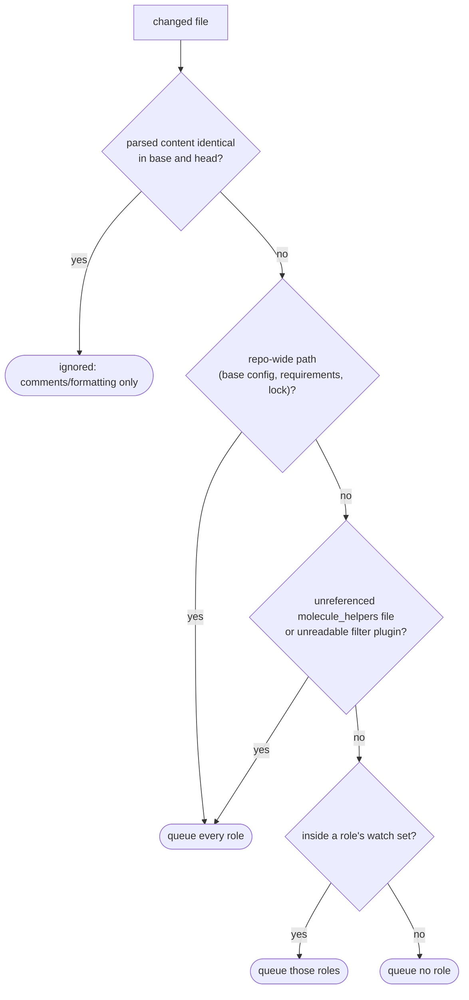

# CI Change Scoping

How `detect-changes` decides which jobs a PR queues: the scoped outputs it feeds them, each Molecule role's watch set, and the comment-only and formatting-only changes that queue nothing. The jobs and how they fit together are in [CI: PR Checks](pipeline.md#jobs).

## Change-scoped, not a full sweep

`detect-changes` diffs the PR's base and head and feeds most jobs a scoped input, so a docs-only PR runs no Molecule or boot test. `pre-commit-checks` always runs, since its hooks span nearly every file type. The path filters' exact globs, each with its reason, are in [`detect-changes-filters.yml`](../../../../.github/detect-changes-filters.yml); this table says what each output is for.

| Output | Set when this changes | Comment-only changes ignored |
| :--- | :--- | :--- |
| `roles` | A file in a Molecule role's [watch set](#molecule-watch-sets), or a repo-wide path | yes |
| `compose_apps` | An app's compose file, `Dockerfile`, `configs/` or `scripts/`, minus the exclusion list. The boot test's own scaffolding queues `lldap`, which runs all of it | no |
| `dockerfiles` | An app's `Dockerfile` or image smoke test, excluded apps included ([Dockerfile changes](gates.md#dockerfile-changes)) | no |
| `excluded_compose` | A compose file (not a `.j2` template) of an excluded app that still exists ([compose boot-test](gates.md#compose-boot-test)) | no |
| `deploy_ordering` | The inventory, playbooks, the `secrets` and `restore` roles, the ordering gate and its fixtures, the lockfile | yes |
| `uv_lock` | `pyproject.toml` or `uv.lock` | yes |
| `ansible_lint` | `ansible/`, the ansible-lint config or the pre-commit config | no |
| `trivy_ansible` | `ansible/` | no |
| `release_checksums` | The checksum verifier and keys, or a file holding a pinned hash or apt key fingerprint ([release checksum check](release-checksum-check.md)) | no |
| `image_provenance` | The provenance checker and keys, or a file that can pin an image ([provenance check](image-provenance-check.md)) | no |
| `python_unit_tests` | Controller-side Python and what its tests read: `tools/`, `ansible/tests/`, scripts, filter plugins, shared modules, workflows, the shard table, the lockfile | yes |
| `mermaid_check` | A `.md` file or [`check_mermaid.py`](../../../../tools/doc_scripts/check_mermaid.py), which holds the image pin ([Mermaid render check](../../documentation/doc-checks.md#mermaid-render-check)) | no |
| `renovate_config` | `renovate.json5`, `renovate.yml` or the check ([validating the config](renovate.md#validating-the-config)) | no |
| `doc_site` | The renderer, the generator and what it reads (all of `docs/`, the inventory), `pages.yml`, the lockfile ([publishing](../../documentation/doc-site.md#publishing)) | no |
| `tofu` | Anything under `tofu/`, the provider lock included ([`tofu-checks`](pipeline.md#jobs)) | no |
| `shell_tests` | A `.sh` or `.sh.j2` file or the shell tests and their tooling ([in CI](../../testing/shell-tests.md#in-ci)) | no |
| `shell_test_pins` | The Bats pins or their verifier; gates the pin check inside `shell-tests` ([where it runs](../../testing/shell-test-pins.md#where-it-runs)) | no |

`compose_apps` is computed by [`compose_apps.py`](../../../../tools/ci/scope/compose_apps.py), the one reader of the exclusion list. A directory with no compose file is not an app. The `compose` role stages `configs/` and `scripts/` before the stack boots, and the boot test builds the `Dockerfile` in place of the published image, so each changes what it exercises.

A few paths queue *every* role: `ansible/requirements.yml`, `pyproject.toml` and `uv.lock` (which pin `ansible-core`), `.config/molecule/`, and everything that base config points scenarios at (`molecule_helpers`' requirements files, `ansible.cfg`, the coverage callback plugin). The last group is read from the config on each run (`base_config_paths`), not listed.

### Molecule watch sets

How a changed file becomes a queued Molecule role:



[`molecule_scope.py`](../../../../tools/ci/scope/molecule_scope.py) builds each role's watch set from what its scenarios reference, and queues the role when a changed file falls inside it. Each queued role's log line names the file and why it matched. Tests are in `tools/tests/ci/scope/`.

| In the watch set | Detail |
| :--- | :--- |
| The role's own directory | everything under it |
| Every role it runs | `include_role`, `import_role`, play `roles:` and `meta` dependencies, followed in turn. The whole included role is watched, whatever `tasks_from` names. A role with no scenario is watched, never queued |
| Filter plugins it calls | A plugin in `ansible/filter_plugins/` defining a name used in the watched files. Names come from the dict literal `FilterModule.filters()` returns, read without import and matched whole |
| Shared modules it imports | `ansible/module_utils/` imports found by reading watched Python as text, followed through modules that import others |
| `molecule_helpers` task files | Those a scenario includes, followed through further includes. `resolve_compose_apps.yaml` runs `compose`'s `preinit.yaml`, so its consumers watch `compose` and the `resolve_apps` filter |
| Paths in `molecule.yml` | Each `${MOLECULE_PROJECT_DIRECTORY}/...` path, such as the shared prepare playbooks |
| Symlink targets under `molecule/` | Scenarios link real `docker/<app>/` files and fixtures, and git reports the target |
| Files read through `playbook_dir` | `playbook_dir ~ '/../x'` and the like, also through a variable defined from it (`project_root`, `repo_root`). A deleted target still queues the scenario. A variable used only as a base contributes the files joined to it, not its directory |

The last row is how files such as `app_catalog.yaml`, `restore_all.py` and `docker/openbao/policies/controller.hcl` reach the scenarios that read them. Because a scenario linking `docker/seaweedfs/` files is queued when they change, that app's [boot-test exclusion](gates.md#compose-boot-test) stays correct.

Fail-safes queue *more* when the scanner cannot tell who is affected:

| Changed file | Queues |
| :--- | :--- |
| Under `molecule_helpers/`, referenced by no scenario | every role (a deleted one: none) |
| Under `filter_plugins/` with unreadable names (deleted, nested, not `.py`, or built other than a dict literal) | every role; a readable plugin nobody calls queues none |
| Under `module_utils/` that is not an existing top-level `.py` | every role; a module nobody imports queues none |
| A repo-wide path (`GLOBAL_PATHS` and the base config's paths) | every role |

A reference the scanner cannot resolve (a templated `include_role` name, a missing role or `tasks_from` file, a dangling symlink) fails `detect-changes` instead of being skipped. Left out on purpose: the roles directory, the coverage output, and the coverage thresholds and `molecule_cov` package, which the gate reads after the scenarios run and `pytest` covers. Not modelled: paths built any other way, and paths that leave the repository or are the role's own directory or an ancestor.

### Comments and formatting don't queue Molecule

Before any matching, `detect-changes` drops a changed file whose *parsed* content is the same in base and head ([`semantic_diff.py`](../../../../tools/ci/scope/semantic_diff.py)). A comment or reformat queues no role and trips no fail-safe, and the log says `comments/formatting only -> ignored`.

The same rule gates `uv_lock`, `deploy_ordering` and `python_unit_tests` ([`effective_changes.py`](../../../../tools/ci/scope/effective_changes.py)): true only if a matched file changed for real. `ansible_lint` and `trivy_ansible` are never gated, because they read comments (`# noqa`, `#trivy:ignore`).

What the parser produces is compared, so a `#` line inside a YAML block scalar is data. Only files whose parser is the consumer are eligible:

| Eligible | Compared as |
| :--- | :--- |
| YAML that Ansible, `ansible-galaxy` or Molecule loads (role, scenario, playbook, inventory and requirements files, `.config/molecule/`) | parsed YAML. YAML shipped as content (a compose fixture, a file copied to a host) is not eligible, since a comment can matter there (`#cloud-config`) |
| Python | AST plus the shebang and `coding:` line; a docstring is code |
| `pyproject.toml`, `uv.lock` | parsed TOML; `[tool.ruff]` is left out, every other table counts |

Everything else (`.j2`, shell, compose files), an added or deleted file, a file that does not parse and a mode-only change are real changes.

[`filter_scope.py`](../../../../tools/ci/scope/filter_scope.py) runs the same two steps on a local range of commits and prints `<filter>=true|false`:

```bash
cd tools && uv run python -m ci.scope.filter_scope --base origin/main python_unit_tests
```

[`land_series`](../landing-a-series.md#replay) uses it to run the unit tests only where CI would. It matches globs with `pathlib`'s `full_match`, not paths-filter, so a glob needing more than `*` and `**` has to be checked there.

`detect-changes` runs the scanner with `uv run`, so it sets up uv itself, unlocked and with no `needs:` on `warm-uv-cache` ([cache warming](pipeline.md#cache-warming)).
