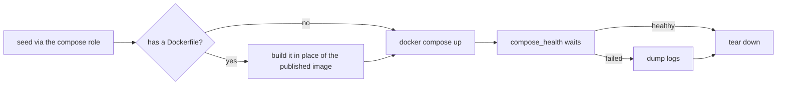

# CI Gates

The regression checks and gates in `.github/workflows/pr-checks.yml` that each look at one kind of change. Image tags and pinned release checksums have their own pages, [`image-tag-check.md`](image-tag-check.md) and [`release-checksum-check.md`](release-checksum-check.md). How jobs are selected and wired into the pipeline is in [CI: PR Checks](pipeline.md).

## Gates at a glance

| Gate | Runs as |
| :--- | :--- |
| [Deploy ordering](#deploy-ordering-check) | the `deploy-ordering-check` job |
| [Secret catalog rules](#secret-catalog-rules) | the `check-secret-catalog` hook |
| [App catalog rules](#app-catalog-rules) | the `check-app-catalog` hook |
| [Compose hardening rules](#compose-hardening-rules) | the `check-compose-hardening` hook |
| [docker_container rules](#docker_container-rules) | the `check-docker-container-hardening` hook |
| [Flow list rules](#flow-list-rules) | the `check-flow-list` hook |
| [Molecule coverage](#molecule-coverage-gate) | the `molecule-coverage` job |
| [Compose boot-test](#compose-boot-test) | the `compose-boot-test` job, and `compose-syntax-check` for excluded apps |
| [Dockerfile changes](#dockerfile-changes) | the `check-image-pins`, `check-molecule-image-vars` and `check-image-digests` hooks, and the `dockerfile-build-check` job |

The `pre-commit-checks` job runs every hook on every pull request. To run one hook locally, from the repository root with the [Python environment](../../deploy/controller-setup.md#python-environment) activated:

```sh
hook=check-app-catalog
pre-commit run "$hook" --all-files
```

Each rule check prints every violation with what it is about and the rule, and fails on any. Each has a test for each of its rules under `tools/tests/`, most of which also run it over the real files.

## Deploy-ordering-check

Regression coverage for `ansible_host` resolving through a fact a role generates (`secrets_generated`). Nothing else in CI exercises that chain: other checks bypass `ansible_host` resolution or test the `secrets` role against a synthetic inventory.

| Run | What it does | It fails when |
| :--- | :--- | :--- |
| `deploy` | The real `deploy.yaml` against `inventory/ci-deploy-ordering-inventory.yaml`, with `--tags` that match nothing, so only secrets generation and the resolution it gates happen | the play fails |
| `restore` | `bootstrap-secrets.yaml` and `restore.yaml` in one invocation, as [`restore.md`](../../disaster-recovery/restore.md) describes, with an archive that does not exist | anything other than the archive-not-found failure happens, a failure to resolve `ansible_host` above all |

The CI inventory mirrors `inventory.yaml`'s `ansible_host` → `host_domain` → `main_domain` → `secrets_generated` chain and its `managed_hosts`/`controller` split, with `ansible_connection: local` everywhere. The restore run covers the two-file invocation only; `restore`'s own validation is [Molecule's](../../testing/molecule-testing.md). Both runs and the verdict are [`deploy_ordering.py`](../../../../tools/ci/gates/deploy_ordering.py).

The job is triggered by the `deploy_ordering` filter. It includes all of `ansible/inventory/**`, since a catalog or `group_vars` change is the kind that broke this, and `pyproject.toml` and `uv.lock`, so an `ansible-core` bump is exercised here too.

Two [fixtures](../../../../tools/ci/fixtures) run first, both reading the real `secret_catalog.yaml`:

- `preseed_manual_secrets` writes a throwaway file under `ansible/files/secrets/` for each `store: controller_file` secret the operator would enter (empty for an `allow_blank` entry). It refuses a catalog key that is not a plain file name.
- `file_cache_catalog` writes only the `store: controller_file` entries to the catalog override both runs load, because the job has no OpenBao or step-ca. It fails if `main-domain`, which the ordering chain resolves, is not one of them. Reaching OpenBao is covered by the `secrets` role's `vault_backed` and `rotate_secret` scenarios.

Do not run these fixtures on the controller: they write into the real secret cache directory.

## Secret catalog rules

`ci.gates.secret_catalog_rules` holds every `secret_catalog.yaml` entry to the rules in that file's header comment. Without it a wrong combination surfaces at deploy or rotation time, or not at all: the `secrets` role skips a `hex` entry stored outside OpenBao without an error.

| Key | Rule |
| :--- | :--- |
| entry name | kebab-case |
| any | no unknown key |
| `source` | `hex`, `uuid4` or `manual` |
| `store` | stated on every entry, `openbao` or `controller_file`; always `openbao` for `hex` and `uuid4` |
| `length` | on `hex` entries, and nowhere else |
| `scope` | on every `store: openbao` entry, in one of the header's shapes, and on no `controller_file` entry |
| `description` | on every `manual` entry |
| `allow_blank`, `sensitive` | only on `manual` entries, as booleans |

## App catalog rules

`ci.gates.app_catalog_rules` checks what merging a host's entry over `app_catalog.yaml` cannot.

| About | Rule |
| :--- | :--- |
| app names | none appears twice |
| `compose_apps` | every app a managed host lists has a catalog entry |
| `routes` | each has an `upstream`; the old `caddy` key is refused |
| `auth: false` | only for a route listed, with its reason, in `OPEN_ROUTES` |
| `backup` block | names at least one volume, each declared in `volumes`; an app with nothing to back up has no block |
| `cloud_targets` | list of names |
| `retention_days` | positive integer |
| `compression` | `gz`, `zst` or `none` |
| `stop_during_backup` | boolean |
| `cron` | non-empty string |
| unknown backup key | refused, with the nearest valid one; the old `backup.extra_cloud_targets` is refused too |
| `restart_after` | a list of other apps in the catalog |
| `recovery_tier` | `1` or absent |
| `doc` | a markdown path under `docs/topics/`, the app's [service record](../../../decisions/0100-recording-how-a-system-is-integrated/revision-000.md); that it exists with its sections is the [docs drift check's](../../documentation/doc-checks.md#docs-drift-check) |
| wrong shapes | a `volumes`, `backup` or route entry of the wrong shape is reported, not left to crash the check |

The backup-setting rules hold in an app's block, in a host's own `backup:` override in `compose_apps` (which may also empty `volumes`, switching that app's backup off on the host) and in `backup_defaults`. A new `OPEN_ROUTES` entry is a security review, since the route then relies on the app's own authentication; an entry whose route is gone or gated again fails as stale.

It also checks the catalog against the inventory, read as plain YAML ([ADR 0068 (Backup defaults)](../../../decisions/0068-where-per-app-backup-settings-get-their-defaults/revision-000.md)):

- `backup_defaults` supplies every setting.
- Every cloud target named is a key of `cloud_sync_targets` in `host_vars/storage.yaml`.
- Every managed host running a backed-up app has its own `seaweedfs-s3-access-key-<host>` and `seaweedfs-s3-secret-key-<host>` in the secret catalog, scoped to `hosts/<host>`, and the `seaweedfs_s3_access_key` and `seaweedfs_s3_secret_key` host variables taken from them.

The hook runs when the catalog or an inventory file it reads changes. It cannot import Ansible code, so `ansible/tests/test_backup_plan.py` holds its list of backup settings and its derivation of backup hosts equal to Ansible's. `ansible/tests/test_backup_plan_invariants.py` fails if a role, template or playbook reads an app's `backup` block or `backup_defaults` instead of `backup_plan`, or uses a name ADR 0068 retired.

## Compose hardening rules

`ci.gates.compose_hardening_rules` keeps the [container hardening](../../deploy/container-hardening.md) baseline. Every service in a production compose file sets `cap_drop: [ALL]` and `security_opt: [no-new-privileges:true]` (`=true` counts too). Anything wider needs an entry with its reason in the module's `EXCEPTIONS`: each `cap_add` capability, `privileged`, a host `network_mode`, `pid`, `ipc`, `uts` or `userns_mode`, `devices`, a Docker socket mount, and any other `security_opt`. An entry is keyed by file, service and setting (`cap_add:CHOWN`, `network_mode:host`, `docker-socket`), and one nothing uses any more fails.

| Scope | Detail |
| :--- | :--- |
| Read | compose files under `docker/` and compose templates of Ansible roles |
| Not read | Molecule fixtures |
| Jinja | read as text: `{{ ... }}` becomes a placeholder, and a line holding only `` is dropped, so an `if` or `for` body is read once |
| Refused | a statement sharing a line with other text, `include` in a file, `extends` in a service, a repeated key |
| Not covered | containers a systemd unit starts for one job, reviewed by hand; containers an Ansible task starts, which the next check reads |

## docker_container rules

`ci.gates.docker_container_rules` holds a container started with `community.docker.docker_container` to the same baseline: `cap_drop: [ALL]` exactly and `security_opts: [no-new-privileges:true]`. Exceptions are in the module's `EXCEPTIONS`, keyed by file, task name (as written, Jinja included) and setting, and a stale one fails. The settings are named as for compose; `capabilities` entries are `cap_add:<CAPABILITY>`, and `docker-socket` covers a `volumes` entry or `mounts` source naming `docker.sock`.

| Scope | Detail |
| :--- | :--- |
| Read | playbooks, and every role's tasks and handlers, at any depth (`block`, `rescue`, `always`) |
| Not read | `molecule_helpers` and Molecule scenarios; `state: absent` tasks; `docker_container_exec` and `docker_container_info` |
| Tolerated | a tag such as `!vault`, read as text |
| Refused | a repeated key; a task without a `name`, or two checked tasks of one name in a file; a `command` or `shell` task running `docker run` |
| Refused as unjudgeable | `cap_drop`, `capabilities` or `security_opts` that is not a literal list; `privileged`, `devices`, `volumes`, `mounts`, a host namespace or `state` given only as a Jinja expression |
| Not covered | containers started by `command`, `shell` or `script` other than with `docker run`; `docker_compose_v2` tasks, whose compose template the compose check reads |

## Flow list rules

`network_checks.rules` checks the flow list in `tools/network_checks/flows.yaml` ([ADR 0094](../../../decisions/0094-showing-the-network-boundary-behaves-as-declared/revision-000.md)). What it and the loader enforce is in [`network-boundary-checks.md`](../../infra/network-boundary-checks.md#what-the-loader-and-rules-enforce).

## Molecule coverage gate

Each `molecule` leg uploads the coverage data its scenarios wrote. The `molecule-coverage` job unpacks all of it into one directory, regenerates each tested role's task inventory (gitignored, since it holds absolute paths) and reports each role against its floor in [`thresholds.yaml`](../../../../ansible/molecule-coverage/thresholds.yaml). A sharded role's legs write different scenarios' files, so together they give the whole role; the data joins on the absolute task path, which matches because every job checks out at the same workspace path. What the report measures, and how to run it locally, is in [`molecule-coverage/README.md`](../../../../ansible/molecule-coverage/README.md).

Floors are per role, taken from a real run. A role with no entry fails the job, so a new role gets a deliberate floor. A floor below 100% is an understood gap:

| Role | Not covered | Why |
| :--- | :--- | :--- |
| `apt` | the reboot-if-required task | A privileged container's `reboot` reboots the Docker host's own kernel (moby/moby#21929). Covering it needs isolation such as a real VM. |
| `bind9` | the resolv.conf upstream task | It needs an existing non-upstream `resolv.conf`, not worth simulating. |
| `openbao` | the failure task of the wait for OpenBao | It needs an OpenBao that never answers, and a scenario cannot shorten the role's retries. |
| `openbao_cli` | the failure on a version mismatch between CLI and server | No scenario runs a server at another version. |
| `restore` | the interactive confirmation prompt | Every scenario bypasses it to run non-interactively. |

## Compose boot-test

`_compose-boot-test.yml` is the shared job, called by `pr-checks.yml` for changed apps and by `boot-test-all.yml` for every app (manual only).



Seeding uses the real `compose` role (`ansible/playbooks/ci_boot_test.yaml` against `ci-inventory/`, since the real inventory assumes a remote host), after applying the `docker` role's [daemon defaults](../../deploy/docker-daemon.md) so containers run under production's `no-new-privileges`. The Dockerfile step is [below](#dockerfile-changes). [`compose_health.py`](../../../../tools/ci/gates/compose_health.py) takes each service in turn: with a healthcheck it polls a fixed number of times and fails at once on `unhealthy`; without one the container must still be running after a grace period. It checks every container of a scaled service and prints the logs of a failing one.

`lldap` also gets a real certificate from a throwaway `smallstep/step-ca`, by [`seed-lldap-ci-cert.sh`](../../../../.github/scripts/seed-lldap-ci-cert.sh), with the same `step ca certificate` call `step_ca_cert` makes. A change to that script, `_compose-boot-test.yml`, `ci_boot_test.yaml` or `ansible/ci-inventory/` queues the `lldap` boot test.

### Excluded apps

Listed in `.github/compose-boot-test-exclusions.txt`:

| App | Why not boot-tested | Covered by |
| :--- | :--- | :--- |
| `bind9`, `caddy` | Molecule asserts the real protocol, which a health poll does not. | Their role's scenarios. |
| `seaweedfs` | Same. | The `seaweedfs_bucket` and `backup_agent` scenarios ([watch sets](change-scoping.md#molecule-watch-sets)). |
| `tinyauth` | It needs an `lldap` to resolve, which per-app isolation cannot give. | `tinyauth/default`: a real lldap, bootstrapped ([`lldap.md`](../../services/lldap.md#bootstrapping-the-observer-account)), then tinyauth healthy and bound. |
| `molecule-dind` | An image for Molecule, with no compose file. | Nothing to run. |
| `openbao` | It cannot boot in isolation (below). | `step_ca_cert/signal_chown` and `openbao/data_chown`, which deploy the real `compose.yaml.j2` through `roles/openbao`. These are the only checks of that file. |

`openbao` fails in isolation for three reasons, each enough alone:

1. `roles/openbao` chowns its data volume to the image's non-root user before it starts; boot-test seeding does not.
2. Its listener needs a leaf certificate, which the workflow issues only for `lldap`.
3. Its healthcheck, `bao status`, fails while OpenBao is sealed or uninitialized, as a fresh volume is.

Excluded apps still get `compose-syntax-check`: `docker compose config --quiet` on each changed `compose*.yaml` of theirs (not `.j2` templates), running every file even after one fails, with an empty `.env` stubbed where an `env_file:` needs one.

[`compose_apps.py`](../../../../tools/ci/scope/compose_apps.py) is the only reader of the exclusion list (`changed`, `all` and `syntax-check`). Names match exactly, and a test holds that every exclusion names a real `docker/` directory.

## Dockerfile changes

An image built from `docker/<app>/Dockerfile` is published only after merge, by its `build-*-image.yml` workflow, and compose files pin the published tag. Each workflow runs on a push to `main` that changes its Dockerfile, weekly, and on demand; `molecule-dind`'s also watches the `docker` role's tasks file that its Dockerfile mirrors.

Only `main` publishes: the build job has `if: github.ref == 'refs/heads/main'`. Whoever pushes a branch can edit that line there, so the [provenance check](image-provenance-check.md#tiers) also requires the build's attestation to name `refs/heads/main`. `tools/tests/ci/branches/test_image_publishing.py` fails for a workflow that pushes an image without the condition, or that a pull request or another branch can start.

[`registry.py`](../../../../tools/ci/images/registry.py) is the one place each image's published name and tag rule are written. The build workflows ask it for their tags.

| `docker/` directory | Published as `ghcr.io/wenenhoe/…` | Tag |
| :--- | :--- | :--- |
| `caddy` | `caddy-digitalocean` | the final stage's Caddy version |
| `wastebin` | `wastebin` | the upstream wastebin version |
| `gatus` | `gatus` | the upstream Gatus version without its leading `v` |
| `molecule-dind` | `molecule-dind` | `latest` |

A tag rule fails unless the Dockerfile has exactly one match that looks like a version (`latest` aside). The tools here are stdlib-only Python on the runner's `python3`, which a test enforces, so the build jobs, which hold a package-write token, install nothing.

### Checks on image references

| Check | Fails on |
| :--- | :--- |
| `check-image-pins` (`ci.images.registry check-pins`) | a compose pin newer than what the Dockerfile will publish; a Molecule scenario naming an unpublished tag; an image with no registry entry; a Dockerfile with none |
| `check-molecule-image-vars` (`ci.images.molecule_vars`) | an image literal in a scenario's playbooks (Renovate would never bump it); a play using an image variable without loading its file, or loading one it does not use; an image file nothing loads ([shared image pins](../../testing/molecule-fixtures.md#shared-image-pins)) |
| `check-image-digests` (`ci.images.digests`) | a reference with no `@sha256` digest; one `name:tag` pinned to two digests; a malformed digest ([ADR 0108](../../../decisions/0108-which-images-a-deploy-runs-and-where-they-come-from/revision-000.md)) |

A compose pin may lag its Dockerfile, never lead it: a Renovate bump of a Dockerfile merges first, and the pin follows in a second pull request once the tag exists. `check-image-digests` reads the same references as the weekly [image tag check](image-tag-check.md). A few images stay on floating tags, each with its reason in `FLOATING` in `digests.py`, and an entry nothing names fails. A reference that cannot be pinned (a template, `scratch`, a `:local` build) is skipped.

### Building a changed Dockerfile

`dockerfile-build-check` builds each changed Dockerfile without pushing, then runs `.github/image-smoke-tests/<app>.sh` against it. Every registry image needs a smoke test, and a change to one queues the build too.

| Smoke test | Checks |
| :--- | :--- |
| `caddy` | the DigitalOcean DNS module, and `curl` |
| `gatus` | a non-root numeric user; booted alone, its `/wget` gets `/health` and the sqlite file appears in `/data` |
| `molecule-dind` | Docker Engine, `python3-requests`, `fuse-overlayfs` and its `daemon.json` default |
| `wastebin` | only that the build produced an image; `compose-boot-test` boots it |

To run the same build and smoke test locally, from the repository root with Docker running:

```sh
app=gatus
(cd tools && python3 -m ci.images.build build-check "$app")
```

In a pull request's boot test, an app with a Dockerfile also runs the image built from it: `ci.images.build shadow-tag` tags the build as the `ghcr.io/wenenhoe/<image>` reference the compose file pins, and Compose uses the local tag instead of pulling. `boot-test-all.yml` turns this off (`build-dockerfiles: false`), so a full sweep boots the published images a deploy pulls, and fails on a pin whose tag was never published.

### What is not covered

- Molecule scenarios that pull a published image (`caddy-digitalocean`, and `molecule-dind` for every DinD scenario) run the published one, so a Dockerfile change reaches them only after merge and a build. For `caddy`, the pull request that bumps the compose pin is the first to run the new version.
- `check-image-pins` reads text and never asks the registry, so a pin to a tag that was never pushed passes it. The manual `boot-test-all.yml` sweep and the weekly [image tag check](image-tag-check.md) fail on one.
