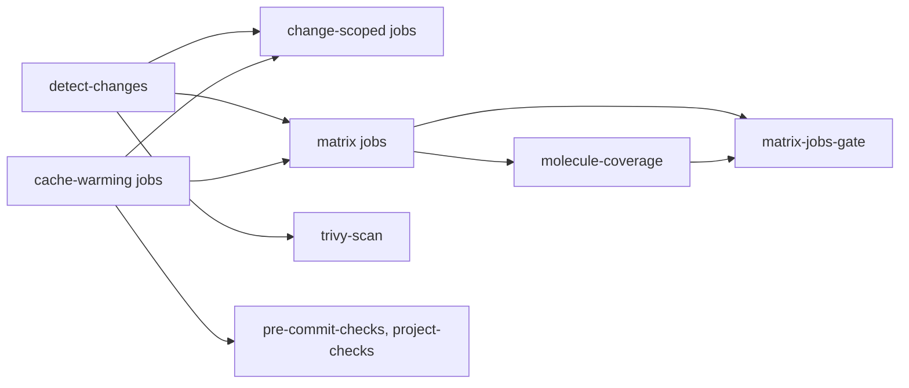

# CI: PR Checks

`.github/workflows/pr-checks.yml` runs on every pull request into `main`, `maintenance` or `develop` ([ADR 0076 (Branch separation)](../../../decisions/0076-keeping-what-production-runs-apart-from-work-in-progress/revision-000.md)). Which jobs block a merge is set by the [rulesets](../branching.md#the-rulesets), not in the repository. [Molecule](../../testing/molecule-testing.md) tests one role in isolation; this pipeline tests what it cannot: linting the whole tree, booting real compose stacks, and the `deploy.yaml` and `restore.yaml` ordering.

| For | Read |
| :--- | :--- |
| which jobs a change runs | [CI Change Scoping](change-scoping.md) |
| the regression checks and gates | [CI Gates](gates.md) |
| index generation and drift | [Doc Checks](../../documentation/doc-checks.md) |
| project and decision records | [Project and Record Checks](../../documentation/project-checks.md) |
| the Renovate window and Trivy | [CI Scheduled Jobs](scheduled-jobs.md) |

## Where the CI logic lives

Anything with a pass/fail rule or a decision in it is Python under `tools/`, tested in `tools/tests/`. Workflows and pre-commit only call it, as `python -m <package>.<module>` from `tools/` ([ADR 0064 (CI and doc check code)](../../../decisions/0064-where-the-code-behind-ci-and-documentation-checks-lives/revision-000.md)).

| Package in `tools/ci/` | Holds |
| :--- | :--- |
| `ci.scope` | what a diff needs run: Molecule watch sets and legs, no-op filtering, compose-app and Dockerfile lists |
| `ci.gates` | checks with their own verdicts, the [gates](gates.md) among them, and `matrix-jobs-gate` |
| `ci.images` | the image registry, image checks and CI image builds |
| `ci.checksums`, `ci.provenance` | that [pinned release hashes](release-checksum-check.md) and [image digests](image-provenance-check.md) are the publisher's |
| `ci.scan` | setup for the security scans |
| `ci.shell_tests` | the pinned Bats clones ([shell tests](../../testing/shell-tests.md)) |
| `ci.timing` | the scheduled [Molecule timing run](../../testing/molecule-timings.md) |
| `ci.fixtures` | data a job seeds before a real run, derived from the repo |
| `ci.branches` | keeping the long-lived branches in step |
| `ci.promotion` | the [promotion checklist](#promotion-checklist) |

`tools/utils/` has the one reader each of `secret_catalog.yaml` and `app_catalog.yaml`, both refusing a repeated name. They need only PyYAML, so a pre-commit hook can import them.

`tools/doc_scripts/` has the documentation checks and generators of [ADR 0037 (Decision and project workflow)](../../../decisions/0037-decision-and-project-documentation-workflow/revision-003.md). They read `docs/` from the repository root, not the working directory.

| Module | Runs in |
| :--- | :--- |
| `generate_doc_indexes`, `check_doc_drift`, `check_doc_change` | pre-commit hooks; `check_doc_change` also in the `project-checks` job |
| `check_mermaid` | the `mermaid-check` job only ([Mermaid render check](../../documentation/doc-checks.md#mermaid-render-check), [ADR 0078 (Diagram render check)](../../../decisions/0078-checking-that-diagrams-in-docs-render/revision-000.md)) |
| `suggest_project_scope`, `suggest_adr_consolidation` | nowhere: they print advice ([scope](../../documentation/project-checks.md#scope-suggestions), [consolidation](../../documentation/project-checks.md#consolidation-suggestions)) |

Workflow YAML and `.github/scripts/` keep only what needs Actions (`uses:` steps, caches, registry login) or is a plain command sequence. `.github/scripts/` holds no Python, which `tools/tests/ci/test_layout.py` enforces.

Some jobs run modules on the runner's own `python3` and install nothing. Those modules are standard-library only and parse on an older Python than the repository's, which [`test_stdlib_only.py`](../../../../tools/tests/ci/test_stdlib_only.py) lists and enforces. The rest run through `uv run`.

## Jobs

| Job | Runs when | What it does | Required |
| :--- | :--- | :--- | :--- |
| `warm-uv-cache` | always | Populates the uv cache ([cache warming](#cache-warming)). | via gate |
| `warm-galaxy-cache` | always | Populates the Ansible Galaxy collections cache. | via gate |
| `warm-pre-commit-cache` | always | Populates the pre-commit hook-environment cache. | yes |
| `pre-commit-checks` | always | Every commit-stage hook on every file, then gitleaks over the pull request's commits. | yes |
| `project-checks` | always | `check_doc_change` over the merge-base diff: the [project and record checks](../../documentation/project-checks.md#the-four-project-and-record-checks-as-one-command). | yes |
| `ansible-lint` | `ansible/**` or the lint config changed | The push-stage hook, over the whole `ansible/` tree. | yes |
| `uv-lock` | `pyproject.toml` or `uv.lock` changed | `uv sync --locked`: an unregenerated or broken lockfile fails. | yes |
| `python-unit-tests` | `python_unit_tests` | `pytest ansible/tests/ tools/tests/` over all cores, with provider calls and `rclone` mocked. | yes |
| `deploy-ordering-check` | `deploy_ordering` | The real `deploy.yaml` and `restore.yaml` against a CI inventory ([deploy ordering](gates.md#deploy-ordering-check)). | yes |
| `molecule` | any role touched | One leg per role, or per [shard](#sharded-roles), running [`molecule-test-all.sh`](../../testing/molecule-testing.md#running-scenarios) and uploading coverage and timings. | via gate |
| `molecule-coverage` | always | Merges the legs' coverage and holds each tested role to its [floor](gates.md#molecule-coverage-gate); does nothing when none was tested. | via gate |
| `release-checksums` | `tools/ci/checksums/**` or a file with a pinned release hash or apt key fingerprint changed | Pinned hashes and apt keys are the publisher's ([release checksum check](release-checksum-check.md)). | yes |
| `provenance` | `tools/ci/provenance/**` or a file that can pin an image changed | Pinned digests are signed or attested by the publisher ([provenance check](image-provenance-check.md)). | yes |
| `shell-tests` | `shell_tests` | Shell tests on the pinned Bats ([shell tests](../../testing/shell-tests.md)); a pin change also checks the [pinned tags](../../testing/shell-test-pins.md). | yes |
| `mermaid-check` | `mermaid_check` | Every Mermaid block renders ([Mermaid render check](../../documentation/doc-checks.md#mermaid-render-check)). | yes |
| `renovate-config-check` | `renovate_config` | `renovate.json5` is valid ([validating the config](renovate.md#validating-the-config)). | yes |
| `doc-site` | `doc_site` | Builds the site and checks its layout, as `pages.yml` does ([doc site](../../documentation/doc-site.md#publishing)). | yes |
| `tofu-checks` | `tofu/**` changed | `fmt`, `init`, `validate` and `test` in `tofu/`, `init` and `validate` in the scratch roots; no state or credentials. | yes |
| `compose-boot-test` | a non-excluded compose file, `Dockerfile`, `configs/` or `scripts/` touched | Boots each changed app ([compose boot-test](gates.md#compose-boot-test)). | via gate |
| `dockerfile-build-check` | a `docker/<app>/Dockerfile` touched | Builds each without pushing and smoke-tests it ([Dockerfile changes](gates.md#dockerfile-changes)). | via gate |
| `compose-syntax-check` | `excluded_compose` | `docker compose config --quiet` on what boot-test excludes. | yes |
| `matrix-jobs-gate` | always | One fixed check name for the matrix jobs and what they depend on ([below](#requiring-checks-before-merge)). | yes |

A name alone in "Runs when" is an output of [change scoping](change-scoping.md#change-scoped-not-a-full-sweep). Two jobs are not in the table: `detect-changes`, which produces those outputs, and `trivy-scan` ([security scanning](../../security/policy/security-scanning.md)), which always runs and decides inside itself whether to run its Ansible check.

Every job that runs steps sets `timeout-minutes`, which [`test_workflow_timeouts.py`](../../../../tools/tests/ci/test_workflow_timeouts.py) enforces; a job calling a reusable workflow cannot, so the called jobs carry theirs.

The shape of the dependencies, with each job's exact `needs` in the workflow:



`pre-commit-checks` and `project-checks` do not wait on `detect-changes`: their checks span nearly every file type.

## Sharded roles

A run takes as long as its slowest `molecule` leg. [`.github/molecule-shards.yml`](../../../../.github/molecule-shards.yml) splits the slow roles into shards, each a list of scenarios, and [`ci.scope.molecule_shards`](../../../../tools/ci/scope/molecule_shards.py) turns queued roles into legs: one per shard (`secrets-1`, `secrets-2`, ...) for a split role, one for any other.

- **Every scenario of a split role is in exactly one shard.** A scenario in none would never run, so `detect-changes` fails the run, and `tools/tests/ci/scope/test_molecule_shards.py` checks the table. Add a new scenario to a shard in the same pull request.
- **Order is not guaranteed.** Split roles are listed first, but Actions may start a long leg behind short ones when the concurrent-job limit is reached. A run of every role is bounded by that limit, not by its longest leg.
- **When to split.** The role's leg is the longest in a typical run, and its time is spread over scenarios; one dominant scenario cannot be split. Each leg also pays its own checkout and setup.

Shards are balanced on measured times, which a [scheduled run](../../testing/molecule-timings.md) keeps current and proposes changes from. [Coverage](gates.md#molecule-coverage-gate) still gates per role.

## Cache warming

Each shared cache has one job that may write it. Every other job restores only. Without this, a pull request that changes a key (a Renovate bump, typically) has every consuming job miss and then race to save the same entry.

| Cache | Keyed on | Written by | Save input of `setup-uv-ansible` |
| :--- | :--- | :--- | :--- |
| uv packages | `uv.lock`, `pyproject.toml` | `warm-uv-cache` | `save-uv-cache` |
| Ansible Galaxy collections | `ansible/requirements.yml` and `molecule_helpers`' two requirements files | `warm-galaxy-cache` | `save-galaxy-cache` |
| pre-commit hook environments | `.config/.pre-commit-config.yaml` | `warm-pre-commit-cache` | `save-precommit-cache` |

- The warm jobs have no `if:` and do not wait on `detect-changes`, so an evicted cache is rebuilt on any pull request.
- They do not wait on each other: on a cold run a little repeated work is cheaper than a longer critical path.
- `warm-pre-commit-cache` runs `pre-commit install-hooks` only, so it needs no Docker.
- `warm-uv-cache` syncs unlocked, so a stale lockfile fails `uv-lock`, with its own message, rather than skipping everything that needs the warm job.

### Base-branch warming

A cache saved by a pull-request run is visible only to that pull request; other pull requests can restore only what their base branch saved ([GitHub's cache access rules](https://docs.github.com/en/actions/reference/workflows-and-actions/dependency-caching#restrictions-for-accessing-a-cache)). [`warm-caches.yml`](../../../../.github/workflows/warm-caches.yml) therefore saves all three on `main`, in one job.

| Trigger | Why |
| :--- | :--- |
| `push` to `main` | a merge that changes a key writes the new entry at once; there is no `paths:` list to drift from the keys |
| `schedule`, [twice a week](scheduled-jobs.md) | a restore counts as access, so entries are not evicted for disuse |
| `workflow_dispatch` | rebuild by hand after an eviction |

The pull-request warm jobs stay, since a pull request that changes a key needs the entry before it merges.

## Promotion checklist

A pull request into `main` gets the commands it asks you to run by hand written into its description, between `<!-- promotion-checklist:start -->` and `<!-- promotion-checklist:end -->`. The CD agent deploys `main` by itself ([`cd-agent-host.md`](../../deploy/cd-agent-host.md#applying-it)), so the list holds only what it does not apply, or says there is nothing to run. It is advice: [`promotion-checklist.yml`](../../../../.github/workflows/promotion-checklist.yml) is no required check, and a failure there changes nothing on the pull request. The maintainer's text outside the markers is never touched, a box already ticked stays ticked while its command is still on the list, and a description with a start marker but no end (or the reverse, or two blocks) is left as it was and fails the job.

The rules are a table in [`ci/promotion/rules.py`](../../../../tools/ci/promotion/rules.py), in the order to run them. A rule fires when a changed path matches one of its globs and none of its exclusions:

| Changed path | Command |
| :--- | :--- |
| `pyproject.toml`, `uv.lock` | `uv sync` |
| `ansible/requirements.yml` | `ansible-galaxy collection install -r requirements.yml` |
| the `cd_agent` role, `playbooks/cd-agent.yaml`, `group_vars/cd_agent.yaml`, `tools/cd_agent/` | `ansible-playbook playbooks/cd-agent.yaml` |
| `docker/openbao/compose.yaml.j2`, `docker/openbao/configs/` | `python3 -m openbao_utils.unseal`, twice, from `tools/`: only if `bao status` on `security` reports `Sealed true` |
| `tofu/`, other than its tests | `tofu -chdir=tofu plan`, then `apply` once the plan is read |

Only the OpenBao **server** container seals. The compose file's image pin and the seeded `openbao.hcl` are what recreate or restart it, so they are the only OpenBao paths that fire. The role's one-shot containers (`openbao-read-uid`, `openbao-chown-data`, the `step_ca_cert` chown) and the native `bao` client package on `security` run from the same release and are never sealed, and a certificate renewal reloads the server with `SIGHUP` and leaves it unsealed, so none of those ask for an unseal.

Two kinds of change are applied by hand and have no rule: a new or changed Vault policy (`docker/openbao/policies/`, written with `bao policy write <name>`) and the rotation read watcher's files (`docker/openbao/watcher/`, copied to `security`). Both depend on the file's name or on where it is installed, which the table's fixed commands cannot express, so the pull request description's own text is where to note them.

To add a rule, add a `Rule` to the table with a test in `tools/tests/ci/promotion/test_rules.py` for a path it asks for and one it does not.

The workflow triggers on `pull_request_target`, so the workflow and the code it runs are `main`'s and a branch cannot edit them to use the `pull-requests: write` token. It checks nothing out of the pull request: the changed paths come from the pull request files API and are only matched against the globs, and a path is printed back only when it is made of plain characters. It takes effect once it is on `main`.

Two repository settings go with it:

- **An Actions policy** (Settings > Actions > Policies) that allows `pull_request_target` and targets `.github/workflows/promotion-checklist.yml` alone, since GitHub otherwise disables that event on a public repository. A policy that restricts events is an allowlist, so it must not cover other workflows. Without it the run fails and the description keeps its last content.
- **Letting Actions approve pull requests stays off**, because this job's token could otherwise approve a promotion.

## Requiring checks before merge

The `main` and `maintenance-and-develop` [rulesets](../branching.md#the-rulesets) require the same checks: every job marked `yes` under [Jobs](#jobs), and `trivy-scan / ansible-misconfig-scan`. A ruleset names a check by its job's name alone, or, for a job that calls a reusable workflow, as the calling job and the called one. [Adding a required check](../branching.md#adding-a-required-check) has the command.

To read what `main` requires now:

```sh
id=$(gh api repos/wenenhoe/homelab/rulesets --jq '.[] | select(.name == "main") | .id')
gh api "repos/wenenhoe/homelab/rulesets/$id" --jq '.rules[] | select(.type == "required_status_checks") | .parameters.required_status_checks[].context'
```

| Not required | Why |
| :--- | :--- |
| `molecule`, `compose-boot-test`, `dockerfile-build-check` | A matrix posts one name per entry (`molecule (apt)`, `molecule (secrets-1)`), and the bare name only when skipped, so no name posts on every pull request. `matrix-jobs-gate` stands for them. |
| `warm-uv-cache`, `warm-galaxy-cache`, `detect-changes`, `molecule-coverage` | `matrix-jobs-gate` requires them to succeed. |
| `trivy-scan / secret-scan` | A pull request never enables it, so it always reports `skipped`; gitleaks in `pre-commit-checks` is the secret scan that blocks. |

Requiring a job that is skipped by its own `if:` is safe, because a required check accepts `skipped`. A `paths:` filter on the workflow's `on:` trigger is not used: it leaves the check "Pending" for ever.

The same acceptance means a job whose `needs` failed, which also reports `skipped`, would pass. `matrix-jobs-gate` closes that for the jobs it covers. It does not cover `warm-pre-commit-cache`, so that one is required directly: a failed warm would otherwise skip `pre-commit-checks` and `ansible-lint` and let the merge through.

The verdict is [`matrix_gate.py`](../../../../tools/ci/gates/matrix_gate.py), given the whole `needs` context and the matrix jobs' names (`MATRIX_JOBS`):

- A matrix job passes on `success` or `skipped`. Every other job in `needs` must be `success`.
- Any other value, including an unknown one, fails, as does a matrix job missing from `needs`.
- A new matrix job goes in both `needs` and `MATRIX_JOBS`; a test reads the real workflow and fails otherwise.

The job checks out only `tools/ci` and uses the runner's `python3`, and a failed checkout fails the gate. Like every job here it runs the pull request's own code, so a pull request that edits the gate edits what checks it.
