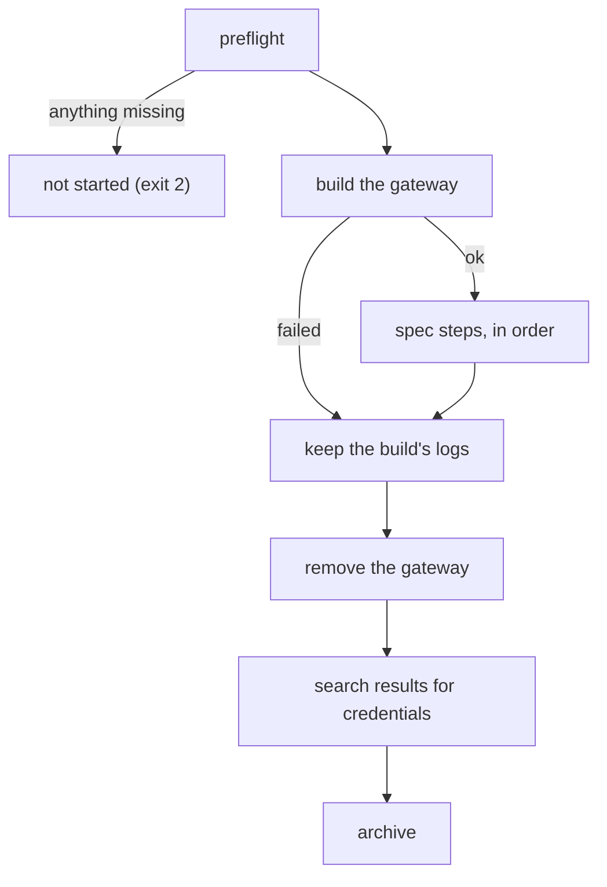

# Scratch gateway runs from a spec

One command takes a written spec, builds a [scratch gateway](tofu/opnsense-scratch-gateway.md), runs the spec's steps in order, removes the gateway and bundles what each step printed into one archive. Every run starts from the image and the seed, and nothing carries from one run to the next. It runs on the Proxmox node or under [QEMU](#the-qemu-backend) on the machine that runs the command.



## Running a spec

All commands run from `tools/`. Once, on a machine that will use the node, write the settings file and fill it in:

```bash
cd tools
uv run python -m scratch_run --init-env
```

Choose a spec, and check it against the flow list or against everything a run needs:

```bash
spec=rehearsal
uv run python -m scratch_run --list
uv run python -m scratch_run "$spec" --check-spec
uv run python -m scratch_run "$spec" --preflight
```

Run it on the node:

```bash
uv run python -m scratch_run "$spec"
```

Or on QEMU on this machine:

```bash
uv run python -m scratch_run "$spec" --backend qemu
```

`spec` is a file stem in [`tofu/scratch/opnsense/runs/`](../../../tofu/scratch/opnsense/runs/rehearsal.yaml) or a path. `--keep` leaves the gateway up after the steps.

| Exit status | Meaning |
| :--- | :--- |
| 0 | every step had the outcome the spec expected |
| 1 | a step did not, or a result file held a credential |
| 2 | the run could not start |

The committed specs:

| Spec | Shows | Backend |
| :--- | :--- | :--- |
| `rehearsal` | The play applies and then reports no change; the services and desktops flows pass; a block rule makes one fail until lifted | either |
| `stray-rule` | The play reports and removes a firewall rule it does not write | either |
| `seed-vlans` | A gateway seeded with nine scratch VLANs has nine VLAN interfaces; the services and desktops flows pass | either |
| `canary-vm` | A scratch VM stands in for the services canary | node |
| [`dmz-probe`](#the-dmz-probe) | The DMZ zone's own flows pass and its denials hold | node |
| [`coding-zone`](#the-coding-agent-zone-run) | The coding-agent zone from a VM tagged into it | node |

## Settings

Nothing is typed per run. `--init-env` writes `~/.config/homelab/scratch-run.env` (`--env-file` names another): `KEY=VALUE` lines read as text, never run as a shell script. It holds the Proxmox token, so the command refuses a file that is not yours, not mode 600 or inside the repository.

| Variables | For |
| :--- | :--- |
| `NODE`, `PROXMOX_ENDPOINT`, `PROXMOX_API_TOKEN` | the node backend |
| `VM_ID`, `LAN_BRIDGE`, `WAN_BRIDGE`, `WAN_VLAN_ID`, `LOCAL_PORT`, `WANT_VERSION` and the rest | passed to `scratch_gateway.sh` |
| `SCRATCH_RUN_OUT_DIR` | where state, credentials and results go; outside the repository |
| `SCRATCH_RUN_IMAGE_URL`, `SCRATCH_RUN_IMAGE_CHECKSUM` | the image and the `.img.bz2`'s SHA-256 |
| `ANSIBLE_PLAYBOOK` | another `ansible-playbook` |

A real environment variable beats the file, and a flag beats both: `--image-url`, `--image-checksum`, or the output directory given after the spec.

## The ssh master

`scratch_gateway.sh` and the node backend can never answer a prompt, so every ssh command of a run, and the GUI tunnel, multiplex over one master connection. Before a run or a preflight the command checks the socket and, when no master answers, opens one on your terminal, which is where a passphrase, password or hardware-key touch is asked for. It stays up for an hour after its last use. A socket a dead master left is removed first.

- The socket is `SSH_CONTROL_PATH`, by default `~/.cache/scratch-run/ssh.sock`, in a directory only you can enter.
- Without `NODE` set, no master is touched.

To manage it by hand (`status` exits 1 when no master is up):

```bash
uv run python -m scratch_run --ssh status
```

`up` and `down` in place of `status` open and close it.

## The spec

A spec is a YAML file under [`tofu/scratch/opnsense/runs/`](../../../tofu/scratch/opnsense/runs/rehearsal.yaml). The loader refuses an unknown key, a repeated step id, a tag or flow id the [flow list](network-boundary-checks.md#the-flow-list) does not have, and a block step with no rule, and names every problem at once, so a mistake costs no gateway build.

| Key | Meaning |
| :--- | :--- |
| `name`, `description` | The run's name, which is also its results directory, and what it shows |
| `gateway.vlans` | Optional. The seed's VLAN list, passed as `SEED_VLANS`; unset, the seed takes its scratch list. A committed list starts with the scratch list |
| `gateway.play_vars` | Optional. The play's `-e` variables, each starting `opnsense_gateway_`. The four the backend sets (CA file, API port, credentials file, `opnsense_gateway_scratch_wan`) are refused |
| `canary_vm` | Optional. `zone`: whose canary [a scratch VM](#the-canary-vm) replaces. A `vm` step needs it, and it needs a `vm` step |
| `block_rule` | Optional. `source`, `destination`, `protocol` (`TCP` or `UDP`) and `port` of the quick block rule the block steps [add and lift](../../../tofu/scratch/opnsense/boundary/block_rule.yaml) |
| `steps` | The steps, in order |

A step has an `id` and exactly one of these:

| Step | Does | Passes when |
| :--- | :--- | :--- |
| `play: apply` or `check` | Runs the gateway's play, with `--check` for `check` | `expect`: `ok` (exit 0, `apply`'s default), `unchanged` (exit 0 and `changed=0`, `check`'s default) or `changed` |
| `flows: {tags: [...], ids: [...]}` | Runs the [runner](network-boundary-checks.md#the-probe-module-and-the-runner) on the selection, building the namespace canaries on the first such step | `expect`: `pass` (default), or `fail`: at least one flow reported failed, so an empty selection or a crashed runner does not count |
| `block: present` or `absent` | Adds or lifts `block_rule` | the playbook succeeds |
| `vm: up` | Builds the [canary VM](#the-canary-vm); at most one, before every `flows` step | the VM answers over ssh through the gateway |
| `vlans: check` | Asks the gateway's API for its interfaces; needs `gateway.vlans` | it has exactly the seeded VLAN interfaces |
| `stray: present` | Adds [a rule the play does not write](../../../tofu/scratch/opnsense/acceptance/stray_rule.yaml) on the desktops zone's interface. Put it before a `play: check` with `expect: changed` and a `play: apply` | the playbook succeeds |

The `vlans` step reads `api/firewall/filter/get_interface_list`, which the seeded API user's filter privilege covers; the seed deliberately does not grant the privilege that would show VLAN tags. The seed names the interfaces `opt1`, `opt2`, ... in its list's order, so the step shows that the seed took the whole list, not which tag each carries, which the seed's own tests cover.

A failed step does not stop the run, so one archive shows everything; a failed build skips the steps. The gateway is removed on every path unless `--keep` is given. The terminal shows each step, each command's output as it prints, and each step's time. Most of a run is the build, which updates the gateway's firmware, so `up` is the log to watch.

## Preflight

A run starts only when every precondition holds, and the message lists all that do not.

| Needs | Node | QEMU |
| :--- | :--- | :--- |
| Image URL and checksum, and an output directory outside the repository | yes | yes |
| `ansible-playbook`, `ansible-galaxy`, `ssh-keygen`, the pinned `oxlorg.opnsense` release and `httpx` | yes | yes |
| `OPNsense.internal` resolves to | `127.0.0.1` | `192.168.77.1` |
| `NODE`, `PROXMOX_ENDPOINT`, `PROXMOX_API_TOKEN`, and `ssh`, `scp` | yes | no |
| A prompt-free ssh path to the node, no VM at `VM_ID`, no `/root/scratch-run` left there | yes | no |
| `qemu-system-x86_64`, `qemu-img` and the seed and image tools, passwordless `sudo`, `/dev/kvm`, the bridge and tap names free | no | yes |
| For `gateway.vlans`: a seed builder that takes them | yes | yes |
| For `canary_vm`: [what the VM needs](#the-canary-vm) | yes | refused |

## What a run leaves

| Path under the output directory | Holds |
| :--- | :--- |
| `state-<name>-<stamp>/` | The gateway's credentials, certificate and the runner's key. A clean teardown removes it |
| `<name>-<stamp>/` | One `<step id>.txt` per step, plus `up.txt`, `down.txt`, `results.json`, `results.md` and `logs/` |
| `results-<name>-<stamp>.tgz` | The same as the results directory |

- When the teardown fails, or with `--keep`, the state directory stays, and `scratch_gateway.sh down` on it removes a node gateway. Credentials are never in the results.
- `logs/` holds what the build wrote to files, taken before the gateway is removed: the seed build, `init` and `apply`, and the firmware update's files from the node. Each is cut to its last 200,000 characters. The update's release line in `up.txt` carries the firmware's status message.
- Before the archive is written, every result file is searched for the run's credential values (the seed's root password, one-time-code seed, API key and secret, and the Proxmox token's secret half). A hit fails the run and no archive is written.

## The canary VM

Namespace canaries stand in for every zone's canary VM. With `canary_vm: {zone: ...}` and a `vm: up` step, one zone's canary is a real [scratch Ubuntu VM](tofu/ubuntu-vms.md#scratch-ubuntu-vm), cloned from the template:

- Its VMID is the one the [VMID scheme](vm-provisioning.md#vmid--vlan--ip-scheme) gives the canary's address (208 for the services canary at `192.168.20.8`), with the zone's VLAN tag on its NIC and a static address from cloud-init.
- That zone's namespace skips the canary address; a zone left with no address gets no namespace.
- The step waits up to `VM_WAIT_SECONDS` (default 600) for the runner's ssh to reach the VM through the gateway. Later `flows` steps run the zone's flows from it.

So a pass shows the tagged-VM path end to end: a wrong tag is a VM that never answers. The VM needs:

- **A VLAN-aware `LAN_BRIDGE`.** Tick VLAN aware on it in the web console and apply, or use an isolated bridge that already is. The namespace canaries work on either kind but take another route on an aware bridge, so after the change run [`rehearsal`](../../../tofu/scratch/opnsense/runs/rehearsal.yaml), then [`canary-vm`](../../../tofu/scratch/opnsense/runs/canary-vm.yaml).
- **The Ubuntu template** on the node (VM 106, or `TEMPLATE_VM_ID`) and `tofu` here (`TOFU` names another).
- **No VM at the canary's VMID** left from an earlier run.

The VM's state and variables (`vm.tfstate`, `vm.tfvars.json`) are in the state directory. After a failed destroy they are kept, and `tofu destroy` with them removes the VM.

## The DMZ probe

[`dmz-probe`](../../../tofu/scratch/opnsense/runs/dmz-probe.yaml) seeds the gateway with the DMZ's VLAN 35, the play's `dmz` zone, and runs a canary in it:

- **Passes:** the gateway's DNS, time and echo, its own SSH port, and the Internet over 443.
- **Refused:** the services and desktops canaries from it, the services canary to it, and the Proxmox node's management address (`host_proxmox_node`) on 22 and 8006.

The node's refusals count only beside their controls, the desktops canary reaching the same two ports (`node` in the [flow list](network-boundary-checks.md#the-flows-in-the-list)), so the spec admits that canary as an operator host and needs:

- **The node backend.** The QEMU WAN is user-mode networking with no route to the node.
- **A WAN that reaches the node.** `WAN_BRIDGE` and `WAN_VLAN_ID` (VLAN 10 on `vmbr1` by default) must reach `10.0.0.254` on 22 and 8006. The VLAN 10 zone allows that only from `192.168.10.2`, reserved for VMID 501's WAN MAC, so another `VM_ID` gets a route out and no path to the node. The node must also answer the gateway's WAN address. A failed control points at this setup, not at the rule.

The play has no row admitting the operator hosts to the DMZ, so the spec carries `opnsense_gateway_flows` with that one row added; a test fails if the copy differs in anything else. The run does not show the node's own firewall, the tailnet policy's tests or the untrusted-tier proxy that [ADR 0116 (Egress for default-deny zones)](../../decisions/0116-internet-egress-for-hosts-in-default-deny-zones/revision-000.md) sets as the DMZ's only way out, which the play's `dmz` zone does not yet carry: it reaches the Internet directly, private ranges denied.

## The coding-agent zone run

[`coding-zone`](../../../tofu/scratch/opnsense/runs/coding-zone.yaml) seeds nine scratch VLANs, the `coding` zone among them (VLAN 30, no Internet, no DNS from the gateway), and replaces that zone's canary with a VM (VMID 308). From the VM it shows:

| Shows | By |
| :--- | :--- |
| The tagged-VM path | The VM answers ssh through the gateway; time and echo to its gateway and its own SSH port pass |
| Default-deny both ways | No other zone's canary reaches it, and it reaches none of theirs, nor the secrets store, the Minecraft and KMS hosts, an outside address on 443 or its gateway's DNS. Each refusal counts beside its control |
| The node is closed to it | Refused on the SSH and API ports, beside the desktops canary reaching them, as in [the DMZ probe](#the-dmz-probe) |

The play's [`operator-vlan30-ssh` and `tailscale-vlan30-ssh`](tofu/opnsense-gateway.md#zone-policy) reach only the coding-agent host, not the canary at `.8`. So the spec carries `opnsense_gateway_flows` with five rows added, admitting the operator hosts over SSH to the coding zone and to the management, isolated, experimental and DMZ canaries; a test holds the copy to that. The rows exist only in this run, and since the desktops canary is an operator host here, its own way into those zones is left unasserted.

It needs the node backend, a VLAN-aware bridge, the Ubuntu template and a WAN that reaches the node. It does not show the two flows to the coding-agent host, the zone's way to the Internet and its resolver (which [`coding-agent-egress.md`](../../projects/coding-agent-egress.md) adds), or the tailnet policy that limits the route to the laptop.

## Backends

`scratch_run.engine` decides each step's outcome, writes the files and checks them for credentials. A backend builds the gateway, runs one step at a time and removes it; neither changes the spec. The node backend is the default.

| | Node | QEMU |
| :--- | :--- | :--- |
| Gateway | `scratch_gateway.sh up` and `down` on the node | `qemu-system-x86_64` here |
| Play, block rule, API reads | from here, through the ssh forward | from here, to the LAN address |
| Canaries | `scratch_canaries.py` on the node (files in `/root/scratch-run`, removed by `down`) | namespaces on a local bridge, built with `sudo -n` |
| Runner | reaches the canaries through a `ProxyCommand` | the same |
| `canary_vm` | built | refused |
| Needs | node, token, ssh master | `sudo -n`, `/dev/kvm` |

## The QEMU backend

A run does these in order, each through a recorded command so the tests see every argument list.

1. **Image.** The pinned `.img.bz2` is downloaded, checked against its SHA-256 and unpacked into `SCRATCH_RUN_IMAGE_CACHE` (default `~/.cache/scratch-run/image`). A mismatch is removed and stops the run; a cache for another checksum is replaced.
2. **Seed.** `build_seed.sh`, with the flags `scratch_gateway.sh` gives it, so both backends seed alike.
3. **Network.** A bridge with this machine's address (`192.168.77.10`) and a tap for the gateway's LAN. The gateway is `192.168.77.1`.
4. **Gateway.** A qcow2 overlay of the cached image at the module's disk size, booted with [the layout](#the-qemu-layout). A QEMU that exits within seconds stops the run with what it printed.
5. **Import.** `import_seed.py` imports the seed over the serial console; the root password goes on standard input, never in arguments.
6. **Update.** Once the API port answers, `update_gateway.sh` takes the gateway to the pinned release, from a credentials file that exists only while it runs.

`down` stops the canaries, terminates QEMU (killing it after 30 seconds), removes the tap and bridge, and removes the state directory only when all of that worked. Everything kept is redacted of the seed's credentials, and on GitHub Actions each credential is also masked with `::add-mask::` once it exists.

KVM needs `/dev/kvm` readable and writable. `SCRATCH_RUN_QEMU_ACCEL=tcg` uses software emulation instead: no device, about twenty times slower, with longer import timeouts.

### The QEMU layout

The gateway must be laid out as the Tofu module lays out the VM, or a run would measure another machine. `scratch_run.qemu_layout` states the layout once (`STATED`) and builds the command line from it: `q35`, 2 cores, 2048 MiB, a virtio-scsi controller per disk, the system disk booting from `scsi0`, the seed second, a virtio NIC for the WAN (user-mode) and one for the LAN (tap), and a serial console.

It also reads the same facts from the [OPNsense module](../../../tofu/modules/proxmox_opnsense_vm/main.tf) (`var.` references from their defaults), and `test_run_qemu_layout.py` fails on any difference; CI runs it when either side changes. Three differences are intended: the CPU model (`host` under KVM, since a runner's CPU is not `x86-64-v2-AES`), the MAC addresses and the disks' files. A module attribute outside the layout can change unnoticed, and only a run shows that the command line boots.

### Bumping the pinned image

The image comes from [`image-pin.yaml`](../../../tofu/scratch/opnsense/image-pin.yaml), because a CI runner has no settings file; `--image-url` and `--image-checksum`, or the settings, name another. Its `version`, `url` (file name `OPNsense-<version>-nano-amd64.img.bz2`) and `sha256` have to agree. The [release checksum check](../engineering/ci/release-checksum-check.md) verifies `sha256` against the release's signed checksum file, so a hash copied from anywhere else fails.

To bump within the 26.1 series, set the new version and, from the repository root, fetch and verify its checksum file with the committed key. `openssl` prints `Verified OK`, then the line holding the hash:

```bash
version=26.1.7
dir=$(mktemp -d)
file="OPNsense-$version-checksums-amd64.sha256"
curl -fsS -o "$dir/$file" "https://pkg.opnsense.org/releases/26.1/$file" &&
  curl -fsS -o "$dir/$file.sig" "https://pkg.opnsense.org/releases/26.1/$file.sig" &&
  openssl base64 -d -in "$dir/$file.sig" -out "$dir/sig.bin" &&
  openssl dgst -sha256 -verify tools/ci/checksums/keys/opnsense-26.1.pem -signature "$dir/sig.bin" "$dir/$file" &&
  grep 'nano-amd64.img.bz2' "$dir/$file"
```

Copy that hash into `sha256`, and set `version` (quoted, so a release such as `26.7` stays text) and `url`.

The key belongs to a release series. A move to the next series fails the check with a missing manifest until the series in the entry's two URLs, the key file and its fingerprint in [`registry.py`](../../../tools/ci/checksums/registry.py) change in the same pull request. Take the new key from the release's documentation page and the changelog repository, compare the two, and take its fingerprint from:

```bash
key=tools/ci/checksums/keys/opnsense-26.7.pem
openssl pkey -pubin -in "$key" -outform DER | sha256sum
```

## The workflow

[`scratch-gateway-qemu.yml`](../../../.github/workflows/scratch-gateway-qemu.yml) runs `rehearsal` on a hosted runner with `--backend qemu`.

| Trigger | Runs |
| :--- | :--- |
| pull request touching a file the gateway depends on (the workflow's `paths:`) | `rehearsal` |
| [schedule](../engineering/ci/scheduled-jobs.md) on the default branch | `rehearsal`; keeps the cached image from eviction |
| `workflow_dispatch` | `rehearsal` or `seed-vlans` |

- It is not a required check: it needs a runner with `/dev/kvm`, and a hosted runner's nested virtualization is GitHub's to change.
- The image is cached by the pin file's hash and saved even when the run fails. A run reads its own ref's cache, then the default branch's, so after a new pin the first run on the default branch downloads again.
- Its logs and results archive are public, so it runs rehearsal specs only ([`docs/README.md`](../../README.md#public-repo)).

The QEMU backend runs on any host with the tools, `sudo -n` and `/dev/kvm`, privately and without the node. None is set up. The operator host's VM has no `/dev/kvm`, since `proxmox_ubuntu_vm` fixes the CPU type at `x86-64-v2-AES`, which has no `vmx`.

## What it does not do

- [`acceptance.sh`](../../../tofu/scratch/opnsense/acceptance/acceptance.sh) keeps its checks that are not the play or the flows (a forward the play does not write, the GUI login, the API key's scope), and still writes the play's variables itself.
- It builds one VM at most, and only for a zone the play and flow list have.
- It never touches the live gateway, and cannot show the real `vmbr1` bridge, the tailnet or the node's own firewall.

## Tests

`tools/tests/scratch_run/` covers the loader (every refusal, and that each committed spec loads), the engine against a stand-in backend, the node backend through a runner that records its commands, the `vlans` API read against a TLS server, and the QEMU backend through a stand-in runner, process and TCP check. None starts a gateway, so a change to the commands a backend issues is proven only by a run: on the node, or by the workflow.

```bash
uv run python -m pytest -q tests/scratch_run
```
