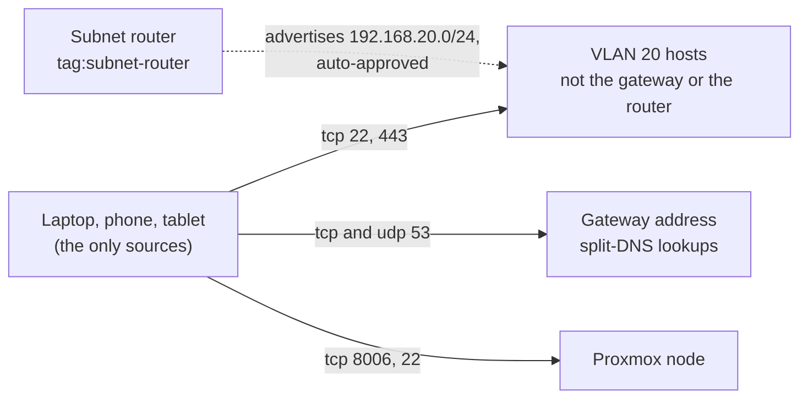

# Tailnet policy

The policy is edited by hand in the Tailscale admin console and is coded into
OpenTofu later ([ADR 0059 (Tailnet policy)](../../decisions/0059-where-the-tailnet-policy-is-defined/revision-000.md)).
It holds explicit grants only: nothing is allowed that no grant names. The saved
policy is described here by role, never by device name or address, and its email and
tailnet addresses are kept out of the repository. The subnet router it applies to is
in [`network-infra.md`](network-infra.md).

## Devices

Every device belongs to the maintainer's one user. No other user's device is on the
tailnet.

| Role | Tag | Key expiry |
| :--- | :--- | :--- |
| Subnet router (VM 202) | `tag:subnet-router` | None |
| Proxmox node, joined by hand, no approved route | None | Off, since an expired key drops the way to the hypervisor when the router VM is broken |
| Maintainer laptop | None | The domain's default |
| Maintainer phone and tablet, backup clients for when the laptop is out of reach, with the laptop's access | None | The domain's default |

## Policy sections

| Section | Holds |
| :--- | :--- |
| `hosts` | Names the laptop, phone, tablet, Proxmox node and router by their tailnet addresses, so a grant and a test read by role. Re-adding a device gives it a new address, which is then updated here |
| `tagOwners` | Lets the maintainer apply `tag:subnet-router` |
| `autoApprovers` | Approves `192.168.20.0/24` for a node carrying the tag. The router carries it |
| `grants` | The [flows](#flows) below. The router and the Proxmox node are sources of nothing |
| `tests` | Assert every grant and every refusal below. The console refuses a save that fails one |
| `ssh`, Funnel | Absent: nothing uses Tailscale SSH or Funnel ([ADR 0097](../../decisions/0097-how-a-tailscale-node-is-configured/revision-000.md) leaves both out) |

## DNS

MagicDNS is on. The global nameserver is a public resolver and needs no grant. Split
DNS lists the gateway for `host_domain` and for `lan_domain`. The gateway sits inside
the route the router advertises, so a client resolves those names only through the
grant on port 53 below. The gateway forwards to both DNS servers of
[ADR 0040](../../decisions/0040-dns-for-tofu-provisioned-vms/revision-000.md), and the
secondary is not listed beside it: the router's own path to the Internet runs through
the gateway, so a second entry would keep no name resolving that the tailnet could
still reach.

## Flows

The laptop, phone and tablet are the only sources.

| To | Port | Why |
| :--- | :--- | :--- |
| VLAN 20 hosts, not the gateway or the router | tcp 22 | SSH to the hosts away from home |
| VLAN 20 hosts, not the gateway or the router | tcp 443 | The apps behind Caddy |
| The gateway's address | tcp and udp 53 | Split-DNS lookups |
| The Proxmox node | tcp 8006 and 22 | Its web interface and a shell when the router VM is broken |

A grant takes a CIDR and no exclusion, so "VLAN 20 hosts, not the gateway or the
router" is the subnet split into the CIDRs that cover `.3` to `.255`. No source
reaches the router's own address, since the host is managed from the operator host
through the gateway and not over the tailnet, and none reaches the gateway's
management ports. A remote Minecraft player is not a flow: the only player is a VM
behind the same gateway as `play`.

## Changing the policy

The maintainer edits it in the console, and no one else has a way to.

1. Copy the current policy somewhere outside the repository first.
2. Make the edit and read the console's preview before saving. The policy is
   tailnet-wide, so an edit that tightens access can lock out access in use. "Reset
   to default" in the console restores the allow-all grant.
3. After the save, check from the laptop a flow the edit should allow and one it
   should refuse.

## Adding a grant for a route

A new route, for a zone the router will reach, needs three entries in the policy
before the router advertises it:

1. A grant whose `src` is the intended device or devices alone and whose `dst` is the
   route's CIDR, limited to the ports in use.
2. `tests` that accept each port in use at one address of the range and refuse the
   others, and that refuse every other source. A test cannot take a CIDR, so each
   address is listed.
3. An `autoApprovers.routes` entry keyed by the CIDR with `tag:subnet-router`, so the
   router's advertisement is approved without the console.

Save the policy first, then add the CIDR to the router's
`tailscale_node_advertise_routes` ([`network-infra.md`](network-infra.md#adding-a-route)).
The grant is what makes the route reachable, and only to the sources it names.
