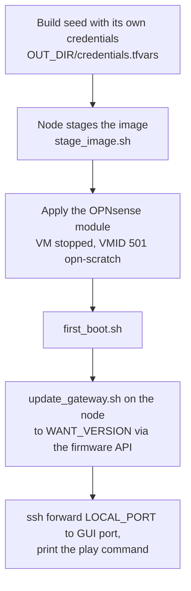

# Scratch OPNsense gateway

A throwaway gateway for developing the [gateway play](opnsense-gateway.md) without
touching the real one, and the acceptance run that checks what the play leaves
behind. Both run from the operator host.

```sh
# paste alone; it waits for a directory outside the repository, the image URL and its checksum
read -r -p 'OUT_DIR: ' out_dir; read -r -p 'IMAGE_URL: ' image_url; read -r -p 'IMAGE_CHECKSUM: ' image_checksum
```

```sh
# from the repo root: build
tofu/scratch/opnsense/scratch_gateway.sh up "$out_dir" "$image_url" "$image_checksum"
```

```sh
# remove
tofu/scratch/opnsense/scratch_gateway.sh down "$out_dir"
```

```sh
# the acceptance run, which builds and removes its own gateway
tofu/scratch/opnsense/acceptance/acceptance.sh "$out_dir" "$image_url" "$image_checksum"
```

## Bridges

The scratch bridges mirror the production pair: `vmbr0` is the real WAN and `vmbr1` the real VLAN-aware LAN, while `vmbr9` is the scratch gateway's VLAN-aware LAN and `vmbr8` its plain one. The scratch WAN is on `vmbr1`, tagged VLAN 10 by default (`WAN_VLAN_ID`), where the production gateway's scratch zone leases it an address, a route out and the gateway's resolver, and `vmbr0` is refused.

## Building it

`scratch_gateway.sh up` needs `NODE`, `PROXMOX_ENDPOINT` and `PROXMOX_API_TOKEN` set.



The seed uses credentials of its own, so the real credentials file is untouched. The
update is refused unless it lands on `WANT_VERSION` (default the pinned release), and
the seeded key must still authenticate, and a wrong secret still be refused,
afterwards. The root's state and provider directory live in `OUT_DIR`, and the root
uses the provider pin and lock file of the main root. `down OUT_DIR` closes the
tunnel and destroys the VM, the seed it uploaded and everything left on the node, but
not the staged image.

| Setting | Default | Notes |
| :--- | :--- | :--- |
| `LAN_BRIDGE` | `vmbr9` | Must exist with no ports and no address and be usable by the API token (`SDN.Use` on `/sdn/zones/localnetwork/<bridge>`), because the seed's LAN serves DHCP. The node takes `192.168.77.10` on it. A run with a canary VM also needs it VLAN-aware ([below](#lan-and-wan-details)) |
| `WAN_BRIDGE` | `vmbr1` | The bridge of the WAN NIC, tagged with `WAN_VLAN_ID`. The production WAN bridge is refused |
| `WAN_VLAN_ID` | 10 | The WAN NIC's tag. `none` leaves it untagged, for a DHCP server on another network ([below](#lan-and-wan-details)) |
| `LOCAL_PORT` | 8443 | The ssh forward to the gateway's GUI port. The operator host must resolve `OPNsense.internal` to `127.0.0.1` and have no proxy variables set |
| `WANT_VERSION` | The pinned release | |
| `SEED_VLANS` | The seed's scratch list (11, 20, 25, 30, 35, 40, 45, 50, 55) | Comma-separated VLAN tags the seed adds on the LAN device, such as `11,20,25,30,35,40,45,50,55,60`, for a zone it does not carry yet ([below](#adding-vlans)) |
| `PURGE_IMAGE=1` | | `down` also removes the staged image |
| `UPLOAD_IMAGE=1` | | The operator host downloads the image and the module uploads it, for a node with no route to the mirror (about 7 GB free where `OUT_DIR` is) |

### LAN and WAN details

- **LAN bridge.** A canary VM needs it VLAN-aware (`bridge-vlan-aware yes`), which the
  run's preflight checks. `vmbr8`, a plain bridge, serves any run without one.
- **WAN tag 10** is the production gateway's scratch zone. It leases the WAN
  `192.168.10.2` (reserved for VMID 501's MAC, which a default run has, and the only
  address the zone passes to the node's SSH and API ports), a route out and the
  gateway's resolver. A production gateway without that zone has no lease for the tag.
- **DNS.** The zone denies direct DNS, so the script builds the seed with
  `--forward-dns`: Unbound forwards every query to the lease's nameserver instead of
  recursing from the root servers.

### Adding VLANs

The scratch list is the production list with a placeholder, 11, where the production
seed holds VLAN 10. So the WAN's `192.168.10.0/24` belongs to no interface and every
other zone stays on the interface the play names. The play names a zone's interface by
its VLAN's position in the list, so a list should start with the scratch list, in its
order; another start puts the play's rules on other VLANs. An added tag has no
`opnsense_gateway_zones` entry, so its interface carries none of the play's rules.

### Image staging

`stage_image.sh`, piped to the node, downloads the `.img.bz2`, checks it against
`IMAGE_CHECKSUM`, unpacks it and moves it into the images datastore's `import`
directory in one rename as `<release>-nano-amd64.raw`, with the checksum beside it in
a `.sha256` file. A later run that finds the file with the checksum it asks for
fetches nothing, so the 3 GB upload through the Proxmox API, which can fail with a
closed connection, happens in no run. The checksum is checked when the image is
staged, not again when it is used.

The node needs `curl`, `bunzip2`, `pvesh` and `python3`, a route to the mirror and
about 4.5 GB free in the datastore.

## Acceptance

`acceptance.sh` runs the play against a scratch gateway it builds with
`scratch_gateway.sh` and checks what the play must leave behind:

| Check | Asserted by |
| :--- | :--- |
| A second run with `--check` exits cleanly and reports no change | `acceptance.sh` |
| A forward the play does not write, added behind its back, is reported by `--check`, removed by a run, and gone from the next `--check` | `acceptance.sh`, `stale_forward.yaml` |
| A firewall rule the play does not write, added behind its back, is reported by `--check`, removed by a run that leaves the guard rule alone, and gone from the next `--check` | `acceptance.sh`, `stray_rule.yaml` |
| The GUI login refuses the password alone, a wrong code and the code after the password, and accepts the code in front of it | `gui_login.py` |
| The API key is answered on the calls the play and the update make and refused with 403 on user management, source NAT and the service list | `api_scope.py` |
| From the node's admitted LAN address the gateway's port 443 answers and its port 22 does not; from a second address on the LAN bridge neither does | `acceptance.sh`, `management_reach.py` |
| No credential value is in the results | `acceptance.sh` |

It does not probe the flows between zones. It needs the environment of
`scratch_gateway.sh` plus `OPERATOR` (an address in the desktops zone, default
`192.168.40.250`, used as the play's operator host and one reservation), `ansible-playbook`,
the pinned collection and `httpx` on the operator host, a free `192.168.77.11` on `LAN_BRIDGE` for the probe, ssh to the node without a
prompt, and no VM with the scratch gateway's VMID. The play reaches the gateway through the ssh forward, so the run sets `opnsense_gateway_operator_not_listed_ok` and the play's check of its own source address does not apply.

`OUT_DIR` must be outside the repository because it holds the credentials file. The
results go to `OUT_DIR/run-HHMMSS` as one file per step, and the gateway is removed on
every exit path unless `KEEP=1`. The two scripts need only the standard library, and
their tests run against stand-in servers.
