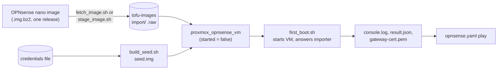

# OPNsense VM

How Tofu builds the OPNsense gateway's VM: the `proxmox_opnsense_vm` module, the
seed disk that holds its first configuration, and the script that answers the
importer at the first boot. What the gateway is then configured with is the
[gateway play](opnsense-gateway.md). The first configuration comes from a seed disk
the importer reads at the first boot
([ADR 0089 (OPNsense configuration)](../../../decisions/0089-how-the-opnsense-gateway-is-configured/revision-000.md)).

The root module declares no OPNsense VM: the production gateway is hand-maintained,
and the module's callers are the [scratch gateway](opnsense-scratch-gateway.md)
and the tests.

## The module

| Aspect | Behaviour |
| :--- | :--- |
| `vm_id` | The gateway VMID of a range, host part 01 (201 by default) |
| NICs | Two `virtio` NICs with MACs from the [MAC scheme](../vm-provisioning.md#mac-address-scheme). NIC 0 on the physical WAN bridge, NIC 1 on the VLAN-aware LAN bridge, both untagged so OPNsense sees every VLAN |
| WAN as a client | Setting `wan_bridge` to the LAN bridge and `wan_vlan_id` tags NIC 0 onto a VLAN of it instead, for a WAN that is an ordinary client of another OPNsense's LAN. NIC 1 stays untagged |
| System disk | The only boot device, imported at `disk_gb`. The image is 3 GB and the gateway grows its root file system into the rest at the first boot |
| Console | A serial port on a socket |
| Seed | When `seed_image_path` names a raw disk image holding `conf/config.xml`, the module uploads it as import content under the VM's lowercased name and attaches it as `scsi1`. It is needed for the first boot only: [`first_boot.sh`](#first-boot) detaches the disk afterwards, and unsetting `seed_image_path` makes Tofu drop the import file |
| `started` | The caller sets `started = false` when a script on the node answers the importer, because that script must be connected to the serial socket before the first boot passes the importer's prompt. `started` applies only when the VM is created: a later apply neither starts nor stops it, so a change of it never powers a running gateway off |
| Boot order | Tofu does not set it. Proxmox requires `Sys.Modify` on `/` for a startup order, which is cluster-wide and far wider than the token's role. Set it once on the VM with `qm set <vmid> --startup order=1,up=60`, so the gateway starts first and has 60 s before any dependent VM, giving DHCP and DNS time to come up |
| Names | The gateway runs no authoritative DNS and registers no name. A Tofu-built VM's name is an `A` record BIND9 on `services` renders from the generated inventory, and the gateway forwards the zone to `services` and `storage` ([`bind9.md`](../../services/bind9.md#the-host-zone)). A client in the `.50`–`.254` DHCP pool has no name |

## Image

OPNsense publishes the image only as the `.img.bz2` of one release, and Proxmox
refuses to decompress a download of import content. There is no stable "latest"
URL, so a newer release is a new URL and checksum.

| Way | How | Use when |
| :--- | :--- | :--- |
| Module downloads | `image_url` and `image_checksum`: the host running Tofu downloads with `fetch_image.sh`, checks the SHA-256, unpacks into `image_cache_dir` (about 3.5 GB; `.image-cache/` is git-ignored) and uploads the unpacked image as import content. A mismatch removes the download and fails the apply before anything is uploaded. Needs `curl`, `bunzip2` and `sha256sum` or `shasum` | Default |
| Image already on the node | `image_volume_id` (`<datastore>:import/<name>.raw`): nothing is downloaded or uploaded and the system disk is imported from that volume | The node holds the unpacked image. The [scratch gateway](opnsense-scratch-gateway.md#image-staging) stages it there |

Exactly one of the two ways must be given, and the plan fails otherwise.

## Seed disk

`seed/build_seed.sh OUTPUT_DIR --lan-ip ADDRESS` writes `OUTPUT_DIR/seed.img`, the
file the module's `seed_image_path` takes. It needs `python3`, `openssl`, `sfdisk`,
mtools and `xmllint`. It starts from OPNsense's own sample `config.xml`
(`seed/SAMPLE_SOURCE.txt` names its release) and sets:

| Setting | Value |
| :--- | :--- |
| NICs | `vtnet0` is the WAN, `vtnet1` the LAN |
| LAN address | `--lan-ip` |
| VLANs | A device `vlan0.<tag>` on the LAN device for each tag of `--vlans` (20, 30, 40, 50 and 60 unless overridden), with an interface at `192.168.<tag>.1/24` |
| Hostname and domain | Domain `OPNsense.internal` unless overridden: the name the play verifies the GUI certificate for |
| Console | The serial port |
| IPv6 | Off: no system-wide allowance and no IPv6 address method on the WAN or LAN |
| Root password | Set from the credentials file |
| GUI login | A one-time password in front of it: a `TOTP` authentication server which the GUI uses, and a seed on root |
| API user | One, holding only the privileges that cover the play's calls, the scratch update and the diagnostics (system information, firmware, aliases, filter rules, Kea DHCPv4, dnsmasq and Unbound), not `page-all` |

OPNsense has no option left to keep console logins off the one-time-password rule,
so the console menu is not password-protected: whoever can open the VM's console in
Proxmox reaches it, and it is the way in when the token is lost. The API user
authenticates by key.

**Credentials.** The root password, API key, API secret and root's OTP seed (base32,
for an authenticator app) are the variables `opnsense_root_password`,
`opnsense_api_key`, `opnsense_api_secret` and `opnsense_root_otp_seed` in the
[credentials file](state-and-credentials.md#credentials-file).

- The builder reads them and appends generated ones when the file holds none of the
  first three, so a rebuilt gateway keeps the credentials the play holds. A file that
  holds the first three without a seed gets one appended.
- The seed carries only a hash of the password and of the secret, and the OTP seed
  itself, which the gateway needs in the clear.
- A credentials file that others can read, or that holds only some of the first
  three, stops the build.
- Tofu warns that these variables are undeclared when it reads the file, which does
  no harm.

## First boot

The importer is offered only at the first boot, so the module is applied with
`started = false` and `first_boot/first_boot.sh VMID OUTPUT_DIR` starts the VM and
answers the importer. It runs on the operator host with `NODE` set to the Proxmox
node's ssh target; the node needs `python3`.

1. It refuses a VM that is not stopped, copies `import_seed.py` to the node and runs
   `qm start`.
2. It runs the driver beside the VM's serial socket with the seed's root password on
   stdin, read from the credentials file, so the password reaches neither a command
   line nor the node's disk.
3. The driver names the seed disk (`da1`) to the importer, logs in at the console
   with the seed's root password when the console asks for one (a login prompt that
   the menu follows within five seconds is not answered) and reads the web GUI's
   certificate off the console.
4. `OUTPUT_DIR` holds `console.log`, `result.json` and `gateway-cert.pem`, the CA
   file the play pins. The driver refuses a certificate that does not match the
   fingerprint the console banner prints, and the script removes the output if it
   finds the password in it.
5. Once the importer has taken the seed, the script unplugs the seed disk (`scsi1`,
   or `SEED_SLOT`) from the running VM, deletes the volume it leaves behind and reads
   the VM's running configuration and the datastore back. The disk holds root's
   one-time-password seed in the clear and the gateway never reads it again, so it
   must not stay in the VM or in a dump of it. A disk that is still there fails the
   script with the volume named, after the certificate has been brought back.

The import file is still on the node after the script. Unset `seed_image_path` and
apply: Tofu drops the file, and the VM, which no longer has the disk, shows no
change. Applying again with `seed_image_path` still set would attach a seed again.

A node that takes a password is reached through a master connection opened by hand
(`ssh -fN -M -S /tmp/opn-ssh.sock root@pve`) and named in `SSH_CONTROL_PATH`. A first
boot that did not take the seed cannot be repeated on the same VM: destroy it and
apply the module again.
