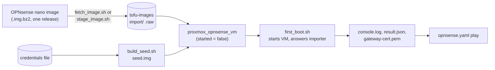

# OPNsense VM

How Tofu builds the OPNsense gateway's VM: the `proxmox_opnsense_vm` module, the
seed disk that holds its first configuration, and the script that answers the
importer at the first boot. What the gateway is then configured with is the
[gateway play](opnsense-gateway.md). The first configuration comes from a seed disk
the importer reads at the first boot
([ADR 0089 (OPNsense configuration)](../../../decisions/0089-how-the-opnsense-gateway-is-configured/revision-000.md)).

The root module declares the production gateway in `tofu/opnsense.tf`
([below](#the-production-gateway)), and the module's other callers are the
[scratch gateway](opnsense-scratch-gateway.md) and the tests.



## The module

| Aspect | Behaviour |
| :--- | :--- |
| `vm_id` | The gateway VMID of a block of 50, host part 01 or 51 (201 by default) |
| NICs | Two `virtio` NICs with MACs from the [MAC scheme](../vm-provisioning.md#mac-address-scheme). NIC 0 on the physical WAN bridge, NIC 1 on the VLAN-aware LAN bridge, both untagged so OPNsense sees every VLAN |
| Startup | The VM starts at the node's boot. `startup_order` puts it at that place in the node's order, with `startup_up_delay` seconds (30 by default) before the next VM starts, so the gateway is up before the VMs behind it |
| WAN as a client | Setting `wan_bridge` to the LAN bridge and `wan_vlan_id` tags NIC 0 onto a VLAN of it instead, for a WAN that is an ordinary client of another OPNsense's LAN. NIC 1 stays untagged |
| System disk | The only boot device, imported at `disk_gb`. The image is 3 GB and the gateway grows its root file system into the rest at the first boot |
| Console | A serial port on a socket |
| Seed | When `seed_image_path` names a raw disk image holding `conf/config.xml`, the module uploads it as import content under the VM's lowercased name and attaches it as `scsi1`. It is needed for the first boot only: [`first_boot.sh`](#first-boot) detaches the disk afterwards, and unsetting `seed_image_path` makes Tofu drop the import file |
| `started` | The caller sets `started = false` when a script on the node answers the importer, because that script must be connected to the serial socket before the first boot passes the importer's prompt. `started` applies only when the VM is created: a later apply neither starts nor stops it, so a change of it never powers a running gateway off |
| Boot order | Tofu does not set it. Proxmox requires `Sys.Modify` on `/` for a startup order, which is cluster-wide and far wider than the token's role. Set it once on the VM with `qm set <vmid> --startup order=1,up=60`, so the gateway starts first and has 60 s before any dependent VM, giving DHCP and DNS time to come up |
| Names | The gateway runs no authoritative DNS and registers no name. A Tofu-built VM's name is an `A` record BIND9 on `services` renders from the generated inventory, and the gateway forwards the zone to `services` and `storage` ([`bind9.md`](../../services/bind9.md#the-host-zone)). A client in the `.50`–`.254` DHCP pool has no name |

## Image

OPNsense publishes the image only as the `.img.bz2` of one release, and Proxmox
refuses to decompress a download of import content. There is no stable "latest"
URL, so a newer release is a new URL and checksum.

| Way | How | Use when |
| :--- | :--- | :--- |
| Module downloads | `image_url` and `image_checksum`: the host running Tofu downloads with `fetch_image.sh`, checks the SHA-256, unpacks into `image_cache_dir` (about 3.5 GB; `.image-cache/` is git-ignored) and uploads the unpacked image as import content. A mismatch removes the download and fails the apply before anything is uploaded. Needs `curl`, `bunzip2` and `sha256sum` or `shasum` | Default |
| Image already on the node | `image_volume_id` (`<datastore>:import/<name>.raw`): nothing is downloaded or uploaded and the system disk is imported from that volume | The node holds the unpacked image. The [scratch gateway](opnsense-scratch-gateway.md#image-staging) stages it there |

Exactly one of the two ways must be given, and the plan fails otherwise.

Connections from a workstation to the Proxmox API dropped now and then during the spike runs (an
upload closed mid-transfer, a VM create answered with an empty reply), and three tries in a row of
the 3 GB image upload failed. The scratch gateway's script has the node download and unpack the
image once, so a run uploads none. The cause of the drops is not found, the seed and the other
uploads still go through the API, and the module has no retry of its own.

## Seed disk

`seed/build_seed.sh OUTPUT_DIR --lan-ip ADDRESS --operator-host ADDRESS` writes `OUTPUT_DIR/seed.img`, the
file the module's `seed_image_path` takes. It needs `python3`, `openssl`, `sfdisk`,
mtools and `xmllint`. It starts from OPNsense's own sample `config.xml`
(`seed/SAMPLE_SOURCE.txt` names its release) and sets:

| Setting | Value |
| :--- | :--- |
| NICs | `vtnet0` is the WAN, `vtnet1` the LAN |
| LAN address | `--lan-ip` |
| VLANs | A device `vlan0.<tag>` on the LAN device for each tag of `--vlans` (10, 20, 25, 30, 35, 40, 45, 50 and 55 unless overridden; VLAN 10 is the first, so `opt1`), with an interface at `192.168.<tag>.1/24` |
| Hostname and domain | Domain `OPNsense.internal` unless overridden: the name the play verifies the GUI certificate for |
| Time zone | `--timezone`, `Asia/Singapore` by default, the inventory's `server_timezone` |
| Management reach | Anti-lockout off, so the gateway admits no host to the GUI, API and SSH ports unless a rule does. The GUI and API listen on the LAN and the VLAN interfaces, never the WAN |
| LAN rules | The sample's two allow-all rules are removed. One pass rule per `--operator-host` (an address in the LAN network, one or more, required) admits that host to the gateway's port 443 on the LAN, and nothing else is admitted there |
| Console | The serial port |
| IPv6 | Off: no system-wide allowance and no IPv6 address method on the WAN or LAN |
| Root password | Set from the credentials file |
| GUI login | A one-time password in front of it: a `TOTP` authentication server which the GUI uses, and a seed on root |
| API user | One, holding only the privileges that cover the play's calls, the scratch update and the diagnostics (system information, firmware, aliases, filter rules, Kea DHCPv4, dnsmasq and Unbound), not `page-all` |

The operator-host rule is how the play's first apply reaches the gateway, before the play has written its guard rule, which names only the zone interfaces. It is a legacy rule, so the API neither lists nor removes it: remove it in the GUI's LAN rules once no host needs the untagged LAN to reach the gateway, at the latest when VM 401 is retired.

OPNsense has no option left to keep console logins off the one-time-password rule,
so the console menu is not password-protected: whoever can open the VM's console in
Proxmox reaches it, and it is the way in when the token is lost. The API user
authenticates by key.

**Credentials.** The root password, API key, API secret and root's OTP seed (base32,
for an authenticator app) are the variables `opnsense_root_password`,
`opnsense_api_key`, `opnsense_api_secret` and `opnsense_root_otp_seed` in the
[credentials file](state-and-credentials.md#credentials-file).

- The builder reads them and appends generated ones when the file holds none of the
  first three, so a rebuilt gateway keeps the credentials the play holds. A file that
  holds the first three without a seed gets one appended.
- The seed carries only a hash of the password and of the secret, and the OTP seed
  itself, which the gateway needs in the clear.
- A credentials file that others can read, or that holds only some of the first
  three, stops the build.
- Tofu warns that these variables are undeclared when it reads the file, which does
  no harm.

## First boot

The importer is offered only at the first boot, so the module is applied with
`started = false` and `first_boot/first_boot.sh VMID OUTPUT_DIR` starts the VM and
answers the importer. It runs on the operator host with `NODE` set to the Proxmox
node's ssh target; the node needs `python3`.

1. It refuses a VM that is not stopped, copies `import_seed.py` to the node and runs
   `qm start`.
2. It runs the driver beside the VM's serial socket with the seed's root password on
   stdin, read from the credentials file, so the password reaches neither a command
   line nor the node's disk.
3. The driver names the seed disk (`da1`) to the importer, logs in at the console
   with the seed's root password when the console asks for one (a login prompt that
   the menu follows within five seconds is not answered) and reads the web GUI's
   certificate off the console.
4. `OUTPUT_DIR` holds `console.log`, `result.json` and `gateway-cert.pem`, the CA
   file the play pins. The driver refuses a certificate that does not match the
   fingerprint the console banner prints, and the script removes the output if it
   finds the password in it.
5. Once the importer has taken the seed, the script unplugs the seed disk (`scsi1`,
   or `SEED_SLOT`) from the running VM, deletes the volume it leaves behind and reads
   the VM's running configuration and the datastore back. The disk holds root's
   one-time-password seed in the clear and the gateway never reads it again, so it
   must not stay in the VM or in a dump of it. A disk that is still there fails the
   script with the volume named, after the certificate has been brought back.

The import file is still on the node after the script. Unset `seed_image_path` and
apply: Tofu drops the file, and the VM, which no longer has the disk, shows no
change. Applying again with `seed_image_path` still set would attach a seed again.

A node that takes a password is reached through a master connection opened by hand
(`ssh -fN -M -S /tmp/opn-ssh.sock root@pve`) and named in `SSH_CONTROL_PATH`. A first
boot that did not take the seed cannot be repeated on the same VM: destroy it and
apply the module again.

## The production gateway

`tofu/opnsense.tf` calls the module for VMID 201: the name `OPNsense`, two cores, 2 GiB, `vmbr0`
for the WAN, `vmbr1` for the LAN and startup order 1. Its NICs carry the MACs the MAC scheme
derives from VMID 201 (`BC:24:11:00:C9:00` and `BC:24:11:00:C9:01`). It sets `started = false`,
so a create leaves the VM stopped and [`first_boot.sh`](#first-boot) starts it; a later apply
never starts or stops it. The image is the pinned release's unpacked
copy in the images datastore (`opnsense_image_volume_id`), the one the scratch gateway's
runs stage. The seed is `opnsense_seed_image_path`, null in the steady state.

While a VM holds VMID 201, an apply that creates one fails, so a rebuild destroys the old VM
first ([below](#rebuilding-the-production-gateway)). `gateway_preflight.sh create` checks what the
create needs ([the tool](../../disaster-recovery/rebuild-tools.md#gateway_preflightsh)):

- `tofu plan` shows the gateway VM and the seed file as the only additions.
- `pvesm list tofu-images --content import` on the node lists the image under the name the
  variable gives. When it does not, stage it as `scratch_gateway.sh` does, with
  `tofu/scratch/opnsense/stage_image.sh`.
- VM 201 is gone, one dump of it is the rollback, and the Tofu user holds the privilege the
  startup order needs.

It does not check that the seed was built with the LAN address of the gateway and the operator
host's address ([above](#seed-disk)).

The create is `tofu apply -var-file="$HOME/.config/tofu/credentials.tfvars"
-var opnsense_seed_image_path="$HOME/opnsense-seed/seed.img"`, after which `first_boot.sh`
takes the seed. When it is done, apply again without the seed variable. The startup order
needs `Sys.Modify` on `/`, which the Tofu user does not hold, so the create fails with a
403 until it is granted for the create
([the credentials topic](state-and-credentials.md#proxmox-api-token) says how, and to revoke it).

The image is OPNsense 26.1.6 and the play is pinned to 26.1.11, so the gateway is updated
between the first boot and the first apply of the play. The update script of the scratch
gateway runs from the operator host, which reaches the gateway's port 443 on the LAN and
needs no more than the seed admits:

```sh
printf 'API_KEY=%q\nAPI_SECRET=%q\nLAN_IP=ADDRESS\n' KEY SECRET > ~/.opnsense-update.env   # mode 0600, removed after
bash tofu/scratch/opnsense/update_gateway.sh ~/.opnsense-update.env CERT 26.1.11 OUTPUT_DIR
```

`KEY` and `SECRET` are the credentials file's `opnsense_api_key` and `opnsense_api_secret`,
and `CERT` is the `gateway-cert.pem` the first boot wrote. The gateway reboots, and the
script fails unless it answers on 26.1.11 afterwards with the seeded key still accepted.
Before the play has written its rules the operator host reaches only port 443, so the
snapshot a run of the play is preceded by is taken on the node, with `qm snapshot`, and not
with the snapshot token over the API.

### Rebuilding the production gateway

A rebuild replaces VM 201 with one built from the seed, so the whole lab is offline while the
gateway is down. Settle these first:

- **Rehearsal.** A scratch gateway built from the same seed and the same play, with the same `-e`
  variables, passes `tofu/scratch/opnsense/acceptance/acceptance.sh` and the flow list's probes. It
  does not apply the root module or hold the live token's rights; `gateway_preflight.sh` reads those.
- **The router.** The rebuilt gateway carries the MACs derived from VMID 201, not the old VM's, so the
  physical router sees a new WAN client. Move any DHCP reservation or port forward for the old WAN MAC
  to the new one.
- **The VM.** `q35`, with a disk at least as large as the old gateway's.
- **The play's variables** ([above](opnsense-gateway.md#variables-the-play-needs)) and the
  [credentials file](state-and-credentials.md#credentials-file). Put the variables in a `0600` JSON
  file and pass it with `-e @FILE`, so no secret or address list lands in the shell history. Delete it
  afterwards.
- **The operator host** runs behind the gateway, so it loses the node, the host zone's DNS and the
  Internet while the gateway is down. Before the window it takes a fixed address on the untagged LAN
  (the `--operator-host` address) and its NIC moves to `vmbr0`, where it reaches the node without the
  gateway.

**The untagged LAN reaches nothing but the gateway.** From step 5 until step 7 the operator host is
on it, and so is any other machine there: `ssh` to the node hangs, so `move_vm_nic.sh` and
`qm snapshot` over `ssh` fail. Do those in the node's web UI (VM, Hardware, Network Device, VLAN Tag)
or its console, or from a machine in a zone the gateway admits to the node.

The commands below use `NODE=root@pve`, VM 401 as the operator host and the desktops zone's VLAN 40
as its VLAN; change them to yours.

1. **Preflight, operator host, seed.**

   ```sh
   # operator host
   NODE=root@pve tools/rebuild_check/scripts/gateway_preflight.sh before

   # a machine other than the operator host: moving the NIC drops the host's own connection
   ssh root@pve 'bash -s -- 401 NAME net0 vmbr0 none' < tools/rebuild_check/scripts/move_vm_nic.sh

   # operator host
   tofu/modules/proxmox_opnsense_vm/seed/build_seed.sh ~/opnsense-seed --lan-ip LAN_ADDRESS --operator-host HOST_ADDRESS
   ```

   The preflight's `dns` check fails from any zone but `services`, since the play denies direct DNS
   to a zone with Internet. Run `python -m rebuild_check.dns` from a `services` host instead.
   `--lan-ip` is the gateway's address on the untagged LAN, a network of its own: the script refuses
   one that overlaps a VLAN's `192.168.<tag>.0/24`. Read the old LAN address and the operator host's
   from the old gateway (GUI, Interfaces, LAN) before it stops.

2. **Stop, dump and destroy the old gateway.**

   ```sh
   ssh root@pve 'qm shutdown 201'
   ssh root@pve 'bash -s -- dump 201 OPNsense' < tools/rebuild_check/scripts/retire_vm.sh
   ssh root@pve 'bash -s -- destroy 201 OPNsense' < tools/rebuild_check/scripts/retire_vm.sh
   ```

3. **Grant the startup order's privilege and create the VM.**

   ```sh
   # node
   pveum role add TofuStartup -privs "Sys.Modify"
   pveum acl modify / --users tofu@pve --roles TofuStartup

   # operator host, in tofu/, with Tofu's state settings sourced
   NODE=root@pve ../tools/rebuild_check/scripts/gateway_preflight.sh create
   tofu apply -var-file="$HOME/.config/tofu/credentials.tfvars" \
     -var opnsense_seed_image_path="$HOME/opnsense-seed/seed.img"
   ```

4. **First boot, then apply again without the seed variable.**

   ```sh
   NODE=root@pve tofu/modules/proxmox_opnsense_vm/first_boot/first_boot.sh 201 ~/opnsense-firstboot
   cd tofu && tofu apply -var-file="$HOME/.config/tofu/credentials.tfvars"
   ```

5. **Move the operator host's NIC to `vmbr1`, untagged**, in the web UI (see above), give it its
   fixed LAN address and map the gateway's name to the LAN address:

   ```sh
   echo 'LAN_ADDRESS OPNsense.internal' | sudo tee -a /etc/hosts
   ```

6. **Update the gateway, snapshot it, run the play.** The update is
   [above](#the-production-gateway).

   ```sh
   # node console: ssh to the node hangs from the untagged LAN
   qm snapshot 201 pre-play

   # operator host, in ansible/
   PLAY="-e opnsense_gateway_ca_file=$HOME/opnsense-firstboot/gateway-cert.pem -e @$HOME/.opnsense-play-vars.json"
   ansible-playbook playbooks/opnsense.yaml --check --diff $PLAY
   ansible-playbook playbooks/opnsense.yaml --diff $PLAY -e '{"opnsense_gateway_operator_not_listed_ok": true}'
   ansible-playbook playbooks/opnsense.yaml --check --diff $PLAY -e '{"opnsense_gateway_operator_not_listed_ok": true}'
   ```

   The first `--check` stops at the Kea reservations on an empty gateway
   ([why](opnsense-gateway.md#variables-the-play-needs)); read what it covered and apply. The
   override is needed because the gateway sees the host at its untagged address and the alias lists
   its VLAN address. The last `--check` must report no change.

7. **Move the host to its VLAN.** Edit its netplan first and do not apply it: an address on the VLAN
   is no use on the untagged LAN. The gateway's DHCP answer for a reservation carries no default
   route, so the file sets one.

   ```yaml
       addresses: [HOST_VLAN_ADDRESS/24]
       routes:
         - to: default
           via: 192.168.40.1
       nameservers:
         addresses: [192.168.40.1]
   ```

   ```sh
   # operator host
   sudo sed -i -E 's/^[0-9.]+([[:space:]]+OPNsense\.internal)/192.168.40.1\1/' /etc/hosts

   # web UI, or a machine that reaches the node: set the tag
   ssh root@pve 'bash -s -- 401 NAME net0 vmbr1 40' < tools/rebuild_check/scripts/move_vm_nic.sh

   # operator host, Proxmox console: the connection is gone
   sudo netplan apply

   # operator host, in ansible/, without the override
   curl -sk -o /dev/null -w '%{http_code}\n' https://OPNsense.internal/
   ansible-playbook playbooks/opnsense.yaml --check --diff $PLAY
   ```

8. **Probe, clean up, revoke.** The runner needs a canary VM in each source zone, and the root
   module builds one for `services` only ([`canaries.tf`](../../../../tofu/canaries.tf)). Without a
   canary, try the operator host's own zone from the host itself, which is what the `desktops-*`
   smoke flows do, and any lab host's name through the gateway:

   ```sh
   # operator host
   dig +short example.com @192.168.40.1
   dig +short LAB_HOST_NAME @192.168.40.1
   ping -c 2 192.168.40.1
   curl -sS -o /dev/null -w '%{http_code}\n' --max-time 5 https://1.1.1.1
   ```

   With the `services` canary built (`-var 'canary_ssh_public_keys=["KEY"]'` on the root apply, KEY
   the public half of the runner's key), the runner tries that zone's flows from it:

   ```sh
   # operator host, in tools/
   python -m network_checks.runner --ssh-user canary \
     --ssh-command "ssh -i ~/.ssh/RUNNER_KEY -o BatchMode=yes" --tag services
   ```

   `--tag smoke` and a run of the whole list include every zone's canary, so they report failed for
   each zone that has none, and for every flow with `scratch` in its id, which needs a canary in
   VLAN 10. Cleanup:

   ```sh
   # node
   qm listsnapshot 201
   qm delsnapshot 201 pre-play
   pveum acl delete / --users tofu@pve --roles TofuStartup
   pveum role delete TofuStartup
   ```

   Delete the dump (`retire_vm.sh drop-dump 201 OPNsense`) only when the hosts behind the gateway
   are confirmed healthy.

**Rollback.** The dump is the way back: destroy the rebuilt VM and restore the dump to VMID 201 by
hand with `qmrestore`, which brings the old VM's MACs back with it. `retire_vm.sh restore` is not
that: it refuses a VMID below 900 and gives the copy new MACs. Inside the rebuild, a snapshot of the
gateway before the update and another after it are the way back.

The seed's legacy rule for the operator host's untagged address admits a host nobody uses once the
operator host has moved to its VLAN. Remove it in the GUI's LAN rules at the latest when VM 401 is
retired ([`vm-401-retirement.md`](../../../projects/vm-401-retirement.md)). When VM 252 takes over,
its address in VLAN 25 replaces VM 401's in `opnsense_gateway_operator_hosts` and the guard rule
admits it through the management zone's interface.
