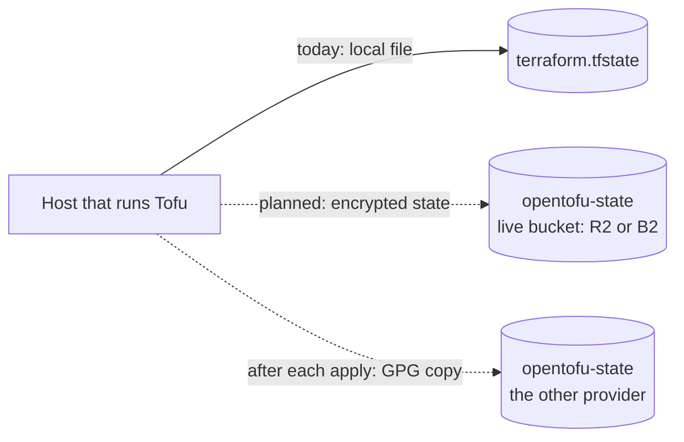

# Tofu state and credentials

Where Tofu keeps what it built, and what it needs to talk to Proxmox. Both live on
the host that runs Tofu, outside the repository.

| What | Where | Notes |
| :--- | :--- | :--- |
| State | `tofu/terraform.tfstate` on the host that runs Tofu | Ignored by git; the only copy ([State](#state)) |
| Credentials | `~/.config/tofu/credentials.tfvars`, mode `0600` in a `0700` directory | Outside the repo and outside OpenBao ([Credentials file](#credentials-file)) |
| API token | Created on the Proxmox node | `tofu@pve!skeleton`; privileges listed [below](#proxmox-api-token) |

## State

State is `tofu/terraform.tfstate` on the host that runs Tofu, ignored by git. It is
the only copy:

- `git clean -x` deletes ignored files, so it is never run in the checkout.
- A backup is taken after each apply with `tofu -chdir=tofu state pull` redirected to
  a `0600` file outside the checkout.
- Git ignores `*.tfvars`, `*.tfvars.json` and state files anywhere in the tree.
- Neither the token nor the endpoint appears in the state, but the domain and the SSH
  keys do, since each VM carries them, so a copy of the state is kept as private as
  the credentials file.

### Remote backend (planned)

[ADR 0103](../../../decisions/0103-where-tofus-state-is-held/revision-000.md) decides
where state moves to; it is `working`, so nothing here is built.



| Aspect | Plan |
| :--- | :--- |
| Bucket | `opentofu-state` on R2 and on B2, made by hand. The backend cannot be a host Tofu builds, which rules out `storage` and, while Tofu can build it, the operator host |
| Live provider | One of the two, chosen by a lock check |
| Copy | After each apply the guarded wrapper pushes `tofu state pull`, encrypted to the backup GPG key, to the other provider with a credential that cannot delete |
| Encryption | OpenTofu state encryption, so a provider holds only ciphertext. The key is in the credentials file with an offline copy |
| Credential | One that reads, writes and deletes in the state bucket only, in the credentials file |
| Migration | `tofu init -migrate-state`; the local file and its copies are deleted once a plan against the bucket shows no change |

## Credentials file

Tofu's own secrets live in a file on the host that runs Tofu, outside the repo and
outside OpenBao, since Tofu must be able to rebuild the host that runs OpenBao — see
the [decision](../../../decisions/0048-where-tofu-credentials-live/revision-000.md).
It is passed with `-var-file`:

```hcl
proxmox_endpoint        = "https://pve.example.lan:8006/"
proxmox_api_token       = "user@realm!tokenid=secret"
dns_domain              = "internal.example.com"
ansible_ssh_public_keys = ["ssh-ed25519 AAAA... ansible"]
```

| Variable | Is | Notes |
| :--- | :--- | :--- |
| `proxmox_endpoint` | The node's API URL | Must be `https://`, and TLS verification is on. `proxmox_insecure = true` skips it, which the provider's own docs limit to development |
| `proxmox_api_token` | `tofu@pve!skeleton=<secret>` | The secret |
| `dns_domain` | The inventory's `host_domain` | Derives from `main_domain`, a secret-catalog value the repository never holds. Not a secret, but feeds every VM |
| `ansible_ssh_public_keys` | The public half of `~/.ssh/proxmox_vm_servers` | Not a secret, but feeds every VM, so it sits with Tofu's other inputs |
| `opnsense_root_password`, `opnsense_api_key`, `opnsense_api_secret`, `opnsense_root_otp_seed` | The gateway's credentials | Present once the [seed](opnsense-vm.md#seed-disk) is built |

## Proxmox API token

The token is created on the Proxmox node, outside this repo, and this section is its
only record. It belongs to the user `tofu@pve`, which holds the role `TofuProvision`
on the paths below, and `TofuImageStore` on one. The token ID is `skeleton` and
privilege separation is off, so the token has the user's rights.

```sh
pveum user add tofu@pve
pveum role add TofuProvision -privs "Sys.Audit,Sys.AccessNetwork,Datastore.Audit,Datastore.AllocateSpace,Datastore.AllocateTemplate,VM.Allocate,VM.Audit,VM.Clone,VM.PowerMgmt,VM.Config.CPU,VM.Config.Memory,VM.Config.Disk,VM.Config.Network,VM.Config.Cloudinit,VM.Config.CDROM,VM.Config.Options,VM.Config.HWType,SDN.Use"
pveum acl modify /nodes/pve --users tofu@pve --roles TofuProvision
pveum role add TofuImageStore -privs "Datastore.Allocate"
pveum acl modify /storage/tofu-images --users tofu@pve --roles TofuProvision,TofuImageStore
pveum acl modify /storage/local-lvm --users tofu@pve --roles TofuProvision
pveum acl modify /storage/backup --users tofu@pve --roles TofuProvision
pveum acl modify /vms --users tofu@pve --roles TofuProvision
pveum acl modify /sdn/zones/localnetwork/vmbr0 --users tofu@pve --roles TofuProvision
pveum acl modify /sdn/zones/localnetwork/vmbr1 --users tofu@pve --roles TofuProvision
pveum user token add tofu@pve skeleton --privsep=0
```

| Path | Used for |
| :--- | :--- |
| `/nodes/pve` | Reading the node, and the image download with its size lookup (`Sys.AccessNetwork`) |
| `/storage/tofu-images` | Storing and removing images, and reading them for the disk import (`Datastore.Allocate`, from `TofuImageStore`, only here) |
| `/storage/local-lvm` | VM disks and cloud-init drives |
| `/storage/backup` | The disk and cloud-init drive of `storage` |
| `/vms` | Creating, cloning, configuring and starting VMs: every VM on the node, Tofu-managed or not |
| `/sdn/zones/localnetwork/vmbr0` | Attaching the OPNsense WAN NIC to the physical bridge |
| `/sdn/zones/localnetwork/vmbr1` | Attaching a NIC to the VLAN-aware bridge |

The role order above matters only on a fresh setup: `TofuImageStore` must exist
before the ACL names it. The image download needs `Sys.AccessNetwork` on the node, or
the older `Sys.Modify` on `/`, which is far wider; the role takes the first.
`TofuProvision` holds every privilege on every path, and Proxmox checks each one only
where it applies. A change that makes Tofu call more of the Proxmox API widens the
role to the privileges it needs and lists them here.
