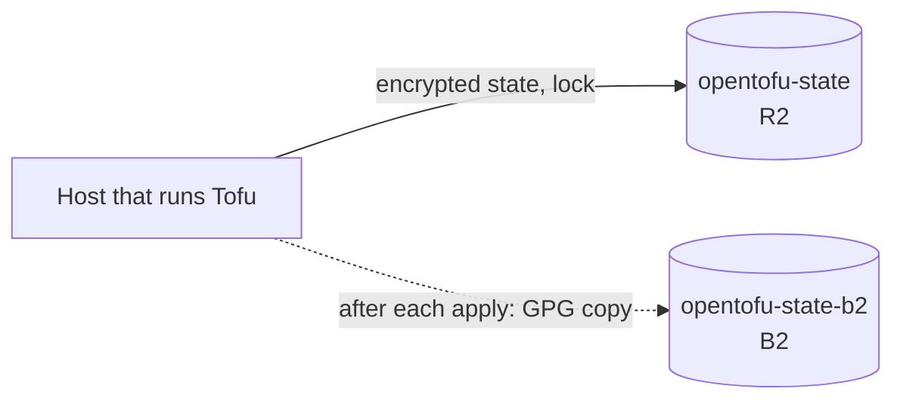

# Tofu state and credentials

Where Tofu keeps what it built, and what it needs to talk to Proxmox. The state is in
an encrypted bucket; the credentials live on the host that runs Tofu, outside the
repository.

| What | Where | Notes |
| :--- | :--- | :--- |
| State | Bucket `opentofu-state` on R2, encrypted by OpenTofu | [Remote state](#remote-state) |
| State credentials | `~/.config/tofu/state-backend.env`, mode `0600` in a `0700` directory | The bucket key pair and the encryption passphrase ([Backend environment](#backend-environment)) |
| Credentials | `~/.config/tofu/credentials.tfvars`, mode `0600` in the same directory | Outside the repo and outside OpenBao ([Credentials file](#credentials-file)) |
| API token | Created on the Proxmox node | `tofu@pve!skeleton`; privileges listed [below](#proxmox-api-token) |

## Remote state

[ADR 0103](../../../decisions/0103-where-tofus-state-is-held/revision-000.md) decides
where state lives. [`tofu/backend.tf`](../../../../tofu/backend.tf) declares the `s3`
backend and holds no secret.



| Aspect | Setting |
| :--- | :--- |
| Bucket | `opentofu-state` on R2, made by hand. The backend cannot be a host Tofu builds |
| Lock | `use_lockfile`: R2 refuses a second conditional write, so a second run is refused while the first holds the lock |
| Encryption | OpenTofu state encryption (`pbkdf2` key, `aes_gcm`) on state and plan files, `enforced`, so a missing or wrong passphrase fails the run and never writes plaintext. R2 holds only ciphertext |
| Credential | An R2 key for that bucket only; it reads, writes and deletes |
| Copy | After each apply [`state-copy-push.sh`](#state-copy) pushes a GPG-encrypted `tofu state pull` to `opentofu-state-b2` on B2 with a key that cannot delete |
| Offline copy | The passphrase, held like the backup GPG key, since the file that holds it is what a total loss removes |

Neither the token nor the endpoint appears in the state, but the domain and the SSH
keys do, since each VM carries them. The bucket holds that only as ciphertext.

## Backend environment

`tools/cloud_credentials/create_state_keys.py` mints the keys and writes
`~/.config/tofu/state-backend.env`, a file a shell can source. Every command that
reads state needs it in the environment, so source it first:

```sh
. ~/.config/tofu/state-backend.env
tofu -chdir=tofu plan -var-file="$HOME/.config/tofu/credentials.tfvars"
```

| Variable | Is |
| :--- | :--- |
| `AWS_ACCESS_KEY_ID`, `AWS_SECRET_ACCESS_KEY` | The R2 key pair |
| `AWS_ENDPOINT_URL_S3` | The account's R2 endpoint |
| `TF_ENCRYPTION` | The steady-state encryption config, `enforced` |
| `TOFU_STATE_ENCRYPTION_MIGRATING` | The same config with an `unencrypted` fallback, for the one migration command |
| `TOFU_STATE_PASSPHRASE`, `TOFU_STATE_KEY_MINTED` | The passphrase the configs are built from, and when the key pair was minted |

The two keys expire a quarter after `TOFU_STATE_KEY_MINTED`. Run
`create_state_keys.py --rotate` before then: it writes the new file before it revokes
the old key, and keeps the passphrase. The weekly `check_freshness.py` warns ahead of
that: the script registers each key's ID, and only the ID, in OpenBao's leaf tier
(`cloudflare-r2-opentofu-state-access-key`, `backblaze-b2-opentofu-state-copy-access-key`),
and the check asks the provider when that key expires. The IDs authenticate nothing, so
the secrets stay in the files. A key minted before the IDs were registered shows as
unchecked until its next `--rotate`.

Anything that calls `tofu` against the root module needs the same environment, the
inventory generator (`tools/tofu_inventory`) among them: without it `tofu output`
stops at backend initialisation. The scratch roots under `tofu/scratch/` are separate
directories with no backend, so they keep their own `-state` files and are not
affected. In the root module, `-state=` is ignored once a backend is declared and the
command runs on the live state, so do not pass it.

### State copy

After each apply, from anywhere on the host that runs Tofu:

```sh
tools/tofu_state/state-copy-push.sh
```

The script pulls the state, encrypts it to the backup GPG key at once, and pushes it
to `opentofu-state-b2/state/` under a new name, `state-<UTC time>.json.gpg`, with
`rclone copy` only. The plaintext pull exists in one scratch directory that is removed
on every exit, including a failed one. The R2 environment is sourced for the pull
alone and the B2 key for the rclone config alone, so each provider's credential reaches
only its own process. It reads `~/.config/tofu/state-copy.env`, which
`create_state_keys.py --provider b2` writes; the key writes but cannot delete, so old
copies stay until a lifecycle rule set on the bucket by hand prunes them.

To recover from a copy, with the offline GPG key and a read credential minted for the
occasion, download the newest object under `state/` from `opentofu-state-b2` with any
S3 client, then:

```sh
gpg --decrypt <name>.json.gpg > recovered.json
. ~/.config/tofu/state-backend.env
tofu -chdir=tofu state push recovered.json
```

Delete `recovered.json` afterwards; it is the state in plaintext.

### Migrating the local state

Once, from the operator host, in a checkout whose `tofu/terraform.tfstate` is the
state to move:

```sh
. ~/.config/tofu/state-backend.env
TF_ENCRYPTION="$TOFU_STATE_ENCRYPTION_MIGRATING" tofu -chdir=tofu init -migrate-state
tofu -chdir=tofu plan -var-file="$HOME/.config/tofu/credentials.tfvars"
```

The first command reads the plaintext file and writes it encrypted to the bucket; the
plan runs under the `enforced` config and must show no change. Only then delete the
local state file and the copies the rebuilds took. Never export the migrating config.

## Credentials file

Tofu's own secrets live in a file on the host that runs Tofu, outside the repo and
outside OpenBao, since Tofu must be able to rebuild the host that runs OpenBao — see
the [decision](../../../decisions/0048-where-tofu-credentials-live/revision-000.md).
It is passed with `-var-file`:

```hcl
proxmox_endpoint        = "https://pve.example.lan:8006/"
proxmox_api_token       = "user@realm!tokenid=secret"
dns_domain              = "internal.example.com"
ansible_ssh_public_keys = ["ssh-ed25519 AAAA... ansible"]
```

| Variable | Is | Notes |
| :--- | :--- | :--- |
| `proxmox_endpoint` | The node's API URL | Must be `https://`, and TLS verification is on. `proxmox_insecure = true` skips it, which the provider's own docs limit to development |
| `proxmox_api_token` | `tofu@pve!skeleton=<secret>` | The secret |
| `dns_domain` | The inventory's `host_domain` | Derives from `main_domain`, a secret-catalog value the repository never holds. Not a secret, but feeds every VM |
| `ansible_ssh_public_keys` | The public half of `~/.ssh/proxmox_vm_servers` | Not a secret, but feeds every VM, so it sits with Tofu's other inputs |
| `opnsense_root_password`, `opnsense_api_key`, `opnsense_api_secret`, `opnsense_root_otp_seed` | The gateway's credentials | Present once the [seed](opnsense-vm.md#seed-disk) is built |

## Proxmox API token

The token is created on the Proxmox node, outside this repo, and this section is its
only record. It belongs to the user `tofu@pve`, which holds the role `TofuProvision`
on the paths below, and `TofuImageStore` on one. The token ID is `skeleton` and
privilege separation is off, so the token has the user's rights.

```sh
pveum user add tofu@pve
pveum role add TofuProvision -privs "Sys.Audit,Sys.AccessNetwork,Datastore.Audit,Datastore.AllocateSpace,Datastore.AllocateTemplate,VM.Allocate,VM.Audit,VM.Clone,VM.PowerMgmt,VM.Config.CPU,VM.Config.Memory,VM.Config.Disk,VM.Config.Network,VM.Config.Cloudinit,VM.Config.CDROM,VM.Config.Options,VM.Config.HWType,SDN.Use"
pveum acl modify /nodes/pve --users tofu@pve --roles TofuProvision
pveum role add TofuImageStore -privs "Datastore.Allocate"
pveum acl modify /storage/tofu-images --users tofu@pve --roles TofuProvision,TofuImageStore
pveum acl modify /storage/local-lvm --users tofu@pve --roles TofuProvision
pveum acl modify /storage/backup --users tofu@pve --roles TofuProvision
pveum acl modify /vms --users tofu@pve --roles TofuProvision
pveum acl modify /sdn/zones/localnetwork/vmbr0 --users tofu@pve --roles TofuProvision
pveum acl modify /sdn/zones/localnetwork/vmbr1 --users tofu@pve --roles TofuProvision
pveum user token add tofu@pve skeleton --privsep=0
```

| Path | Used for |
| :--- | :--- |
| `/nodes/pve` | Reading the node, and the image download with its size lookup (`Sys.AccessNetwork`) |
| `/storage/tofu-images` | Storing and removing images, and reading them for the disk import (`Datastore.Allocate`, from `TofuImageStore`, only here) |
| `/storage/local-lvm` | VM disks and cloud-init drives |
| `/storage/backup` | The disk and cloud-init drive of `storage` |
| `/vms` | Creating, cloning, configuring and starting VMs: every VM on the node, Tofu-managed or not |
| `/sdn/zones/localnetwork/vmbr0` | Attaching the OPNsense WAN NIC to the physical bridge |
| `/sdn/zones/localnetwork/vmbr1` | Attaching a NIC to the VLAN-aware bridge |

The role order above matters only on a fresh setup: `TofuImageStore` must exist
before the ACL names it. The image download needs `Sys.AccessNetwork` on the node, or
the older `Sys.Modify` on `/`, which is far wider; the role takes the first.
`TofuProvision` holds every privilege on every path, and Proxmox checks each one only
where it applies. A change that makes Tofu call more of the Proxmox API widens the
role to the privileges it needs and lists them here.
