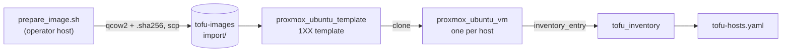

# Ubuntu VMs

How Tofu builds the Ubuntu hosts: a cloud-init template made from a prepared
image, a VM module that derives everything the
[VMID scheme](../vm-provisioning.md#vmid--vlan--ip-scheme) fixes, and the scratch
root for throwaway VMs. The root module declares the template and the five hosts
([`tofu/main.tf`](../../../../tofu/main.tf)); sizes are in their module calls.



## Network at first boot

The VM module sets the NIC's deterministic MAC and an `ip_config` holding a
static IP (the VMID-derived address), gateway and nameservers. Proxmox renders the
cloud-init `network-config` from them, matching the NIC by its MAC. No DHCP is
involved, so a rebuilt VM never races an address it picked up before Ansible could
connect, and Kea is not part of it. A hand-written `network-config` would be an
uploaded snippet the provider writes over SSH to the node; `ip_config` needs only
the API token.

## Modules

| Module | Builds | Notes |
| :--- | :--- | :--- |
| `tofu/modules/proxmox_ubuntu_template` | The cloud-init template, in the 1XX range next to the Windows templates (103–105) | `vm_id` defaults to a free ID in 1XX. Takes `image_url` with `image_checksum` (Proxmox downloads), or `image_volume_id` alone (`<datastore>:import/<name>.qcow2`, a volume already on the node); rejects both or neither |
| `tofu/modules/proxmox_ubuntu_vm` | One VM, cloned from the template | Derives VLAN tag, `/24` address with `.1` as gateway, and MAC from `vm_id` |

The root module passes `image_volume_id`: the copy
[`prepare_image.sh`](#prepared-image) builds from the dated release directory and
SHA-256 in `ubuntu_image_url` and `ubuntu_image_checksum`
([`tofu/variables.tf`](../../../../tofu/variables.tf)), named
`<image name>-<release directory>-prepared-<timezone>.qcow2` on
`image_datastore_id`. The zone comes from the `timezone` variable (default
`Asia/Singapore`, the inventory's `server_timezone`), and the
`ubuntu_image_prepare_command` output prints the command for the current pin.

### The VM module

| Aspect | Behaviour |
| :--- | :--- |
| Accepts | A `vm_id` in 2XX to 5XX whose last two digits are 02 to 49 (not the reserved, gateway or DHCP-pool host parts) |
| Nameservers | The VLAN's gateway by default; `dns_servers` replaces them |
| Search domain | `dns_domain`, the lab's internal zone, with no default: a VM with no search domain gets a copy of the node's own |
| Sizing | `cores`, `memory_mb`, `disk_gb` default in [`variables.tf`](../../../../tofu/modules/proxmox_ubuntu_vm/variables.tf); a larger host overrides them |
| Outputs | `vm_id`, `hostname`, `datastore_id`, `ip_address`, `mac_address` and `inventory_entry` (the one the [inventory generator](../vm-provisioning.md#tofu--ansible-handoff) reads) |

```hcl
module "services" {
  source          = "./modules/proxmox_ubuntu_vm"
  node_name       = var.proxmox_node
  vm_id           = 203
  name            = "services"
  template_vm_id  = module.ubuntu_template.vm_id
  admin_username  = "svcadmin"
  dns_domain      = var.dns_domain
  ssh_public_keys = var.ansible_ssh_public_keys
}
```

`dns_domain` and `ssh_public_keys` come from the `dns_domain` and
`ansible_ssh_public_keys` variables, which the
[credentials file](state-and-credentials.md#credentials-file) sets.

### Replacing the template

The provider imports a disk only when it creates it and ignores a changed
`import_from` on an existing one, so the template resource is replaced whenever
the module's image inputs change.

- A new image pin names a new volume and replaces the template on the next apply.
  The first apply after the template was built from a download replaces it too,
  since the tracking resource is new.
- Tofu destroys the old template before it creates the new one, so the image volume
  has to be on the node first (`pvesm list tofu-images --content import`).
- Replacing the template does not touch its clones, which hold their own disks, but
  a clone cannot be created while the template is absent.

### Firmware

The template and its clones are `q35` machines booting UEFI (`ovmf`) from a `4m`
EFI disk on the VM datastore with the distribution and Microsoft keys pre-enrolled,
so secure boot is on. The clone repeats the firmware and the EFI disk, because the
provider otherwise plans SeaBIOS and a `2m` disk over the template's, and a
different EFI disk type replaces the VM. The OPNsense module does not set firmware.

### Storage

| Storage | Holds | Why |
| :--- | :--- | :--- |
| `local-lvm` (NVMe) | VM disks | Performance |
| `backup` (HDD) | `storage`'s disk only | It holds the on-site copy of every backup, so it must not share a disk with the hosts it protects |
| `tofu-images` | The Ubuntu cloud image and the OPNsense ISO/image | Small one-time downloads; a directory storage that holds only ISO and import content |

`tofu-images` is created once on the node:

```sh
pvesm add dir tofu-images --path /var/lib/tofu-images --content iso,import
```

Deleting a stored file takes `Datastore.Allocate`, which gives full access to every
volume on a storage, so the token holds it on this storage only
([Proxmox API token](state-and-credentials.md#proxmox-api-token)). Bumping an image
URL replaces the download, and the old file goes with it. Disks are imported from it
through the API alone; the other route, `file_id` on an `iso` download, needs SSH to
the node. The provider's docs say a `.qcow2` file name is rejected by Proxmox before
8.4.

### Tests

`tofu -chdir=tofu test` checks the VMID-derived values and the input rules against a
mocked provider, so it needs no node or credentials. A new `run` block with its own
`module` source needs `tofu init` again before it is found. The `tofu-checks` CI job
runs it with the format check, `init` and `validate` on every change under `tofu/`
([`pipeline.md`](../../engineering/ci/pipeline.md#jobs)); run `tofu fmt -recursive`
before pushing.

## Prepared image

Every Ubuntu VM is cloned from a template built from a prepared copy of the cloud
image. The script changes three things, fixed once in the image and not on each
host: the initramfs, cloud-init's hosts template, and the timezone.

```sh
tofu/modules/proxmox_ubuntu_template/prepare_image.sh IMAGE_URL IMAGE_CHECKSUM OUT_DIR TIMEZONE
```

It runs as root or a user with `sudo` (whose password it asks for before it
downloads anything), on a host with `curl`, `qemu-img` and util-linux (`losetup`,
`lsblk`, `blkid`, `mount`, `chroot`), and needs about 8 GB free in `OUT_DIR`
(`MIN_FREE_KB`). It writes
`OUT_DIR/<image name>-<release directory>-prepared-<timezone>.qcow2` as a compressed
qcow2 with its SHA-256 in `<file>.sha256`. The template imports the copy from the
node's `tofu-images` storage: copy it to `/var/lib/tofu-images/import/` on the node
(`scp`), check the `.sha256` there, then apply.

| Change | Why it is in the image |
| :--- | :--- |
| [Initramfs without networking](#initramfs-without-networking) | A stock image's initramfs brings every NIC up with DHCP before cloud-init runs |
| [Hosts template](#hosts-template-and-timezone) | A container resolved the host's own name to loopback |
| [Timezone](#hosts-template-and-timezone) | A host left on UTC runs its `OnCalendar` timers hours away from the containers' cron schedules |

### Initramfs without networking

The 26.04 cloud image builds its initramfs with dracut. Dracut's `systemd-networkd`
module runs in the initramfs and, with no `ip=` option on the kernel command line,
copies `dracut-default.network` to
`/run/systemd/network/zzzz-dracut-default.network`, which asks every NIC for DHCP
before cloud-init runs.

- dracut includes that module only when another module needs the network, and the
  image's generic initramfs has two: `dyn-netconf` and `iscsi`. Omitting
  `dyn-netconf` alone left `network`, `systemd-networkd` and the file in a generic
  build; omitting both leaves none of them.
- Left in, cloud-init fails to rename the NIC to the name its network config uses
  (`[busy] Error renaming ... from ens18 to eth0`), the netplan files it writes match
  no device, and the VM keeps the DHCP lease in place of the static address from
  `ip_config`. Upstream tracks the rename failure in
  [cloud-init issue 6887](https://github.com/canonical/cloud-init/issues/6887).
- Kea serves no VLAN 20 zone once the gateway play has rebuilt the gateway, so a VM
  cloned from the stock image would have no address at all.

What the script does:

1. Downloads the image and checks it against the SHA-256, converts it to a raw disk
   on a loop device, and mounts the partition labelled `cloudimg-rootfs`, the one
   labelled `BOOT` when there is one, and `/dev`, `/proc` and `/sys`. Only the loop
   device's own partitions are searched for labels, since the build host can carry
   the same ones.
2. Binds a directory of its work directory over the image's `/var/tmp`, because
   dracut builds the initramfs there and the image's root file system has almost no
   free space until the first boot grows it.
3. Writes `omit_dracutmodules+=" dyn-netconf iscsi "` to
   `/etc/dracut.conf.d/99-no-initrd-network.conf` and regenerates every initramfs
   with `dracut --regenerate-all --force --no-hostonly --no-hostonly-cmdline`, since
   a chroot sees the build host's devices and a host-only initramfs would fit the
   host instead of the VMs.

The dracut configuration stays in the image, so a later kernel update regenerates
its initramfs without the modules. That regeneration is host-only and holds no
networking at all, so the `/boot` of a VM that has already upgraded a kernel does not
show what its first boot ran; the first boot's journal (`journalctl -b -1`) does.

| The script stops, writing nothing to `OUT_DIR`, when | Because |
| :--- | :--- |
| The image has no dracut | The step does not apply |
| No initramfs lists `systemd-networkd` before the change | The image no longer needs the step |
| Any initramfs lists an omitted module or `systemd-networkd` afterwards | Another module then needs the network, and the omit list needs that module too |
| A listing fails | The result cannot be checked |

On every exit path it unmounts in reverse order, detaches the loop device and removes
its work directory, except that a failed unmount leaves the directory in place, since
removing it over a mount would delete the image's files and the host's `/dev`
entries.

### Hosts template and timezone

A VM has a fully qualified name from its search domain and cloud-init's
`manage_etc_hosts` on, so cloud-init renders `/etc/hosts` from
`/etc/cloud/templates/hosts.debian.tmpl` at every boot with the line
`127.0.1.1 {{fqdn}} {{hostname}}`. `systemd-resolved` answers lookups from
`/etc/hosts`, and Docker's DNS for containers forwards to it, so a container on the
host resolved the host's own name to an address that is loopback inside the
container. Tinyauth could not reach lldap, which it addresses by a CNAME to the
host's name. The script rewrites the line to `127.0.1.1 {{hostname}}`, matching the
whole line, and stops when the template no longer has it, so an upstream change
cannot leave the fully qualified name in place.

It also sets `/etc/localtime` and `/etc/timezone` to `TIMEZONE`, and stops when the
image has no such zone. `server_timezone` reaches containers as `TZ`, and a host left
on UTC would run the `OnCalendar` schedules of its systemd timers hours away from the
containers' cron schedules: the cloud sync that follows the backups, the certificate
renewal heartbeat and the expiry checks. The zone is part of the image's name, so
another zone is another volume and the template is replaced.

## Canary VMs

[`tofu/canaries.tf`](../../../../tofu/canaries.tf) builds the canaries of the [network boundary checks](../network-boundary-checks.md): one small VM per zone, from the same module and template as the hosts, so the zone's flows can be tried from inside it. A canary holds no credential and runs nothing of its own. It is not in `ansible_hosts`, so no Ansible group or role reaches it.

| Aspect | Behaviour |
| :--- | :--- |
| Which zones | The `canary_vm_ids` map, one entry per zone that has a canary. A zone is added once the gateway admits the runner's host to the canary's address on 22 |
| VMID and address | The host part is 08, clear of the DHCP pool, so the services canary is VMID 208 at `192.168.20.8`. The address is the zone's `canary` in the flow list |
| Login | The admin user `canary`, with `canary_ssh_public_keys`. The key is the runner's own, not the one Ansible uses. With no key set, no canary is built |
| Size | 1 core, 1 GiB, 8 GiB disk |

Zones without a canary yet: others, desktops and isolated need a row in the gateway's policy that admits the runner's host to the canary's address, and experimental also needs the module's VMID range widened past 5XX.

## Scratch Ubuntu VM

`tofu/scratch/ubuntu` is a second root for one throwaway Ubuntu VM, for work that
needs a real VM and keeps nothing of it. It clones the template through
`proxmox_ubuntu_vm`, tags the VM `scratch`, and shares the main root's provider pin
and lock file through symlinks, as the [scratch gateway](opnsense-scratch-gateway.md)'s
root does. Its state and provider directory live outside the checkout. Its `ssh`
output names the static address.

| Input | Notes |
| :--- | :--- |
| `vm_id` | No default. Picks the zone, because the module derives the VLAN from its hundred. The VM reaches only what that zone's gateway rules allow: the gateway play gives VLAN 50 no access to the internet (`internet: false` in [`opnsense_gateway_zones`](../../../../ansible/roles/opnsense_gateway/defaults/main.yaml)). A VM in VLAN 60 or 70 needs the module's accepted range widened first. In a zone the play serves with Kea (host numbers 10 to 245, `opnsense_gateway_dhcp_pool`), a host part of 02 to 09 stays clear of the pool |
| `ssh_public_keys`, `dns_domain` | No default |
| `cores`, `memory_mb`, `disk_gb` | 2, 2048 and 16 |

From the repo root, with the [credentials file](state-and-credentials.md#credentials-file):

```sh
umask 077
out="$HOME/scratch-vm"
mkdir -p "$out"
export TF_DATA_DIR="$out/.terraform"
printf '%s\n' 'vm_id = 502' 'dns_domain = "<internal zone>"' \
  'ssh_public_keys = ["<public key>"]' > "$out/scratch.tfvars"
cd tofu/scratch/ubuntu
tofu init -backend=false -input=false -lockfile=readonly
tofu apply -state="$out/terraform.tfstate" \
  -var-file="$HOME/.config/tofu/credentials.tfvars" -var-file="$out/scratch.tfvars"
tofu output -state="$out/terraform.tfstate" ssh
```

`tofu destroy` with the same `-state` and `-var-file` flags removes the VM and its
disks and leaves the template. A VM left running keeps its cores and memory, so
destroy it when the work is done. The API token's role already covers it, since the
VM is a clone like any other.
