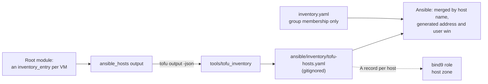

# VM Provisioning: Proxmox via OpenTofu

The scheme OpenTofu-driven Proxmox provisioning rests on (VMID, VLAN, IP and MAC),
the boundary with Ansible, and how to run Tofu. OpenTofu owns everything up to "the
VM exists, boots, and can be reached over SSH with the right network config."
Ansible's job starts there; [`deployment-flow.md`](../deploy/deployment-flow.md)
covers what happens once it takes over.

| Subject | Doc | State |
| :--- | :--- | :--- |
| Ubuntu template, VM module, prepared image, scratch VM | [`tofu/ubuntu-vms.md`](tofu/ubuntu-vms.md) | Built; the five Ubuntu hosts are declared in the root module |
| OPNsense VM module, seed disk, first boot | [`tofu/opnsense-vm.md`](tofu/opnsense-vm.md) | Built; the root module declares no gateway, since the production one is hand-maintained |
| Gateway configuration through its API | [`tofu/opnsense-gateway.md`](tofu/opnsense-gateway.md) | Built; applied to a scratch gateway |
| Scratch gateway and its acceptance run | [`tofu/opnsense-scratch-gateway.md`](tofu/opnsense-scratch-gateway.md) | Built |
| State, credentials file, Proxmox API token | [`tofu/state-and-credentials.md`](tofu/state-and-credentials.md) | State is in an encrypted R2 bucket, with a GPG copy on B2 |
| Rebuilding a host | [`rebuild-runbook.md`](../disaster-recovery/rebuild-runbook.md) | Built |

Build status across the initiative is in the `tofu-vm-provisioning` entry of
[`project-planning.md`](../../project-planning.md#super-projects).

## VMID / VLAN / IP scheme

VMID-hundred ranges follow the existing numbering convention; each networked range
maps to its own VLAN and subnet:

| VMID range | Purpose | VLAN | Subnet | This repo's scope |
| :--- | :--- | :--- | :--- | :--- |
| 1XX | Templates | — (not networked) | — | Tofu's own cloud-init Ubuntu template lands here |
| 2XX | Production — Services | 20 | `192.168.20.0/24` | Primary target: the Ubuntu hosts and the gateway |
| 3XX | Production — Others | 30 | `192.168.30.0/24` | Reserved, unused today |
| 4XX | Production — Desktops | 40 | `192.168.40.0/24` | **Out of scope**: GPU passthrough and manual OS installs, not cloud-init-able the same way |
| 5XX | Experimental | 50 | `192.168.50.0/24` | Isolated experiments: the [scratch gateway](tofu/opnsense-scratch-gateway.md) is VMID 501, and a [scratch VM](tofu/ubuntu-vms.md#scratch-ubuntu-vm)'s VMID picks its zone |
| 6XX–8XX | Unassigned | — | — | Reserved for future ranges as needed |
| 9XX | Archived | — (not running) | — | No networking required |

Within a range, `vlan_id = (vmid // 100) * 10` and `host_octet = vmid % 100`:

- `X00` and `1000+` are never assigned to a real VM, so the derivation never produces
  a `.0` host address.
- `.1` in every networked VLAN is the OPNsense sub-interface (the gateway), whether or
  not a VM holds the `X01` VMID. A VM other than OPNsense never takes `X01`; every
  other VMID in a range starts at `X02`.

Each VLAN's `/24` is split so Tofu's static addresses and Kea's pool never collide:

| Addresses | Used for |
| :--- | :--- |
| `.1`–`.49` | The gateway and Tofu-provisioned VMs (static, VMID-derived) |
| `.50`–`.254` | Kea's DHCP pool, for anything Tofu does not manage (laptops, phones). A client here has no DNS name |

VM 401 ("Development") is the controller today
([ADR 0058](../../decisions/0058-where-operator-work-runs/revision-000.md)), so it is
a dependency of the tooling although it stays outside Tofu's and Ansible's
management.

## MAC address scheme

Proxmox's own auto-assigned MACs use OUI `BC:24:11`. Tofu keeps that prefix, so a
MAC stays recognisable as Proxmox-owned, and encodes the VMID plus the NIC index into
the rest:

`BC:24:11:{VMID as 4 hex digits}:{NIC index}`, for example VMID 201, NIC 0 →
`BC:24:11:00:C9:00`.

It is deterministic per VMID, so a rebuilt VM gets the same MAC every time, which the
MAC-matched network config
([`tofu/ubuntu-vms.md`](tofu/ubuntu-vms.md#network-at-first-boot)) needs to stay
stable across rebuilds.

## Tofu ↔ Ansible handoff

Tofu does not write into `ansible/` directly.



The root module's `ansible_hosts` output maps an inventory host name to
`module.<name>.inventory_entry`, which carries the VM's static address and login
user. `tools/tofu_inventory` reads it and writes `ansible/inventory/tofu-hosts.yaml`
giving each host its `ansible_host` (the IP, since a static VM has no DHCP lease to
register in DNS) and `ansible_user`. Run it from `tools/` after an apply:

```sh
cd tools && uv run python -m tofu_inventory
```

| Rule | Detail |
| :--- | :--- |
| Rejects | An entry with extra or missing keys; a name that is not a DNS label (lowercase letters, digits and hyphens, starting with a letter, not ending in a hyphen, at most 63 characters); an address that is not IPv4. A failed run leaves the previous file in place |
| Merge | `inventory.yaml` keeps only what Tofu cannot know — group membership. `ansible.cfg` loads the two files in that order, so Ansible merges them by host name and the generated address and user win ([`ansible.md`](../deploy/ansible.md#inventory) covers a run that passes `-i`) |
| New VM | A module call, an `ansible_hosts` entry and a name in its groups |
| DNS | No further step: the `bind9` role gives every host the inventory addresses by an IPv4 address an `A` record of its inventory host name and its `ansible_host` in the host zone ([`bind9.md`](../services/bind9.md#the-host-zone)). A host with a hand-written record in `host_vars/services.yaml` loses it when rebuilt: the role refuses a host named both ways |

Each tool keeps one job, as `host_vars` and `app_catalog` already split concerns in
this repo.

## Tofu project

The root module is `tofu/` at the repo root.

| File | Holds |
| :--- | :--- |
| `versions.tf` | Pins OpenTofu (`~> 1.13`) and the `bpg/proxmox` provider (exactly) |
| `providers.tf` | Configures the provider with an API token |
| `.terraform.lock.hcl` | Committed |
| `main.tf` | Reads the `pve` node, so `tofu plan` fails on a wrong endpoint, token or node name instead of passing with nothing to do; that read is its only call apart from the template build and the VMs it declares |
| `modules/`, `tests/` | The modules ([Ubuntu](tofu/ubuntu-vms.md#modules), [OPNsense](tofu/opnsense-vm.md#the-module)) and their tests |

### Installing

OpenTofu is installed on the host that runs it with its official installer (Debian
and Ubuntu). Read the script before running it:

```sh
curl --proto '=https' --tlsv1.2 -fsSL https://get.opentofu.org/install-opentofu.sh -o install-opentofu.sh
chmod +x install-opentofu.sh
./install-opentofu.sh --install-method deb
rm -f install-opentofu.sh
```

`tofu version` must satisfy `required_version` in `versions.tf`. The provider needs no
separate install: `tofu init` fetches it.

### Running

Run Tofu from the repo root with `umask 077`, which makes the state file `0600`, and
with `TF_DATA_DIR` set outside the checkout on every command. Without it `tofu init`
unpacks the provider, README included, into `tofu/.terraform/`, where
`check-doc-drift` scans it and fails `pre-commit`:

```sh
umask 077
export TF_DATA_DIR="$HOME/.cache/tofu/homelab"
tofu -chdir=tofu init
tofu -chdir=tofu plan -var-file="$HOME/.config/tofu/credentials.tfvars"
```

To stop repeating the flags, set them in the shell profile. `TF_CLI_ARGS_<command>`
adds arguments to one command only, which `init` needs since it takes no `-var-file`,
and after `cd tofu` no `-chdir` is needed:

```sh
export TF_DATA_DIR="$HOME/.cache/tofu/homelab"
for c in plan apply destroy refresh import console; do
  export "TF_CLI_ARGS_$c=-var-file=$HOME/.config/tofu/credentials.tfvars"
done
```

The credentials file and the API token are in
[`tofu/state-and-credentials.md`](tofu/state-and-credentials.md).
