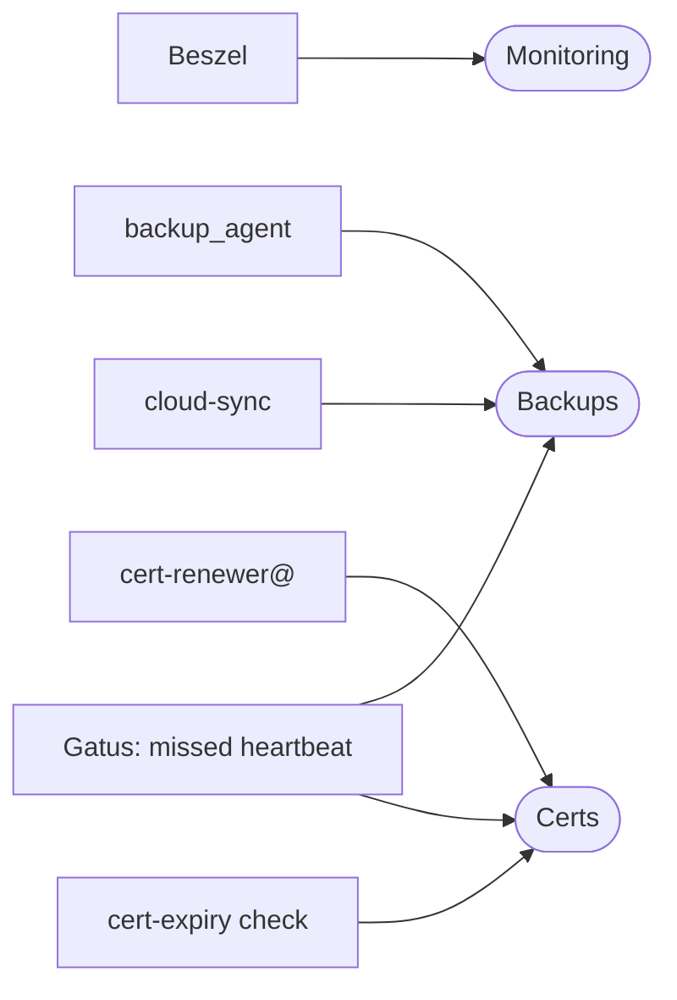

# Telegram Notifications

One bot, one group chat with [Topics](https://telegram.org/blog/topics-in-groups-collectible-usernames)
enabled, a different topic per concern — see
[ADR 0011 (Alert routing)](../../decisions/0011-alert-routing-and-noise/revision-000.md) for why.
The backup and relay failures share the Backups topic, as two halves of the
same disaster-recovery path; both kinds of certificate failure share Certs:



| Concern | Sends via | Topic var |
| :--- | :--- | :--- |
| Host/container monitoring (Beszel) | Beszel's built-in notifications | `telegram_chatid_monitoring` |
| Backup job failures | `docker-volume-backup`'s notifier | `telegram_chatid_backups` |
| Cloud-sync relay failures | `telegram-notify-cloud-sync` (systemd) | `telegram_chat_id` / `telegram_topic_id_backups` |
| Cert renewal failures (lldap) | `telegram-notify@` (systemd) | `telegram_chat_id` / `telegram_topic_id_certs` |
| Caddy cert-expiry check failures | `telegram-notify-cert-expiry` (systemd) | `telegram_chat_id` / `telegram_topic_id_certs` |
| Missed job heartbeats | [Gatus](gatus.md#telegram-routing) | `telegram_topic_id_<group>` |

## One-time Telegram-side setup

1. Create the bot via [@BotFather](https://t.me/BotFather); save the token.
2. Create (or pick) a group, enable **Topics** in its settings, add the bot
   as an **admin** — a non-admin bot can't post into an arbitrary topic.
3. Create a topic per row above (e.g. "Updates", "Monitoring", "Backups",
   "Certs").
4. Get the chat ID: forward any message from the group to
   [@shoutrrrbot](https://t.me/shoutrrrbot), or address a message to
   `@shoutrrrbot` from inside the group.
5. Get each topic's ID: open the topic in Telegram, copy a message link
   (`https://t.me/c/<chat>/<topic_id>/<msg_id>`) — the middle number is
   the topic (thread) ID.

## Wiring it into this repo

`telegram_token`/`telegram_chat_id` are the shared bot secrets
(`secret_catalog.yaml`, see [`secrets.md`](../security/secrets.md)). Each concern
above has its own `telegram-topic-id-*` entry, `allow_blank: true` since
Topics is optional — a blank topic ID falls back to posting in the
group's main stream, no code change needed either way (see `main.yaml`'s
`telegram_chatid_*` vars). All of these are Vault-backed
(`store: openbao`, `scope: hosts/all/telegram`); bootstrap them the same way as any
other Vault-backed manual secret:

```sh
cd tools && python3 -m openbao_utils.bootstrap
```

Two address formats are needed:

| Sender | Format | Vars |
| :--- | :--- | :--- |
| `docker-volume-backup`, Beszel (through [shoutrrr](https://containrrr.dev/shoutrrr/v0.8/services/telegram/)) | One `chat_id:topic_id` string | `telegram_chatid_*` |
| The systemd notifiers (Bot API directly) | `chat_id` and `message_thread_id` apart; the colon form is not understood | `telegram_chat_id`, `telegram_topic_id_*` |

**All three systemd-based notifiers share one library role**,
`telegram_notify` (`ansible/roles/telegram_notify`):

- A oneshot unit that curls `sendMessage` directly, parameterized by
  unit name, description, message text, and which topic to post to.
- Included via `include_role` from each consumer's own
  `tasks/main.yaml`.
- Has no `tasks/main.yaml` or molecule suite of its own (same shape as
  `molecule_helpers`).
- Never reloads systemd or notifies a handler itself, so it never
  depends on a same-named handler existing in whatever play includes it.
  The including role reloads instead, by including the `systemd_reload`
  library role's `reload.yaml` (below), which reads the
  `telegram_notify_env_result`/`telegram_notify_curlrc_result`/
  `telegram_notify_service_result` it registers.

Each timer role (`backup_agent`, `caddy_cert_expiry`, `cloud_sync`,
`step_ca_cert`) runs the same sequence, in this order:

1. Include `systemd_reload` with no `tasks_from`, so its handler exists,
   then install the Telegram notifier with the role above, and the Gatus
   push unit where it has one.
2. Template its own service and timer, each with `notify: Reload systemd`.
3. Include `systemd_reload`'s `reload.yaml`: reload systemd if a notifier
   unit changed, then flush handlers so the handler for its own units has
   run too. A role that installed a Gatus push unit sets
   `systemd_reload_gatus: true`.
4. Enable and start its timer.

`Reload systemd` is defined once, in `systemd_reload`'s handlers. Each of
these roles includes `systemd_reload` (no `tasks_from`) before its first
`notify`; without that the handler doesn't exist yet and the run fails with
"handler not found". It is an include, not a `dependencies:` entry in
`meta/main.yaml`, because Molecule treats a role with a `meta/main.yaml` as
a Galaxy role and fails its prerun without `galaxy_info`.

A trailing `@` in the unit name (`telegram-notify@`, `cert-renewer@`'s
own notifier) renders a genuine systemd `@`-instantiated template unit,
not a plain one — Jinja only substitutes `{{ }}` expressions, so a
literal `%i` left in the message/description text passes straight
through for systemd itself to substitute at instantiation time. This
needs nothing extra from the shared role; it falls out of the interface
as-is.

**Messages are sent with `parse_mode=Markdown`** (legacy, not MarkdownV2), so a
backticked value in `telegram_notify_message` renders as monospace. Only `` ` ``,
`_`, `*` and `[` need escaping when literal. MarkdownV2 would also require it for `.`
and `-`, common in hostnames and unit names, and reject the whole message on a
missed one. No escaping exists, since no caller interpolates a value containing
those four characters; a caller whose value might must escape it.

**The bot token's colon matters.** A BotFather token is `<bot-id>:<rest>`, and
shoutrrr's Telegram service relies on that colon, validating the rejoined value
against `^[0-9]+:[a-zA-Z0-9_-]+$`. A token without that shape fails sender setup on
every scheduled run, and for `docker-volume-backup` sender setup precedes the
backup, so the backup never runs. A real token always has the shape; this bites
only test placeholders.

## Per-app notes

- **Beszel**: not Ansible-managed — its notification channels live in the
  hub's own database, configured once by hand in Settings > Notifications
  (same category as the hub key/token bootstrap, see
  [`beszel.md`](beszel.md#connection-model)). Add a service URL of
  `telegram://<telegram_token>@telegram?chats=<telegram_chatid_monitoring>`.
- **backup_agent**: `NOTIFICATION_URLS` in the role's shared `.env`
  (`ansible/roles/backup_agent/templates/env.j2`) — fires on failed
  backup runs only (`docker-volume-backup`'s own default
  `NOTIFICATION_LEVEL=error`), not on every successful one. Since every
  app's schedule shares this one container and one `NOTIFICATION_URLS`,
  `ansible/roles/backup_agent/files/notification-failure.template`
  overrides the default failure title/body to include
  `Config.BackupSources` (`/backup/<app>`) and `BACKUP_HOST_NAME` — so
  the alert names which app and host failed instead of just "backup
  failed".
- **cloud_sync**: `ansible/roles/cloud_sync/templates/cloud-sync.service.j2`
  sets `OnFailure=telegram-notify-cloud-sync.service`, a plain (non-`@`)
  consumer of `telegram_notify` above — posts to the same Backups topic
  as backup_agent above, since it's the "relay it onward" half of the
  same disaster-recovery story (see
  [`backup.md`](../disaster-recovery/backup.md)).
- **Cert renewal**: `ansible/roles/step_ca_cert/templates/cert-renewer@.service.j2`
  sets `OnFailure=telegram-notify@%i.service` — `telegram_notify` called
  with `telegram_notify_unit_name: "telegram-notify@"`, the `@`-instantiated
  case the shared-role paragraph above describes. `%i` here is the
  *invoking* unit's own instance (e.g. `lldap`), not a generic
  failed-unit name — this is coupled to `cert-renewer@`'s naming, not a
  catch-all notifier for arbitrary units. An `ExecCondition` skip (the
  common, nothing-due-for-renewal case) is not a failure and never
  triggers this — systemd only treats exit codes 255 or an abnormal exit
  as a failure for `ExecCondition`.
- **Caddy cert-expiry**: `ansible/roles/caddy_cert_expiry` — a daily
  timer runs `check.sh`, which checks the certificate Caddy is actually
  serving (a live TLS handshake against one of this host's own routed
  subdomains, not a file on disk) rather than renewal internals, since
  Caddy manages its own ACME renewal and this is meant to catch that
  process silently failing. One check per host: `caddy_domain` and its
  wildcard cert are both per-host, so every routed subdomain shares the
  same cert — no per-domain enumeration needed.
  `OnFailure=telegram-notify-cert-expiry.service`, its own consumer of
  the shared `telegram_notify` role above, posting to the same Certs
  topic as `cert-renewer@` since it's the same kind of concern for a
  different cert. Threshold is `caddy_cert_expiry_threshold_days`
  (default 30).

## Pinned topic headers

This playbook posts one static header message per topic and pins it, so the
group shows what each topic is for:

```sh
# from the repo root
ansible-playbook ansible/playbooks/pin-telegram-topics.yaml
```

Control-node-only (`hosts: localhost`) — nothing to do with any managed
host. Safe to re-run: each topic's `message_id` and whether it has been
pinned are recorded in `ansible/files/telegram-pins/<topic>` (gitignored,
same convention as `ansible/files/secrets/`), since Telegram's API has no
per-topic "already pinned?" query to check against instead. The file
reads `<message_id> unpinned` once the header is posted and
`<message_id> pinned` once the pin succeeds:

- Posted but not pinned (for example the bot lacks the right below): the
  run fails, and the next run pins the same message without posting a
  second header.
- Posted and pinned: later runs do nothing.
- A file holding only a message id counts as pinned, so it is not re-pinned
  over whatever was pinned in the topic since.
- To force a fresh post, delete the file; that posts a new header.

The bot needs the **Pin Messages** admin right in the group for this,
in addition to the admin right the setup steps above already require.

To change the wording or add a topic, edit the `telegram_topic_pins`
list in the playbook directly — there's no separate vars file for it.

The header is static: there is no live status pin that each notifier edits.

## Verifying it actually delivers

Molecule (`ansible/roles/step_ca_cert/molecule/default`,
`ansible/roles/step_ca_cert/molecule/signal_chown`,
`ansible/roles/cloud_sync/molecule/default`, and
`ansible/roles/caddy_cert_expiry/molecule/default`) confirms the
`OnFailure=` link exists, the unit templates correctly, and it loads and
runs under real systemd — it can't confirm a real Telegram message
arrives, since CI has no live bot credentials. Check that part yourself
after deploying:

```sh
# on security: the cert-renewal alert
sudo systemctl start telegram-notify@lldap.service
journalctl -u telegram-notify@lldap.service --no-pager -n 20
```

```sh
# on storage: the cloud-sync alert
sudo systemctl start telegram-notify-cloud-sync.service
journalctl -u telegram-notify-cloud-sync.service --no-pager -n 20
```

```sh
# on any app host: the cert-expiry alert
sudo systemctl start telegram-notify-cert-expiry.service
journalctl -u telegram-notify-cert-expiry.service --no-pager -n 20
```

A `curl` exit status other than a clean `0` there (bad token, wrong chat
ID, bot not an admin in the topic's group) means the alert wouldn't have
reached you for a real failure either — worth confirming once per host,
not just trusting the config rendered.
