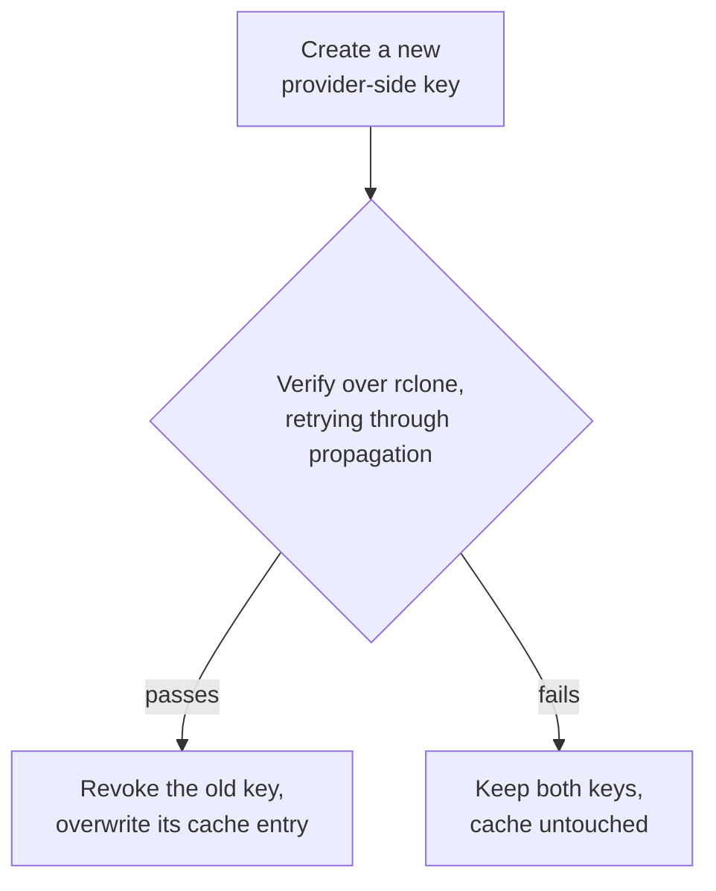

# Cloud Credential Rotation — R2/B2/OCI

How the leaf and rotation credentials are rotated, per provider: the `--rotate` flow and its verification, the `rclone` settings that verification depends on, and rotating the rotation credential itself. Creation is in [`creation.md`](creation.md); what each credential is scoped to is in [`scoping.md`](scoping.md).

## Rotation

### Leftover files and identities

`audit.py --local` flags anything under `ansible/files/secrets/` that matches no current
config. It cannot see console-side IAM objects: if an unused `homelab-key-rotation`
identity from before the SCIM app still exists, delete its API signing key first, then the
policy, the group membership and the user
([ADR 0109](../../../decisions/0109-knowing-a-cloud-credential-is-about-to-expire/revision-000.md)).

### Rotating leaf keys



One leaf, or one kind, at a time:

```sh
cd tools && python3 -m cloud_credentials.create_leaf_keys --provider b2 --rotate write
```

```sh
cd tools && python3 -m cloud_credentials.create_leaf_keys --provider oci --rotate both
```

```sh
cd tools && python3 -m cloud_credentials.create_leaf_keys --provider r2 --rotate read
```

**All six leaves in one run:**

```sh
cd tools && python3 -m cloud_credentials.rotate_leaf_keys
```

It runs `--rotate both` for B2, then OCI, then R2, and takes no arguments:

- A provider that fails verification, exits or raises does not stop the others, since each
  rotates on its own. Failed providers are named on stderr and the run exits 1.
- It asks nothing, except that R2's fallback prompt for its admin token cannot be answered
  without a terminal. So R2 fails unless the token is already cached
  (`create_rotation_keys --provider r2`, [below](#rotating-the-rotation-credential-itself)).

A rotated write leaf reaches `storage` only when `deploy.yaml` renders `rclone.conf` again,
and the old key is already revoked, so after a rotation by hand:

```sh
# from ansible/
ansible-playbook playbooks/deploy.yaml --limit storage,localhost
```

The read leaf needs no redeploy ([both cases](../secrets-rotation.md#manual-secrets-source-manual)).

Verification uses the S3-compatible path production uses (`verify_leaf_via_rclone` in
`cloud_credentials/verify.py`): a listing for the read leaf (rclone lists with the v1 call
on all three), and HeadObject, PutObject, HeadObject for the write leaf. A failed
verification rolls nothing back and retries nothing: the old key keeps working, and the new
one is reported for you to check or delete. `--rotate write` never touches the read leaf.

### Verification

**It retries through the key-propagation window.** A new key is not always usable at once,
and no provider distinguishes that from a policy denial, so the retry matches on HTTP
status alone (403 or 401):

- A real policy problem takes the whole window to surface. Accepted: without retries, each
  manual re-run would mint and orphan another key.
- Windows differ (OCI longest, R2 shortest), all within the ceiling. Widen
  `_run_rclone_with_retry`'s `retries` or `delay` if a rotation exhausts it.
- A hung rclone call (past `--timeout`) fails like any non-retryable error.
- A first success means the key works now, not that propagation is finished: on OCI, fresh
  connections were still refused for a minute or more afterwards.

**Verification stays on rclone, not an SDK client**, because it has to
follow production's request sequence. boto3 sends a different one (no
HEAD around the write, a v2 listing) and needs different settings per
provider, so a key could pass a boto3 check and still fail under rclone.
The comparison is in
[ADR 0104 (Python client libraries)](../../../decisions/0104-which-client-library-each-external-service-uses/revision-000.md).

**rclone settings it depends on:**

| Setting | Why |
| :--- | :--- |
| `no_check_bucket = true` | A bucket-restricted key fails rclone's bucket-existence check, so rclone tries `CreateBucket`, which it has no right to (rclone issues 4703 and 5119). `cloud_sync`'s `rclone.conf.j2` sets it on every upload target too; the buckets are [made by hand](../../disaster-recovery/cloud-sync.md#before-first-use). `restore_discovery` only reads |
| `region` | OCI answers `SignatureDoesNotMatch` if the bucket's region is not stated and differs from the home region. Both `rclone.conf.j2` templates render it from `cloud_sync_targets[target].region`, `auto` for R2, and only when set |
| A new verification-object key per run (`_verify_marker_key`) | A fixed path breaks once the bucket has a retention rule, since every later write overwrites a retained object. Write leaves cannot delete, so the few-byte markers accumulate |

**R2's `--rotate` uses the cached admin token** rather than a delegate: the same
verify-then-revoke, with a broader blast radius if that token is compromised
([R2](scoping.md#cloudflare-r2--rotation-key-exists-now-but-its-not-scoped-like-the-other-two)).
To change the token itself, see the next section.

### Rotating the rotation credential itself

Low-frequency and attended; none rotates on a schedule.

| Provider | What happens | If verification fails |
| :--- | :--- | :--- |
| B2 | Mints a new key, checks it can call `b2_list_keys`, then revokes the old one. Needs the master key again | The old key stays in use |
| OCI | A hard cutover: regenerating the app's client secret (`POST /admin/v1/AppClientSecretRegenerator`) invalidates the old one at once, since an app has one active secret | The new secret is cached anyway; the old one is gone |
| R2 | Create a new Custom Token in the console first, which revokes the old one; the command then caches it | Nothing to verify or revoke |

```sh
cd tools && python3 -m cloud_credentials.create_rotation_keys --provider b2 --rotate
```

```sh
# from tools/: paste alone; it waits for your admin email
read -r -p 'admin email: ' email
```

```sh
# from tools/
python3 -m cloud_credentials.create_rotation_keys --provider oci --rotate --admin-email "$email"
```

```sh
# from tools/, after creating the new Custom Token: prompts for it
python3 -m cloud_credentials.create_rotation_keys --provider r2 --rotate
```

**OCI details.** The new secret is cached as soon as it is returned, before any check, since
OCI shows it once. A failed cache write is retried three times, five seconds apart; if all
fail, the run says so and the secret is lost. If verification fails, check the cached value
by hand; the console's **Regenerate** button on the app's Configuration tab is the fallback.
`--rotate` also re-verifies the leaf identities' IAM policies, using your admin identity.

**R2 details.** Cloudflare's API cannot mint a delegate
([ADR 0110 (R2 admin token custody)](../../../decisions/0110-the-r2-admin-token-as-the-rotation-credential/revision-000.md)),
so `--rotate` overwrites `_rotation-key-cloudflare-r2-token` unconditionally. Without
`--rotate`, `--provider r2` caches it once. R2 is never part of `--provider all`, which
would block on that console step.
