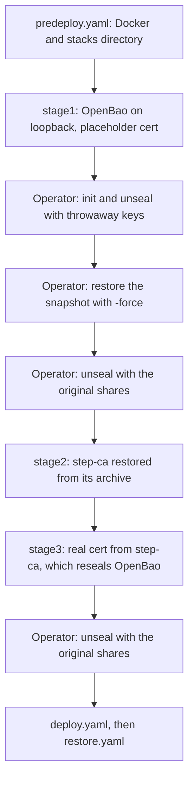

# OpenBao Backup and Restore

A different mechanism from [`backup.md`](../../disaster-recovery/backup.md)'s
generic volume-backup pipeline — `docker/openbao/compose.yaml.j2` has no
`backup:` entry, and [`deployment.md`](deployment.md) explains why: stopping
OpenBao to tar its data volume means sealing it, which needs a manual
unseal ([0018](../../../decisions/0018-unsealing-the-secrets-store-after-restart/revision-000.md)) on every backup
cycle. `bao operator raft snapshot save` is the backup mechanism here
instead, pushed independently to R2/B2 — see
[0111](../../../decisions/0111-recovering-the-secrets-store-from-total-loss/revision-000.md) for why the
push itself also stays out of `backup_agent`/`cloud_sync` rather than
reusing that pipeline.

## Why manual, not a systemd timer

A scheduled job needs a Vault credential on disk and a host to run on. `controller` is the
operator's own machine, never a `managed_hosts` member, and runs no scheduled jobs. That is the job
of the [CD agent project](../../../projects/cd-agent.md)'s `cd_agent` host
([decision](../../../decisions/0044-prod-automation-trigger-and-execution/revision-000-c.md)), not
built yet. Until then
`tools/openbao_utils/scripts/snapshot-push.sh` is a plain script, run by hand as `controller`'s
AppRole (whose policy grants read on `sys/storage/raft/snapshot` for this), and installed as no
systemd unit.

## Push credential

`tools/cloud_credentials/create_snapshot_write_keys.py` mints a
standing, quarterly-rotating, no-delete write leaf on both R2 and B2,
scoped to the `openbao-snapshots` bucket — a different credential from
[0111](../../../decisions/0111-recovering-the-secrets-store-from-total-loss/revision-000.md)'s break-glass
**read-only** restore key, which stays reserved for actual disaster
recovery and is never cached to disk. See
[`cloud-credentials/creation.md`](../cloud-credentials/creation.md) for how
it's minted and rotated.

## Before first use

Create the `openbao-snapshots` bucket by hand on **both** R2 and B2 —
same as [`cloud-sync.md`](../../disaster-recovery/cloud-sync.md)'s own bucket, none of this is
Ansible-managed. Do this before minting either credential above, not
after: `create_snapshot_readonly_keys.py`'s own failure message already
assumes the bucket exists first.

B2 bucket names are globally unique across *every* B2 account, not just
yours — `cloud-sync.md`'s own bucket hit exactly this and needed a
`-b2` suffix. If `openbao-snapshots` is taken on B2, pick a different
name, update `SNAPSHOT_BUCKET_B2` in
`create_snapshot_readonly_keys.py` (both scripts import it from there)
and the hardcoded `openbao-snapshots` bucket name in
`tools/openbao_utils/scripts/snapshot-push.sh`'s `rclone copy` calls,
then (re-)mint both credentials against the new name.

The write leaf has no bucket-admin capability on either provider (see
below) — `rclone copy` against a bucket that doesn't exist yet fails
with an `AccessDenied` on `CreateBucket`, not a clearer "bucket not
found," since rclone's own pre-flight check is what's being denied.

## Running a backup

```sh
tools/openbao_utils/scripts/snapshot-push.sh "$(cat ansible/files/secrets/openbao-controller-role-id)"
```

From `controller`, using the `role_id` cached by [`auth.md`](auth.md)'s runbook. The script:

1. Reads the `secret_id` from the cached `openbao-controller-secret-id` in the secrets directory
   (`HOMELAB_SECRETS_DIR`, else `ansible/files/secrets`), or prompts for it, hidden, when that file
   is missing or empty. It is never an argument.
2. Logs in over TLS. The token is short-lived, so each run logs in again.
3. Saves the snapshot and GPG-encrypts it with the public key
   [`backup.md`](../../disaster-recovery/backup.md) uses (`backup-gpg-public-key.asc`), on top of
   Vault's own encryption.
4. Pushes it to both R2 and B2, then revokes the token.

Everything sits in one `mktemp -d` directory removed on exit. `BAO_TOKEN` lives only in the
script's environment, never in a file or an argument.

**Version note:** the behavior described below was last confirmed live,
by running the drill end to end, on `openbao/openbao:2.7.1`.
`docker/openbao/compose.yaml.j2` pins the release the server runs now,
which can be newer. The `snapshot_restore` Molecule scenario
([`molecule-testing.md`](../../testing/molecule-testing.md))
runs it again on whatever image the Molecule helper pins, on every bump
of that pin. Newer releases can change behavior: `generate-root`'s
authenticated-endpoint behavior changed (see
[ADR 0025 (Admin without root token)](../../../decisions/0025-admin-capability-without-a-standing-root-token/revision-000.md)'s
Context). When that scenario fails, this section and the drill below
are what to revisit.

## `bao` CLI behavior this script and the restore drill depend on

Confirmed against a running instance:

| Command | Behaviour |
| :--- | :--- |
| `bao operator raft snapshot save <path>` | Prints nothing on success; writes a gzip file readable only by the server's user. |
| `bao operator raft snapshot restore <path>` | Fails (HTTP 400, exit 2, `could not verify hash file`) when the target's keyring differs from the snapshot's, which a freshly initialised host's always does. |
| `bao operator raft snapshot restore -force <path>` | The documented way to do that restore. OpenBao reseals itself afterwards. |

After a forced restore, unseal with the **snapshot's** Shamir shares, not the ones from the target's
own `bao operator init`; the target's earlier root token stops working too. `controller`'s AppRole is
part of the restored data, so it logs in. Anything beyond its read access needs
[`vault-bootstrap.md`](vault-bootstrap.md).

## Pulling a snapshot

```text
tools/openbao_utils/scripts/snapshot-pull.sh [r2|b2] [OUTPUT]
```

Steps 2 and 3 of the [restore drill](#restore-drill) in one command, from
`controller` or any machine with Docker, `gpg` and the exported backup private
key. With no provider it tries R2, then B2; `OUTPUT` defaults to `./restore.snap`
and is never overwritten. It prompts for what it needs and nothing is an
argument or in the environment:

- The provider's account id (R2) or region (B2) and the key id, read as typed.
- The credential's secret half, read with echo off and written to a mode-0600
  `rclone.conf` in a scratch directory. The credential is the break-glass
  read-only one
  ([`create_snapshot_readonly_keys.py`](../../../../tools/cloud_credentials/create_snapshot_readonly_keys.py)),
  from the password manager, not anything in OpenBao.
- The path of the exported private key. The script imports it into a throwaway
  keyring in the scratch directory, so it never joins yours, and `gpg` asks for
  the passphrase itself.

It lists `openbao-snapshots`, takes the newest `snapshot-*.snap.gpg` by name (the
name carries a UTC timestamp), decrypts it, refuses a result without a gzip
header, and leaves only `OUTPUT`, mode 0600, with the scratch directory removed
on every exit path. `OUTPUT` is the contents of OpenBao: delete it once the
restore is done.

## Restore drill

On a throwaway host — burn it afterward, don't reuse it:

1. Install OpenBao (same version as the `security` deploy), start it
   with a fresh raft config, run `bao operator init` on it, then unseal
   it with its own fresh keys — required before the restore endpoint is
   even reachable (a sealed node returns `503`, not a clearer error).
   Its own keys and root token are used once more, in the next step,
   then discarded.
2. Fetch the latest snapshot from R2 or B2
   ([`snapshot-pull.sh`](#pulling-a-snapshot) does steps 2 and 3) using the break-glass
   **read-only** credential
   ([`create_snapshot_readonly_keys.py`](../../../../tools/cloud_credentials/create_snapshot_readonly_keys.py)) —
   not the write leaf above, which can't read.
3. Decrypt it with the offline GPG private key
   ([`backup.md`](../../disaster-recovery/backup.md#encryption)).
4. Authenticate with the throwaway host's own root token (from step 1)
   and run `bao operator raft snapshot restore -force <path>` — a
   token is required even against a target with nothing real on it
   yet. The node reseals itself immediately afterward; both the
   throwaway host's root token and its own unseal keys become useless
   against the restored data from this point on.
5. Unseal again using the break-glass bundle's *original* Shamir
   shares (from the password manager, not this host's own `init`
   output).
6. Authenticate as `controller` — its AppRole config is part of the
   restored data, so this also proves the restore brought back more
   than just secret values — and read back a known secret path to
   confirm the restore actually worked, not just that the command
   exited 0. No root token or `vault-bootstrap` needed for this: a
   plain read is exactly what `controller`'s own policy already
   grants.

## Rebuilding `security`

A rebuilt `security` cannot be brought back with `deploy.yaml` or
`restore.yaml` alone. Both start by logging into OpenBao and reading
step-ca's root certificate from `security`'s Docker, and a new VM has neither.
OpenBao needs a certificate from step-ca, step-ca needs a password that is
stored in OpenBao, and `restore.yaml` needs OpenBao for its S3 keys.
[`bootstrap-security.yaml`](../../../../ansible/playbooks/bootstrap-security.yaml)
breaks the loop in three stages, with the steps that handle key shares left
to the operator ([ADR 0099 (Rebuilding security from nothing)](../../../decisions/0099-rebuilding-security-from-nothing/revision-000.md)).
It is for `security` only: a rebuilt `services`, `storage` or `tailscale`
passes Play 0 as soon as `security` is healthy.



What you need before starting, none of it on the new VM:

- The latest OpenBao snapshot, fetched and decrypted with
  [`snapshot-pull.sh`](#pulling-a-snapshot).
- The original unseal shares (the password manager entry).
- The latest `security-step-ca-*` archive, fetched and decrypted into a
  plain `.tar.gz` as [`restore.md`](../../disaster-recovery/restore.md#manual-steps-first)
  describes.
- The controller AppRole's `openbao-controller-role-id` and
  `openbao-controller-secret-id` in the file cache, and `main-domain`. The
  AppRole is part of the restored data, so the cached `secret_id` works if it
  was issued before the snapshot was taken.

The new VM's SSH host key differs from the old one's. Remove the old entry
from `known_hosts` for `security`'s name and address first, or `openbao_utils`
refuses the connection.

1. Docker and the stacks directory, without Play 0:

   ```sh
   cd ansible && ansible-playbook playbooks/predeploy.yaml --limit security
   ```

2. Stage 1 starts OpenBao on `127.0.0.1` with the repository's own config and a
   self-signed certificate valid for 24 hours. It creates the `caddy-proxy`
   network with the labels Compose gives it, so Caddy's stack adopts it later.
   Re-running it keeps an existing certificate.

   ```sh
   ansible-playbook playbooks/bootstrap-security.yaml --tags stage1
   ```

3. Initialise it with throwaway keys and unseal it with them. `init` ends by
   asking you to store what it printed; don't. Discard the keys and the root token
   once step 5 is done:

   ```sh
   cd ../tools
   python3 -m openbao_utils.init
   python3 -m openbao_utils.unseal    # twice, with two of the new shares
   ```

4. Stream the decrypted snapshot into the container as its own user, so no
   copy is readable by anyone else:

   ```sh
   ssh security 'docker exec -i openbao sh -c "umask 077; cat > /tmp/restore.snap"' < restore.snap
   ```

5. On `security`, restore it with the throwaway root token, which is typed at a
   hidden prompt and passed through the environment, never in an argument.
   `bao operator raft snapshot restore -force` is the form the
   [drill](#restore-drill) explains:

   ```sh
   # [1/3] controller: paste alone; it opens a shell on security and waits
   ssh -t security
   ```

   ```sh
   # [2/3] inside that shell: paste alone; it waits for the throwaway root token, hidden
   read -rs BAO_TOKEN && export BAO_TOKEN
   ```

   ```sh
   # [3/3] same shell
   docker exec -e BAO_TOKEN -e BAO_ADDR=https://127.0.0.1:8200 -e BAO_SKIP_VERIFY=true \
     openbao bao operator raft snapshot restore -force /tmp/restore.snap
   docker exec openbao rm /tmp/restore.snap
   exit
   ```

6. Check the status, then unseal with the original shares, twice, whether or
   not it reports sealed:

   ```sh
   # controller
   ssh security 'docker exec -e BAO_ADDR=https://127.0.0.1:8200 -e BAO_SKIP_VERIFY=true openbao bao status'
   ```

   ```sh
   # controller, in tools/: once per share, twice
   python3 -m openbao_utils.unseal
   ```

7. Stage 2 reads step-ca's two passwords out of OpenBao as the `controller`
   AppRole (the `secret_id` goes in over stdin, and the token is revoked at the
   end), renders step-ca's files, and restores its `data` volume from the
   archive before starting it, so it never runs on an empty volume. It refuses
   an archive without `config/ca.json`, which step-ca's entrypoint would answer
   by creating a new CA. It prints the root certificate's fingerprint:
   compare it with a host that already trusts the CA.

   ```sh
   # paste alone; it waits for the full path of the decrypted step-ca archive
   read -r -p 'security-step-ca archive (full path): ' archive
   ```

   ```sh
   cd ../ansible
   ansible-playbook playbooks/bootstrap-security.yaml --tags stage2 \
     -e bootstrap_step_ca_archive="$archive"
   ```

8. Stage 3 re-renders OpenBao on its normal address, removes the placeholder
   (only a self-signed certificate), has step-ca issue the real one with the
   same task `deploy.yaml` uses, and restarts OpenBao, which seals it. Unseal it
   with the original shares, twice:

   ```sh
   ansible-playbook playbooks/bootstrap-security.yaml --tags stage3
   cd ../tools && python3 -m openbao_utils.unseal
   ```

9. Play 0 now passes. Continue with the
   [rebuild cycle](../../disaster-recovery/rebuild-runbook.md#the-cycle): `deploy.yaml
   --limit security,localhost`, then `restore.yaml` for the remaining apps, and
   the Beszel fingerprint ([`beszel.md`](../../monitoring/beszel.md#rebuilding-a-host)).

### If init's output was lost

`openbao_utils.init` waits up to 120 seconds for output and prints it as it
arrives. If it reports a silence, or ends in a traceback, the init on `security`
may have gone on to finish without you seeing the key shares and the root token,
and a second run then says `Vault is already initialized`. The keys cannot be
recovered, and with them the node cannot be unsealed or restored into. Before
the snapshot is restored it holds nothing, so wipe it and start again:

```sh
# [1/3] controller: paste alone; it opens a shell on security and waits
ssh security
```

```sh
# [2/3] inside that shell: paste once its prompt is back
cd /opt/stacks/openbao && docker compose down
docker volume rm openbao_data
exit
```

```sh
# [3/3] controller again: paste after the shell has exited
cd ansible && ansible-playbook playbooks/bootstrap-security.yaml --tags stage1
cd ../tools && python3 -m openbao_utils.init
```

Stage 1 creates the volume again and gives it to the `openbao` user, and keeps a
placeholder certificate that is still in place. After the restore in step 5 this
deletes the restored data too: the snapshot is still in R2 and B2, so go back to
step 3.
