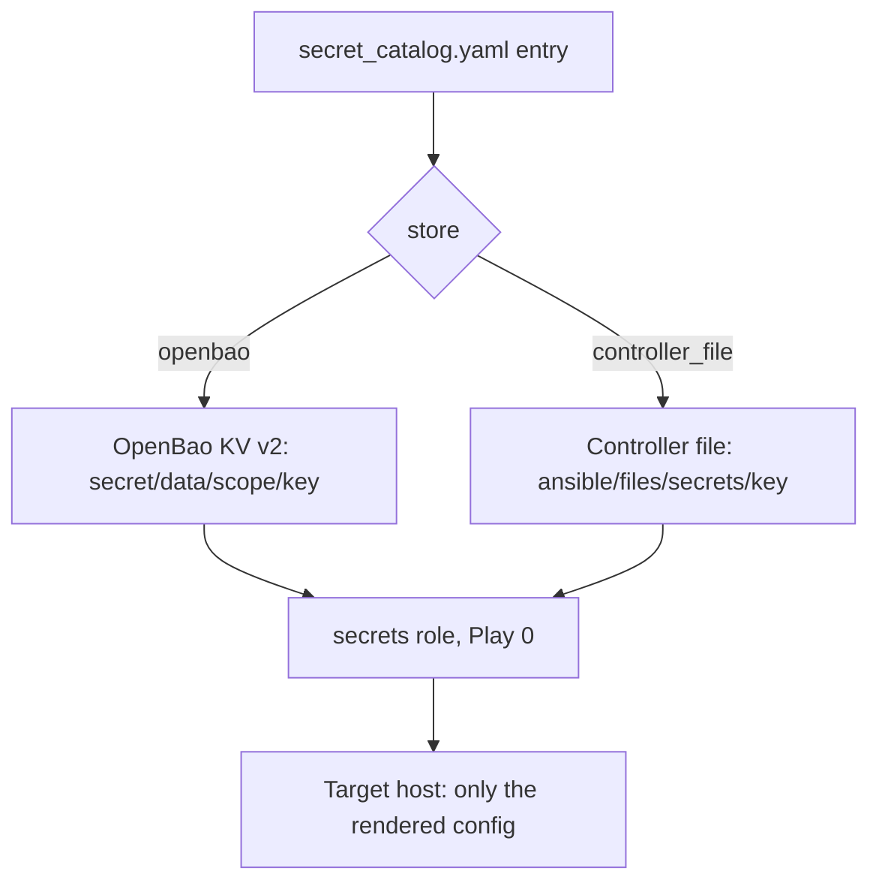

# Secrets

For the SeaweedFS backup S3 credentials specifically, see
[`backup.md`](../disaster-recovery/backup.md).

Every value this repo needs but doesn't want hardcoded is resolved once
and cached by the `secrets` role (`ansible/roles/secrets/`), driven by a
central catalog (`ansible/inventory/group_vars/all/secret_catalog.yaml`).
It runs as `deploy.yaml`'s Play 0, tagged `always`, `gather_facts: false`
— before Play 1, since `ansible_host` itself resolves through a secret
(`main_domain`) and Play 1's implicit fact-gathering needs a live
connection first.

Every secret lives in OpenBao except three that must be known before Vault can be reached, which
stay in a file cache on the controller: `main-domain` and the `openbao-controller-role-id`/`-secret-id`
AppRole pair. Each catalog entry states its `store`, and each `store: openbao` entry's `scope` says
where in Vault it lives (the cloud leaf credentials use `cloud_credentials/leaf`, the path
`tools/cloud_credentials/` writes to, not a `hosts/*` one). See `secret_catalog.yaml`'s header
comment and [ADR 0021 (Ownerless secret paths)](../../decisions/0021-secret-path-layout-for-secrets-with-no-host-owner/revision-000.md).



No template should call `lookup('password', ...)` / `lookup('pipe', ...)`
directly, and `deploy.yaml` should never grow a new `vars_prompt` entry —
any new secret or config value goes through the catalog instead:

1. Add an entry to `secret_catalog.yaml`, with `store: openbao` and a `scope`
   (`hosts/<host>` if it's referenced from that host's own
   `host_vars/<host>.yaml`, `hosts/all/<concern>` if it's referenced
   from `group_vars/all/main.yaml` — see [ADR 0021 (Ownerless secret paths)](../../decisions/0021-secret-path-layout-for-secrets-with-no-host-owner/revision-000.md)):
   ```yaml
   secret_catalog:
     my-new-thing:
       source: hex
       length: 32
       store: openbao
       scope: hosts/security
   ```
   The `check-secret-catalog` pre-commit hook rejects an entry that breaks
   the header's rules — a `hex` entry without a `length`, a generated entry
   that isn't `store: openbao`, a `manual` entry without a `description` —
   before it merges. See [`ci/gates.md`](../engineering/ci/gates.md#secret-catalog-rules).
2. Reference it from a plain var in `group_vars/all/main.yaml`:
   ```yaml
   my_new_thing: "{{ secrets_generated['my-new-thing'] }}"
   ```
   Unless it's only ever needed on one specific host — no other host's
   template or role references it — in which case put the var in that
   host's own `host_vars/<host>.yaml` instead of `main.yaml`. Templates
   reference it identically either way (`{{ my_new_thing }}`); this is
   purely about where the value is visible, not how it's used. Check
   for cross-host references before choosing `host_vars` — e.g.
   `tinyauth_host` looks single-host at a glance but every host's Caddy
   config references it for forward-auth, so it stays in `main.yaml`;
   `step_ca_password` (the server's own bootstrap secret) has no such
   reference and lives in `host_vars/security.yaml` instead. See
   `ansible/inventory/host_vars/{storage,security,services}.yaml` for
   more examples of the split.
3. Use `{{ my_new_thing }}` in the app's `configs/*.j2` template, with
   `no_log: true` on its `app_catalog` entry if it's a real secret (see
   `no_log: true` below). Never in `compose.yaml` itself, even though it
   can also reference Ansible vars now — its deploy task has no
   per-app `no_log:`/mode handling, unlike `configs` (see
   [`adding-an-app.md`](../deploy/adding-an-app.md)).

## Three sources

Each entry's `source` says how its value is produced; its `store` says where it is kept.

| Source | Used for | Mechanism |
| :--- | :--- | :--- |
| `hex` | Most secrets | Vault-backed only: read the secret from KV v2, or generate and write it with `cas=0` when nothing is there, in one `ensure_vault_secret` call per secret (see `ensure_secret.yaml`, [`ensure_vault_secret.py`](../../../ansible/roles/secrets/library/ensure_vault_secret.py) and [`openbao_kv.py`](../../../ansible/module_utils/openbao_kv.py)). |
| `uuid4` | `shlink-api-key` only | Vault-backed only, same reasoning as `hex` above — this source always generates via `python3 -c "import uuid; print(uuid.uuid4())"`, since `lookup('password')`'s `chars=` can't produce a structurally valid UUID4. |
| `manual` | Externally-issued credentials and plain config Ansible can't generate (e.g. the DigitalOcean API key, Beszel's post-boot key/token) | No generation step. Vault-backed entries (everything except the three permanent exceptions) are populated by `create_leaf_keys.py`/`create_rotation_keys.py` for cloud credentials, or `openbao_utils/bootstrap.py` for everything else, before they're first read; missing → the play fails loudly naming the OpenBao path and pointing at the right script. File-cache-backed entries (`main-domain`, the controller AppRole pair) work the same as before: missing cache file → same loud failure, naming the file to create by hand. Present-but-empty is valid (not an error) for entries marked `allow_blank: true`, which lets Beszel's two values start blank either way. |

## Catalog fields

| Field | Values | Where it applies |
| :--- | :--- | :--- |
| `source` | `hex`, `uuid4`, `manual` | Every entry. |
| `store` | `openbao`, `controller_file` | Every entry, with no default: the three file-cache entries show up as exceptions, and a typo can't fall back to a default. |
| `scope` | The Vault path prefix | Required with `store: openbao`, forbidden with `controller_file`. |
| `length` | A positive integer | `source: hex` only. |
| `description` | Text shown when the value is missing | Every `manual` entry. |
| `allow_blank`, `sensitive` | `true` or `false` | `manual` entries only. |

A `scope` is `hosts/<host>` (`security`, `services`, `storage` or `play`),
`hosts/all/<concern>`, or `cloud_credentials/leaf`. `hex` and `uuid4` entries
are always `store: openbao`, because Ansible can only generate into OpenBao.
An entry's OpenBao path is `<scope>/<name>` under the `secret` mount, and it
doesn't change unless a decision says so
([ADR 0066 (Secret definitions)](../../decisions/0066-how-a-secret-definition-states-production-and-storage/revision-000.md)).

Every reader other than Ansible loads the catalog through
`tools/utils/secret_catalog.py`, which refuses a repeated secret name and an
entry whose `store` is missing or unknown. No tool decides where a secret
lives from anything but its `store`. The `check-secret-catalog` pre-commit
hook enforces the rules above before a change merges, so a wrong combination
never reaches a deploy — see [`ci/gates.md`](../engineering/ci/gates.md#secret-catalog-rules).

## Bootstrapping manual secrets

Before your first `deploy.yaml` run:

```sh
cd tools && python3 -m openbao_utils.bootstrap
```

Prompts for every `manual` entry that isn't already set (masked input
for anything marked `sensitive: true`), skipping entries that already
have a value. Safe to re-run. Vault-backed entries need OpenBao
reachable and the controller AppRole already provisioned
([`auth.md`](openbao/auth.md)'s runbook) before this script can
do anything with them; it fetches step-ca's root cert fresh each run to
validate OpenBao's TLS cert, the same mechanism
[ADR 0022 (Controller TLS trust)](../../decisions/0022-controller-trust-in-the-secrets-store-tls/revision-000.md)
uses from Ansible. A CD agent job, which has no SSH key to `security`, is
delivered the root instead
([`openbao-cd-agent-approles.md`](openbao/openbao-cd-agent-approles.md)). To set a
file-cache-backed value without the script:

```sh
# from the repo root: paste alone; it waits for the catalog key, then the value, hidden
read -r -p 'catalog key: ' key; read -rsp 'value: ' value; echo
```

```sh
(umask 077; printf '%s' "$value" > "ansible/files/secrets/$key")
chmod 600 "ansible/files/secrets/$key"
unset value
```

Beszel's key/token can't be known ahead of time — see the manual
redeploy sequence in [`beszel.md`](../monitoring/beszel.md).

The R2/B2/OCI entries are `manual` too, but Vault-backed
(`scope: cloud_credentials/leaf`) and deliberately excluded from
`openbao_utils/bootstrap.py`'s own prompting — `create_rotation_keys.py`/
`create_leaf_keys.py` own them, with real provider-side verification
`openbao_utils/bootstrap.py`'s generic prompt-and-write can't do. See
[`cloud-credentials/creation.md`](cloud-credentials/creation.md) for how
to create them instead.

## Where secrets live

| `store` | Location |
| :--- | :--- |
| `openbao` | `secret/data/<scope>/<catalog-key>` (mount `secret`, KV v2). |
| `controller_file` | `<catalog-key>` in `ansible/files/secrets/`, or in `HOMELAB_SECRETS_DIR` when that names another absolute directory, as a CD agent job's unit does. Gitignored, never committed. |

Target hosts only ever receive the rendered config a value ends up in, never the catalog key or its
location. To change a value, see [`secrets-rotation.md`](secrets-rotation.md).

## One shared value per secret

`docker-volume-backup`'s S3 client (on `backup_agent` hosts) and SeaweedFS's identity config (on
`storage`) are rendered on different hosts. Each generating its own value would leave them
permanently disagreeing, so every secret is resolved from one stored value, including those only one
host renders.

## `no_log: true`

Every `app_catalog` entry whose `configs` render a real secret (API key,
token, password) sets `no_log: true` — and so does anything that reveals
the actual configured domain (a routed URL, an LDAP base DN, a DNS name
list), even though it isn't a credential. A bare timezone or a short
host label that carries no domain information doesn't need it. See
[`adding-an-app.md`](../deploy/adding-an-app.md) for the quick check on whether a
value counts. Without `no_log: true`, `ansible-playbook --diff` prints
the new value in plaintext on any task where content changes —
including the first deploy, since a not-yet-existing file still counts
as a diff. `no_log: true` suppresses this (including on task failure)
while still reporting `changed: true`.

The `secrets` role's `ensure_vault_secret` module returns the secret's
value in plain text, because a module cannot both hide a value from the
task's result and hand it to the playbook. Every task that calls it sets
`no_log: true`, which hides the whole result at every verbosity while the
registered value stays usable.
[`test_secrets_module_no_log.py`](../../../ansible/tests/test_secrets_module_no_log.py)
fails if one does not.

## `force: false`

Every config in this catalog defaults to `force: true` (overwrite on
drift) — this repo is the source of truth. Reserve `force: false` for a
destination the *app itself* writes back to after Ansible first renders
it, where overwriting would destroy state no template can reconstruct.
Nothing currently needs it. `dashy`'s `conf.yaml.j2` is a candidate if its
in-UI config editor (`data/conf.yml`) is ever used — see
[`adding-an-app.md`](../deploy/adding-an-app.md#2-register-it-in-app_catalog)
for the general rule.

## Syncing the LDAP observer account password

`tinyauth-ldap-observer-password` is generated and cached like any other
secret, but it's also consumed by the `lldap_bootstrap` role
(`deploy.yaml`'s Play 7), which sets it as the lldap `observer`
account's real password via lldap's own `bootstrap.sh` — see
[`lldap.md`](../services/lldap.md#bootstrapping-the-observer-account). See
[`secrets-rotation.md`](secrets-rotation.md) for rotating it.
