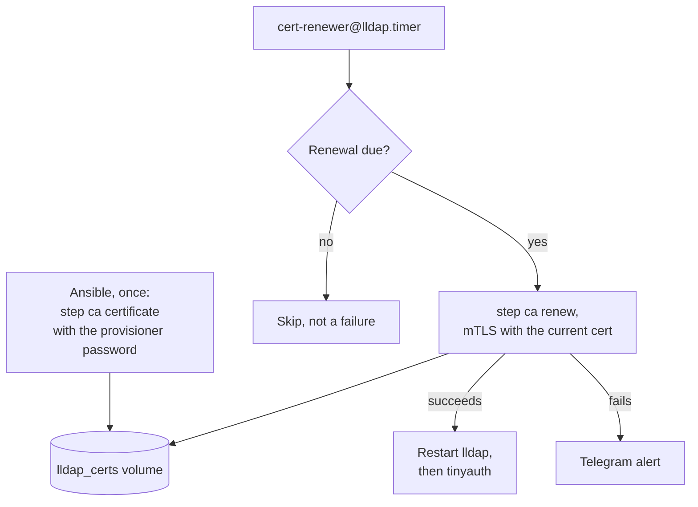

# LLDAP: Directory & LDAPS Cert Lifecycle

`lldap` is the directory backend for the whole homelab — Tinyauth binds to
it over LDAPS for every forward-auth check. Its LDAPS cert comes from the
internal `step-ca` (see [`step-ca.md`](step-ca.md)), issued and kept
current by two host-level Ansible roles rather than a sidecar container.

## One container, two host-level roles

| Component | Type | Purpose |
| :--- | :--- | :--- |
| `lldap` | Container | The directory itself. Serves LDAPS on `6360` (reachable only on the `caddy-proxy` network, under the certificate's name) and a web UI on `17170` (routed through Caddy, `auth: false` — it's the identity provider, so it can't sit behind its own auth check). |
| `step_ca_cert` | Role (`ansible/roles/step_ca_cert/`, `deploy.yaml`'s Play 6, called once for lldap and once for openbao — see [`deployment.md`](../security/openbao/deployment.md)) | For lldap's instance: issues the initial cert via `step ca certificate` (once, on a fresh `certs` volume) and installs a systemd `cert-renewer@lldap.timer` for every renewal after that. |
| `step_ca_client` | Role (`ansible/roles/step_ca_client/`) | Shared prerequisite: caches step-ca's root cert on the host at `/etc/step-ca/root_ca.crt`, bind-mounted (read-only) into whichever `step` invocation needs it. Also used by `tinyauth_ca_trust` (below). |

Renewal runs on the host: `step_ca_cert`'s systemd unit runs as `root` and
restarts the container via `docker compose`, with no Docker socket proxy. See
[ADR 0009 (Internal service certificates)](../../decisions/0009-internal-service-certificate-issuance-and-renewal/revision-000.md)
for why.



## Why renewal is a systemd timer, not an in-container daemon

Smallstep recommends a `cert-renewer@.service`/`.timer` template pair over a
long-running `step ca renew --daemon`, and `step_ca_cert`'s templates are adapted from
[theirs](https://github.com/smallstep/cli/tree/master/systemd). The one adaptation:
their `ExecStartPost` reloads a systemd unit named after the cert, and a Compose service
has none, so this runs
`docker compose -f {{ compose_deploy_dir }}/%i/compose.yaml restart %i`, or sends
`SIGHUP` for an instance whose env file sets `RENEW_ACTION=signal`
([`deployment.md`](../security/openbao/deployment.md)). It fits any step-ca consumer laid
out as `compose_deploy_dir/<app>/compose.yaml`, as every app here is
([`adding-an-app.md`](../deploy/adding-an-app.md)); OpenBao's instance uses it too.

An instance can also list apps in `RENEW_RESTARTS_AFTER`, which are restarted
after its own restart. For lldap that is `tinyauth`: tinyauth holds one LDAP
connection open and, after lldap restarts, fails every login (`ldap: connection
closed`) until its own heartbeat reconnects, which took minutes. Restarting it
with lldap closes that window. The catalog's `restart_after` for lldap names
tinyauth, and both the renewer and the `compose` role read it: a deploy that
recreates or restarts lldap restarts tinyauth too.

A renewal failure is a failed systemd unit and pages a Telegram topic via `OnFailure=`
([`telegram-notifications.md`](../monitoring/telegram-notifications.md)). On the host:

```sh
systemctl status cert-renewer@lldap.service
journalctl -u cert-renewer@lldap.service --no-pager -n 20
```

## `step` runs via its container image, not a host-installed binary

`ExecCondition` and `ExecStart` in `cert-renewer@.service.j2`, and the one-time issuance
task, run `step` as a throwaway `smallstep/step-cli` container. That adds no apt
repository or package to the host: `step_ca_client` only caches step-ca's root cert to a
host path.

- The container mounts the app's certs volume by name, `%i_certs`, instead of resolving
  its host path.
- Per-instance settings (`CA_URL`, `STEP_CLI_IMAGE`, `NETWORK`, restart or signal,
  whether to chown the cert back to a non-root user) come from
  `/etc/cert-renewer/%i.env`, so one template serves every instance.
- It runs with `--user root`, because the image's default user can read a fresh Docker
  volume's root directory but not write into it.

## Why initial issuance and renewal use different auth

Initial issuance (`step_ca_cert`'s own Ansible task, once) authenticates
with the JWK provisioner password — there's no existing cert yet to
prove anything with. Renewal (the systemd timer, forever after)
authenticates via mTLS using the cert `step ca renew` is renewing —
`step ca renew`'s own documented default — so the provisioner password
is never written to disk outside that one-time Ansible run (rendered to
`/tmp`, used, removed in an `always:` block — see
`ansible/roles/step_ca_cert/tasks/issue.yaml`).

## Cert SANs

The cert covers both `lldap` (the bare container name, for anything
reaching it over the `caddy-proxy` Docker network) and
`lldap.{{ caddy_domain }}` (the FQDN) in one `step ca certificate`
call — covers both ways a client might dial it, matching the reference
setup's own `--san` pattern.

## Closing tinyauth's trust gap

lldap's cert comes from a private CA, so with tinyauth's `insecure: false` (the
default, see `config.yaml.j2`) verification fails unless tinyauth trusts step-ca's
root. tinyauth's schema has no
`caCert`/`caFile` option of its own (only `insecure` and the
unrelated `authCert`/`authKey` mTLS pair), so `tinyauth_ca_trust`
(`ansible/roles/tinyauth_ca_trust/`, same Play 6) takes a different
route: it concatenates the host's system CA bundle with step-ca's root
(from `step_ca_client`) and mounts the result into tinyauth's container
at `/data/ca-bundle.pem`, with `SSL_CERT_FILE` pointed at it
(`docker/tinyauth/compose.yaml`). Go's `crypto/x509.SystemCertPool()` on
non-macOS Unix honors that env var, extending the default trust store
rather than replacing it with something narrower.

`tinyauth_ca_trust`'s Molecule scenario
(`ansible/roles/tinyauth_ca_trust/molecule/default/`) deploys a real
tinyauth against a real step-ca-issued cert with
`tinyauth_ldap_insecure: false`, the production value. The run reaches
tinyauth's LDAP bind with no TLS error, so tinyauth's LDAP client does
honor `SSL_CERT_FILE`. If LDAPS verification against a step-ca-issued
cert fails in production, check for a tinyauth change that pins its own
`tls.Config` before suspecting this mechanism.

On a first-ever deploy, `SSL_CERT_FILE` points at a file that doesn't
exist until `tinyauth_ca_trust` runs (Play 6, after tinyauth's Play 4
deploy). tinyauth's LDAP bind runs at startup and exits on failure, so
it crash-loops briefly until Play 6 seeds the bundle and restarts it.
`restart: unless-stopped` absorbs this, as it does the observer-account
bootstrap race below. The scenario reproduces it and asserts on it
(`docker logs` shows at least two process starts; `RestartCount` is the
wrong signal, since a manual restart resets it).

## Bootstrapping the observer account

Tinyauth binds as a read-only `observer` account
(`uid=observer,ou=people,...`) to check logins — see
`docker/tinyauth/configs/config.yaml.j2`'s `ldap.bindDn`. The
`lldap_bootstrap` role (`ansible/roles/lldap_bootstrap`) creates and
maintains it: it runs lldap's own `bootstrap.sh` against a declarative
JSON config, adding the account to `lldap_strict_readonly` — a built-in
lldap group required for real login lookups (a bare bind would still
succeed without it, but every login check afterwards would silently
fail). `deploy.yaml`'s Play 7 runs it right after lldap's own deploy,
using the same `tinyauth-ldap-observer-password` secret `config.yaml.j2`
already renders — see
[`secrets.md`](../security/secrets.md#syncing-the-ldap-observer-account-password).

It runs with `DO_CLEANUP=false`, so it only ever touches the `observer` account. Safe
to re-run: `bootstrap.sh` updates the existing account in place instead
of erroring.

The role's three containers run with every capability dropped,
`no-new-privileges` and a read-only root filesystem, and keep the network
because they call lldap's API. The `bootstrap.sh` one also gets a `tmpfs` at
`/tmp`, since the script makes a temporary directory before it creates the
account. It stays root, which reads the `0600` config because it owns it.

## Runtime config

`docker/lldap/configs/env.j2` sets `LLDAP_LDAP_BASE_DN` and
`LLDAP_LDAP_USER_PASS` (the initial admin password) from
`lan_domain`/`lldap_ldap_user_pass`, and `LLDAP_JWT_SECRET`/`LLDAP_KEY_SEED`
for its own token signing — all three generated once by the `secrets`
role. See [`secrets.md`](../security/secrets.md) for the generation mechanism and
[`volumes.md`](../deploy/volumes.md) for why `data`/`certs` are named volumes
rather than bind mounts.
